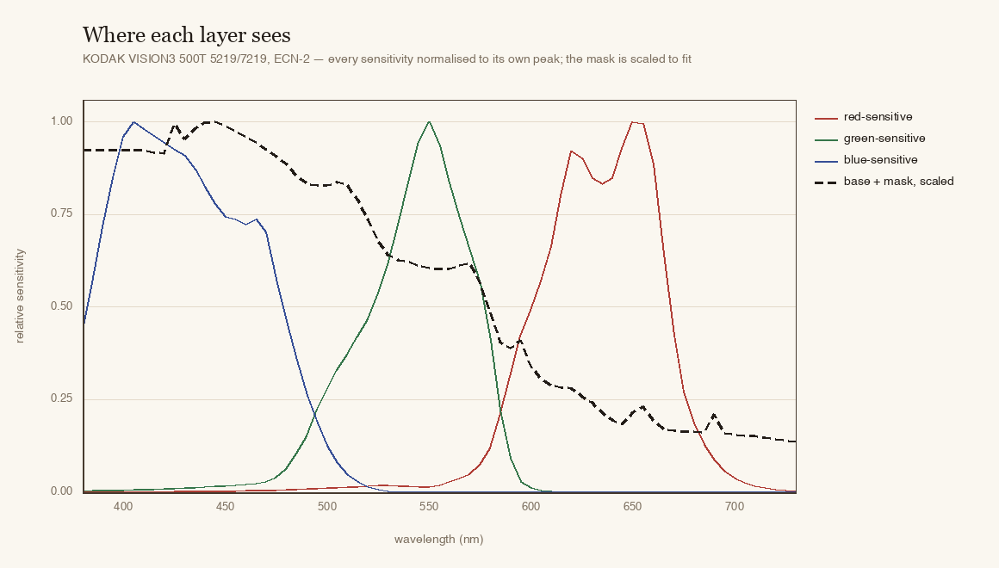

# Kallotype

**A photographic film and print model, in Rust.**

Kallotype takes a digital image and puts it through a physical model of a
negative, a development step and a print. Light is reconstructed as a spectrum,
the spectrum exposes three emulsion layers, each layer's exposure runs through
its published characteristic curve, the dyes are printed onto paper, and the
paper's reflectance is read back into sRGB. Grain is a count of developed
grains, halation is light that left the pixel, and the orange mask is a coupler
that disappears wherever cyan dye is formed.

There is no "film look" table anywhere in it. Every number comes from a
manufacturer's data sheet, and the numbers are data files rather than code.


> *Kallotype* — from the Greek **kalos** (beautiful) and **typos** (impression).
> The name William Henry Fox Talbot gave his negative-positive process in 1841,
> before English flattened it into "calotype".

## The model

**The curve is the sheet's.** Density against log exposure is a toe, a straight
line and a shoulder, so the model is a trapezoid of two softplus corners:

```text
D(x) = d_min + γ·[ softplus(a·(x − toe))/a − softplus(b·(x − shoulder))/b ]
```

Each corner is a softplus divided by its own rate, so the plateau between them
stays `γ·(shoulder − toe)` whatever the two rates are, and the derivative is
`γ` times the difference of two logistic steps. A single logistic — a curve with
a *point* of maximum contrast rather than a straight line — is four times worse
against the same sheets, and puts its base density 0.2 below the measured one.


**The exposure is metered, not guessed.** The input is linear light on the
scale *1 is white*, so 18 % grey sits at `log10(0.18)` by definition. A camera
file whose white point was normalised elsewhere has lost that scale, so
`--ev auto` measures the frame and places its mean on 18 % — the rule an
averaging meter and a laboratory's average printer both rest on, solved in
closed form instead of by a test strip.

**Development is kinetic.** Contrast follows
`γ(t) = γ∞ − (γ∞ − γ₀)·e^(−t/τ)` over an *effective* time that compensates
temperature with a Q10 law, and long development also raises fog and shifts
speed. Three minutes against twelve takes a colour negative from ×0.71 to ×1.18
of its contrast and pulls its speed back 0.27 of a stop. The kinetics were
fitted to DELTA 400's contrast-against-time chart and then checked against
TRI-X 400's exposure ladder, where they land within a tenth of a stop.

**The print is solved, not dialled in.** The enlarger exposure is computed in
closed form so that an 18 % grey card lands on the paper's target reflectance —
what an operator does with a test strip — and a colour pack moves it the way the
filter it names would.

**A contact proof is the film, not a print of it.** `kalo contact` develops one
frame at every time in the ladder, lays each development on paper as its own
strip, and exposes the sheet **once** — the middle strip's balance, which is what
a laboratory's average printer does. So the rebate prints black, the edge
markings print light, and the strips can be compared, because none of them was
corrected. A five-frame strip would be a lie: five development times are five
pieces of film.

**The film is spectral.** Each layer integrates the light against its own
sensitivity, so a colour is what the emulsion sees rather than a channel value.
The dyes are measured absorptions, and the print reads the paper's own dyes.



**The orange mask is a coupler, not a colour.** The cyan layer carries a
coloured coupler that absorbs blue and is destroyed wherever cyan is made, so
its absorption and the dye's own unwanted absorption cancel. That is why an
unexposed negative is orange and an exposed one is not, and it is a term on the
base density rather than a constant.

**Grain is a count.** A pixel is an aperture over a random arrangement of
developed grains, so its exposure has counting statistics:
`σ_logE = 1/(ln 10 · √N)`. One expression gives Selwyn granularity (σ ∝ 1/√area,
so grain survives a change of scan resolution), keeps a blank frame clean, and
needs one parameter per layer — the developed grain density — instead of a
curve of σ against density fitted by hand. The one stock measured in full runs
0.62, 0.51 and 0.07 grains per µm²: blue needs nine times fewer grains than red
to be nine times grainier, which is what being the fast front layer means.

**Halation and couplers are light and chemistry.** Halation is two unit-sum
Gaussian kernels in micrometres of film added to the exposure before grain,
because it is light reaching the emulsion and grain is what that light develops.
The couplers are a matrix with a spatial kernel: a developing layer releases an
inhibitor that suppresses its neighbours' development, which is where interimage
correction and the light line along a dark edge come from — and the matrix can
be fitted back out of measured patch densities rather than typed.

The strip is a drawing of the process. The two plots are not drawings: they are
the numbers in the shipped `.kalofilm`, plotted.

## The data

**Twenty-four films and six papers, every number traced to a data sheet.** A
film is a `.kalofilm` file — curves, layer sensitivities, dyes, mask, MTF and
grain, plus a `[measured]` table saying field by field what is measured,
borrowed or absent. A paper is a `.kalopaper` file: one curve, a target
reflectance, its own dyes and layers. Everything measured lives in
[`data/`](data/README.md) and nothing measured lives in the crates.

Six Kodak colour negatives (PORTRA 160, 400 and 800, EKTAR 100, GOLD 200,
ULTRA MAX 400), four VISION3 cinema stocks (50D, 200T, 250D, 500T), six Fuji
colour negatives (PRO 400H, NPH 400, C200, FILM 200 and 400, SUPERIA X-TRA 400),
three E-6 reversals (PROVIA 100F, VELVIA 50, EKTACHROME E100) and five silver
films (TRI-X 400, T-MAX 400, T-MAX 100, DELTA 400, HP5 PLUS). Each carries its
own report: what was measured, what was borrowed and why, and what the sheet
does not say.

## Quick start

```bash
cargo build --release
cargo run --release --bin kalo -- render photo.png -o out/print.png \
    --film kodak_portra_400 --paper portra_endura --dev 9
```

Or install it:

```bash
cargo install kallotype-cli
kalo stocks                       # every film and paper, with what is measured
kalo stocks --json                # the same, as one document a program can read
kalo curve --dev 9 --sweep        # what a development does, before any render
kalo render photo.png -o out.png --film vision3_500t --ev auto
kalo contact photo.png -o out/proof.png --dev 3,6,9,12,15
```

A camera raw file is read as linear light directly, if the build has the
feature: `--features raw` handles ARW, NEF, CR2/CR3, RAF, ORF, RW2, PEF, DNG and
about twenty more. It is **off by default and that is a licensing decision** —
`rawler` is LGPL-2.1. Decode elsewhere and pass the file with
`--input-encoding linear` if you would rather not.

> **macOS:** if `cargo build` fails with *"You have not agreed to the Xcode
> license agreements"*, run `sudo xcodebuild -license accept` once.

## Checking the model

Three layers, cheapest first.

**The data.** `kalo stock check <file>` re-derives every curve from the points
the file carries and refuses a mismatch; the film reports quote the residuals,
and [`kalofilm.py`](data/films/tools/kalofilm.py) verifies a file's digest and
tables without the renderer at all.

**The pipeline, without reference photographs.** `cargo test` pushes an 18 %
grey patch through every stock and asserts what must hold whatever the film is:
it comes back at 18 % and neutral, a ramp stays monotone, and development moves
contrast in the right direction. Those are tests over every film and paper in
`data/` rather than over a default, so CI runs all thirty on three operating
systems.

**Against real film.** That needs paired exposures of the same scene — a
ColorChecker and a grey card shot on the stock, scanned — and is not something
the repository can do on its own. The numbers to compute are the industry's:
density against exposure, ΔE2000 on the patches, the noise power spectrum, and
an MTF from a slanted edge.

The GPU backend is this same model, transcribed into WGSL and checked against
the CPU pixel by pixel: across a 2 048-pixel grid spanning toe and shoulder the
worst per-channel difference is 1.0 × 10⁻⁶ in linear light, against a stated
tolerance of 1 × 10⁻⁴. It is on by default and worth it — about 4.5× on the
scalar path and 80× on the spectral chain, where seventy-one wavelengths per
pixel across four integrations is exactly the work a device is for. `--no-gpu`
is there for when certain beats fast.

## What this is not

- Not a LUT pack, and not a "film look" filter that happens to be called a
  simulation.
- Not a reimplementation of anything. The physics is public; every line is
  written against published literature and against manufacturer data sheets.
- Not a product yet. There is no GUI and no colour management.

## Crates

| Crate | Role |
|---|---|
| `kallotype-core` | The model: curves, development kinetics, the built-in stocks, render. No I/O, no unsafe. |
| `kallotype-spectral` | Spectra, sensors, and the RGB → spectrum reconstruction. |
| `kallotype-io` | Decoding and encoding. The only place that touches a file format. |
| `kallotype-cli` | The `kalo` binary, plus a library so the commands are testable. |
| `kallotype-gpu` | The wgpu backend, feature-gated into the CLI. |

## Licence

Code is **MIT OR Apache-2.0**, at your option. The **measurement data is
CC BY-SA 4.0** — share it, adapt it, sell it, but keep it open; the full text is
in [`data/films/LICENSE`](data/films/LICENSE), and what is not redistributed is
in [`data/films/NOTICE.md`](data/films/NOTICE.md).

The boundary is a file read. `crates/kallotype-core/build.rs` reads the
`.kalofilm` and `.kalopaper` files at build time and generates the stock tables
from them, so the program text holds no measurements and a checkout without
[`data/`](data/README.md) does not compile.

One exception, fenced off on purpose: `crates/kallotype-raw` is **LGPL-2.1**,
because camera raw decoding is built on `rawler`. It is outside the workspace
and reachable only through `--features raw`, so nothing in a default build links
it.

## Contributing

Early days — open an issue before a large pull request. Useful contributions
right now: curve digitisation, test images with known exposure, and critiques of
the development model.

`just check` runs formatting, clippy and the tests, which are the three jobs CI
runs; [`justfile`](justfile) lists every recipe as the plain `cargo` command
behind it. The interface in [`app/`](app/README.md) is a Flutter build that
draws the film strip from a table this model generates — it is a second consumer
of the same data, not a second model.

## References

- Hurter & Driffield, *Photo-chemical Investigations* (1890) — the H&D curve.
- Mees & James, *The Theory of the Photographic Process*, 4th ed. — development
  kinetics, granularity.
- Hunt, *The Reproduction of Colour*, 6th ed. — couplers and interimage effects.
- Giorgianni & Madden, *Digital Color Management*, 2nd ed. — the
  negative/print pipeline.
- Mallett & Yuksel, *Spectral Primary Decomposition for Rendering with sRGB
  Reflectance* (2019) — spectral upsampling.
