# Kallo
The interface of Kallotype.

This is not a widget library and not a design system for other people to use.
It is **this app's vocabulary**, written down once so that every screen after it
is the same product.

It is also small on purpose. If it grows past a few thousand lines it has become
a framework, and a framework is a thing you maintain instead of a thing you
ship.

---

## Name and mark

The app is **Kallo**; the model, the CLI and the repository are **Kallotype**.
The window titles, the sidebar wordmark and every platform's display name say
Kallo. The Dart package is `kallo`, the bundle identifier is `com.kallo.app`,
and the export folder is `Kallo`. The app has not been published, so these are
the first addresses it has, not a migration away from old ones.

The icon is one 35 mm sprocket edge folded into a K. `icon/kallo-icon.svg` is
the source, `icon/kallo-icon-1024.png` is the rendered master, and
`icon/generate.py` writes every platform's size from it — a rounded square with
a margin for macOS, a full-bleed square for iOS, adaptive layers for Android and
one ICO for Windows.

---

## Run it

Flutter is pinned to **3.47.9** with FVM, and `app/.fvmrc` is the record of it;
CI reads the same number. 3.47 is the first release that renders the desktop
with Impeller and leaves wide gamut on by default on the Mac, so it is a floor
and not a preference.

```bash
brew install fvm    # once
fvm install         # reads .fvmrc
fvm flutter run -d macos
```

Use `fvm flutter`, not `flutter`. A machine can have another SDK on its `PATH`,
and the two render differently — which is exactly the failure this pin exists to
prevent.

All five platforms are checked in: `macos`, `windows`, `linux`, `ios`, `android`.
They share one identity, `com.kallo.app`, and three floors — macOS 13,
iOS 15, and Android API 29, which is where Impeller takes the Vulkan path
instead of falling back to its OpenGL ES backend.

The Mac build is **not sandboxed**, and that is a decision rather than an
omission. A sandboxed app's home directory *is* its container, so the export
folder would be somewhere no person can find it, and remembering a folder the
user chose across launches needs security-scoped bookmarks. Until this app is
going to the App Store — the one place the sandbox is not optional — the folder
behaves the way a person expects, and the bookmarks are the price of the day it
does.

There is no `MaterialApp` anywhere, and that is the point.

---

## What is verified

`fvm flutter analyze` is clean, and the suite covers the strip, the two rooms,
the rack, the catalogue, the contact sheet's data, the model's curves, the
film-frame export, both side panes being put away, the gallery loupe's wall and
close view, and a print opened off the rack. The twelve studio goldens are the
design's instrument: they pin select, develop, print, the drying rack and the
gallery in both appearances, a print taken off the rack, a portrait frame, a
frame under the loupe and the same frame walked up to at 1280 by 820, with the
bundled faces loaded from disk so the picture is in the product's own type
rather than the runner's.

They are opt-in and per platform. A golden is local to the renderer that drew
it, so the baselines live in `test/goldens/<platform>/`: the twelve committed
today are macOS's, and `test/goldens/windows/` is where a Windows pass draws its
own. The test is skipped unless it is asked for, and it is never a way to turn a
red test green:

```bash
fvm flutter test --dart-define=studio-goldens=true   test/studio_golden_test.dart

fvm flutter test --dart-define=studio-goldens=true --update-goldens   test/studio_golden_test.dart
```

The integration test builds the Debug bundle with its own entrypoint. After it
has run, `fvm flutter build macos --debug` (or `fvm flutter run`) before opening
`Kallo.app` from Finder; otherwise the window is the blank test harness.

| | |
|---|---|
| 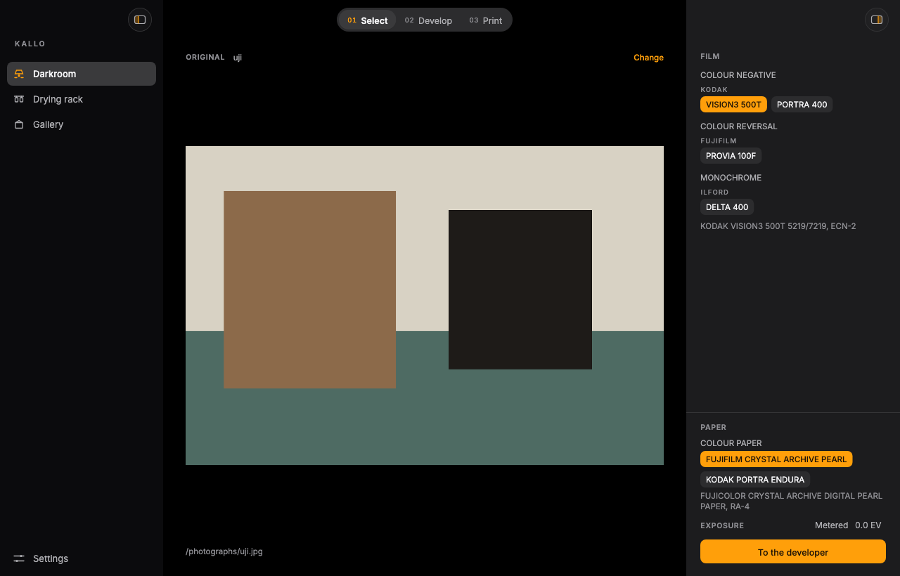 | 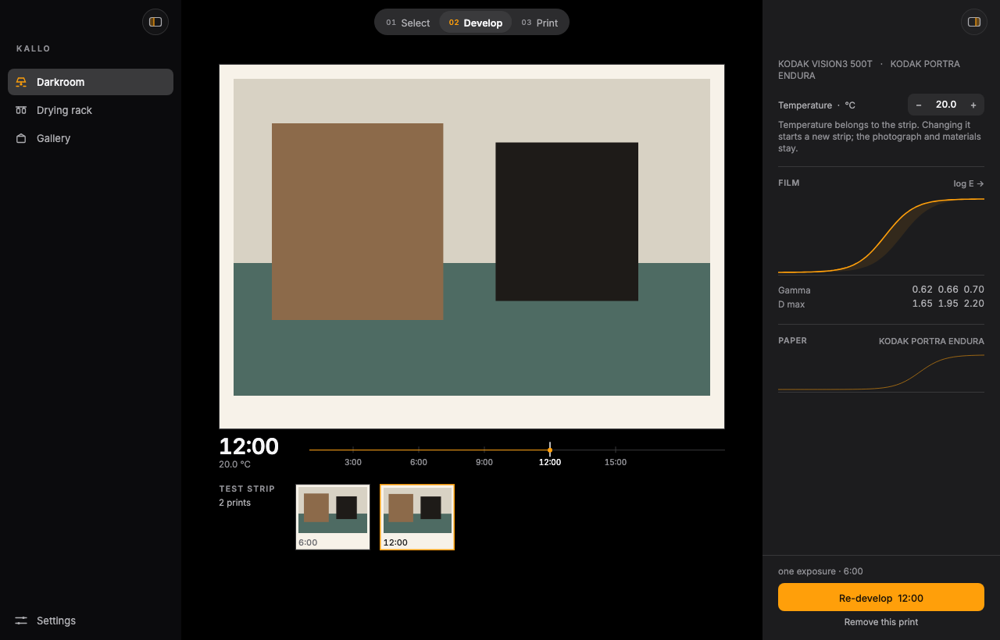 |
| **select**, the photograph before the developer | **develop**, one print at a time, on one exposure |
| 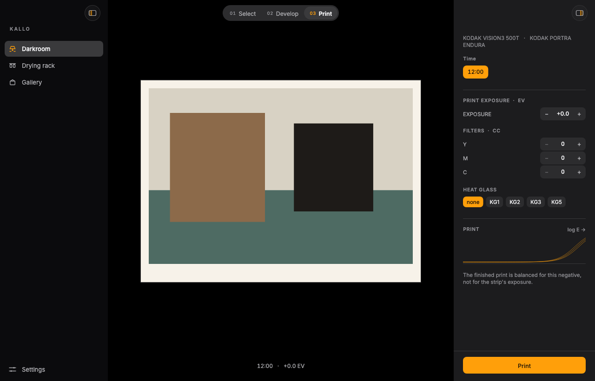 | 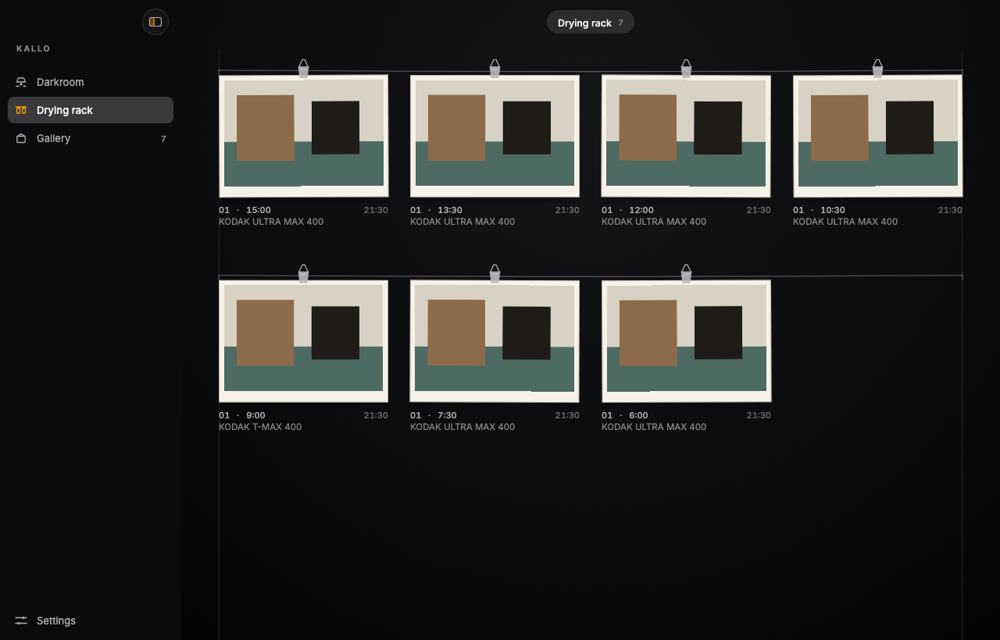 |
| **print**, the enlarger dialled for this negative | **the rack**, the paper before the frame |
| 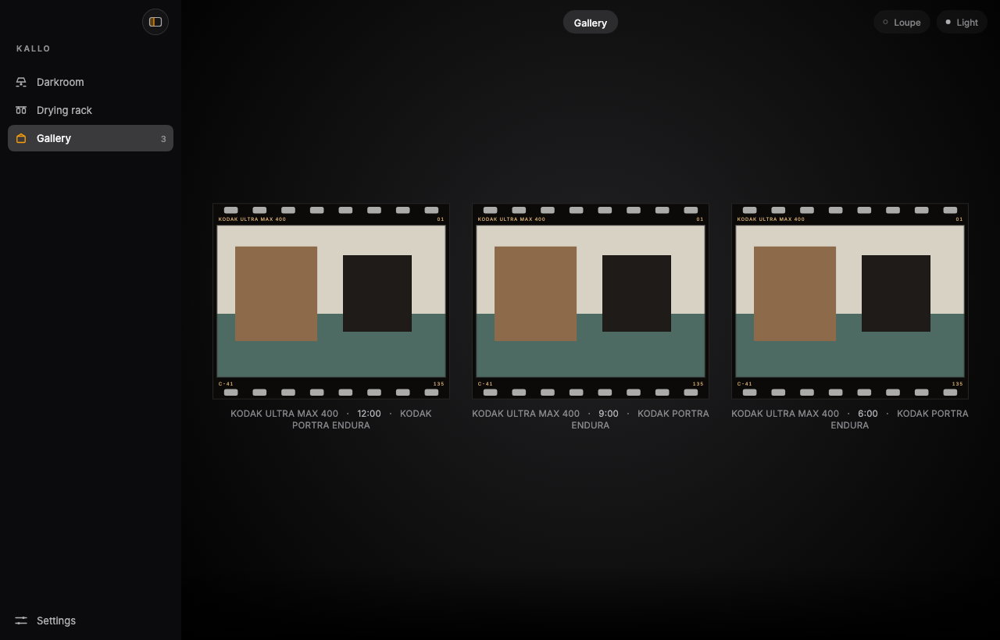 | 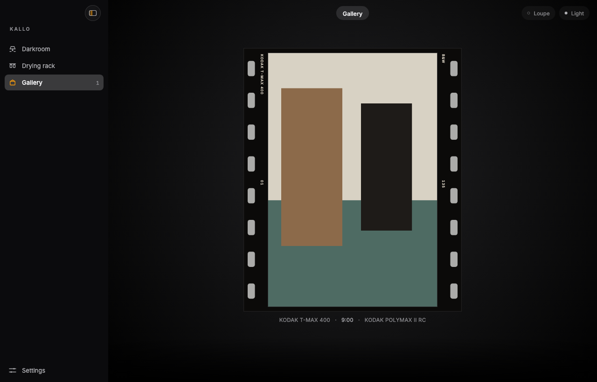 |
| **gallery**, frames on the wall, newest first | **portrait**, the strip turned |
| 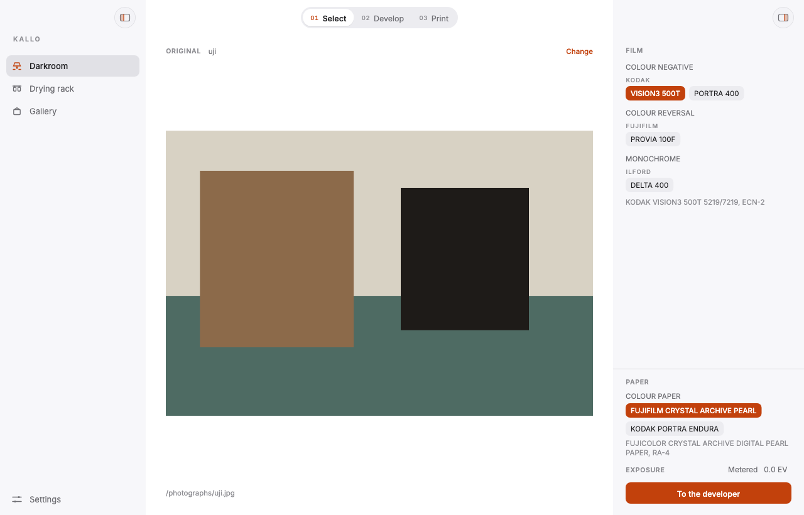 | 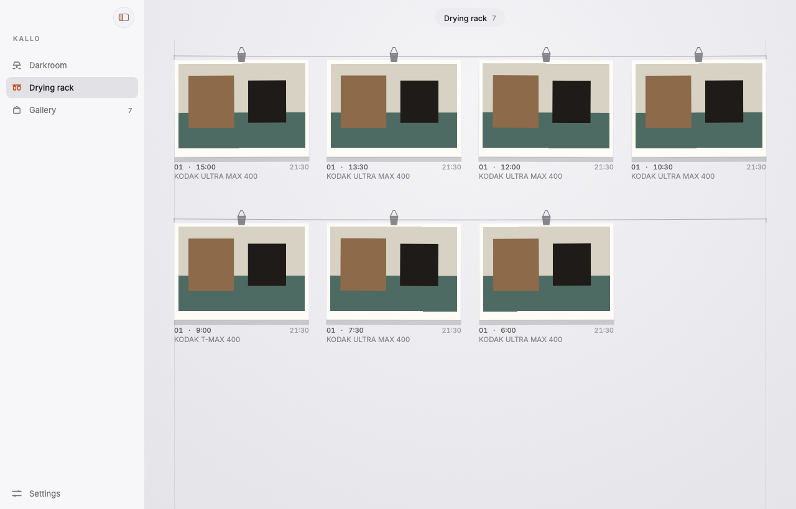 |
| **select, daylight** | **the rack, daylight** |
| 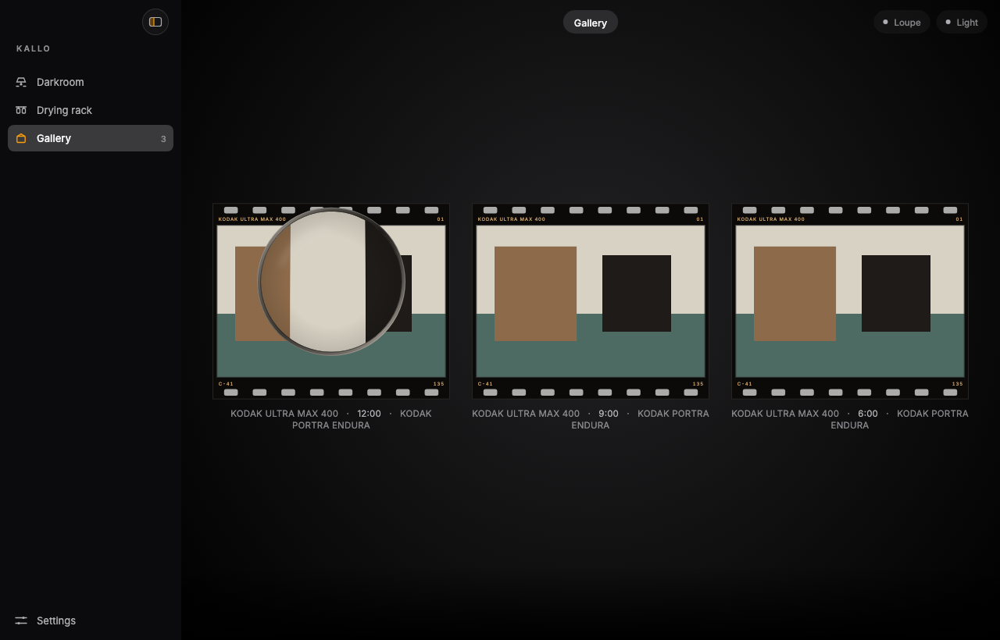 | 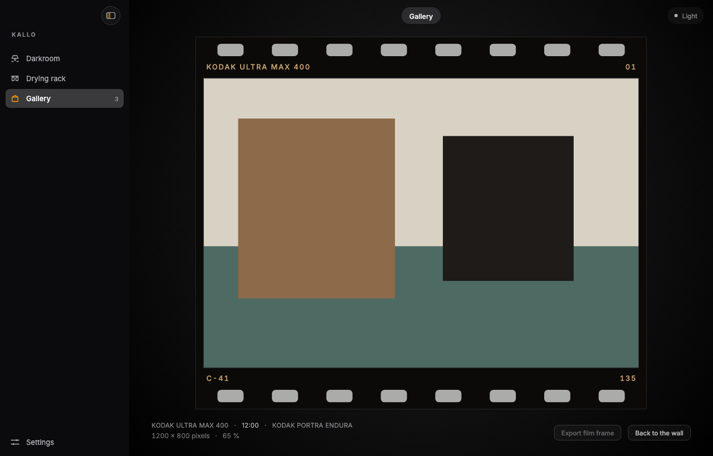 |
| **lens**, the picture bowed under glass | **loupe**, the flat frame, up to 1:1 |
| 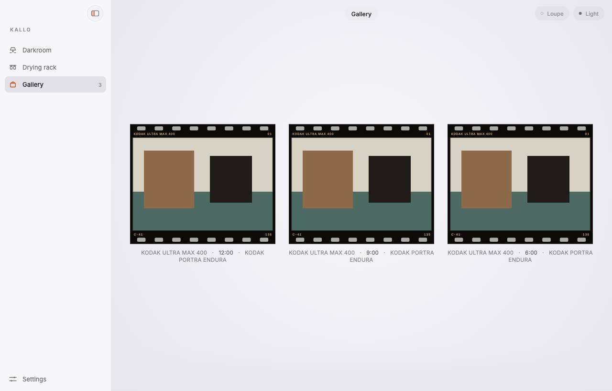 | 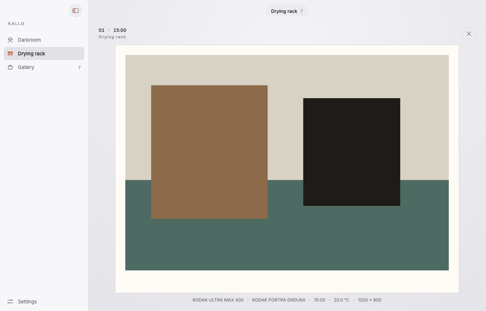 |
| **gallery, daylight** | **viewer**, the print off the rack, full screen |

The gallery, rack and frame goldens draw a test card, because the app ships no
pictures: a print is a file the model exports, and the golden has to have
something on the wall to be about.

The test loads the bundled faces from disk before it draws, so the picture is in
the product's own type rather than the runner's. That is the reason the fonts are
bundled — and both are under the SIL Open Font License, so a public repository
may carry them: `fonts/OFL-Inter.txt`, `fonts/OFL-NotoSansSC.txt`.

GitHub's mark in the About link is from [Simple Icons](https://simpleicons.org)
16 and is CC0 1.0; its source and rendering note live in `assets/README.md`.

The four-plane shell and its twenty-one Windows goldens are gone. What is left
is the window the product opens.
The settings sheet is covered by widget tests rather than a golden: it opens on
About, and neither a drawer title nor the old prose is there.

---

## What you are looking at

One window. The darkroom, the drying rack and the gallery on the left; in the
darkroom, three steps in one small capsule over the centre of the bench: select,
develop, print. There is no bar and no rule under it, because the steps change
what is on the bench, not where the bench is. The instrument panel on the right
belongs to the step, and the one action is at its bottom. Both sides of the
window can be put away. The open sidebar carries its glass switch at the top
right, on the same line as the window's other pane controls; when the sidebar
is put away, the same switch moves into the content's top edge. The right
switch hides the inspector, and the work takes the width back.

Settings is one sheet, opened from the bottom of the sidebar. About is first:
the app's mark, its version, and one click to the repository. There is no
drawer heading and no prose about the type or the model; the other four pages
are the settings themselves, with the one sentence each needs.

| | |
|---|---|
| **The select step is the photograph, before the developer** | One photograph enters the darkroom, and the step shows it — the whole original, not a thumbnail — with the film and the paper in the column beside it. The materials are not constants in the app: `kalo stocks --json` hands over every film the model carries, grouped by chemistry and then by manufacturer, and every paper under a rule of its own, so the shelf cannot show a film or a paper the model does not have. A maker is a heading, not a prefix repeated on every box: `KODAK` over `GOLD 200`, `FUJIFILM` over `PROVIA 100F`. The first picture is the original; the developing has not happened yet. |
| **The develop step is one print at a time** | The print on the easel is the time in hand; the ruler under it moves the time; the strip below it is what has been printed. Dragging the ruler only changes the preview. Pressing *develop* renders one print at 1200 px and adds it to the strip. The first print fixes the enlarger's exposure, and every later print keeps it — the strip compares developments, not timers. The temperature is a dial in the panel; it belongs to the strip, so changing it starts a new strip and keeps the photograph and materials. The panel names both materials with their manufacturers, then draws the film's developed curve, the paper's, the strip's times together, and the densitometer's gamma and D-max. |
| **The print step is the enlarger dialled** | The chosen development is printed again at the photograph's size, balanced on its own negative, with the timer, the CC pack and the heat glass. It is not a copy of the strip's print: the strip is one exposure; the finished print is the one dialled for this photograph. The panel draws the paper's curve under those settings — the timer, the pack and the glass move it — so the picture and the instrument are the same enlarger. Pressing *print* opens a sheet for the size (original, 6000 or 4000 pixels) and the file format (PNG or JPEG). |
| **The drying rack is what came out** | A place beside the darkroom, not a fourth step: lines of wire across the room, each print held by a clip, newest first, wrapping into as many columns as the window holds and scrolling down to the next line. The paper has a shadow because it is in the air; clicking one takes it off the rack and fills the window with it, where it can be pinched or scrolled. A corner says what is still being made. The gallery is the same files looked at properly, as film. |
| **The path is a choice** | Exposure, print and scan go through the spectrum — 71 wavelengths, reconstructed from the input and integrated against each layer's sensitivity — or through one number per channel. It is a setting because the model keeps it opt-in: the structure is physical end to end, and the data under it is mixed — the curves and layer sensitivities of twenty-one films are measured, the papers are, the illuminant is CIE D50, and fifteen films still borrow their dye shapes because their sheets print a neutral instead of three dyes. The select panel and the catalogue say per film which is which. The two paths are different photographs, not different labels, and the strip remembers which made it: a print of that strip is made the same way. |
| **The model is the app's own library** | The app's Dart package (`kallo`) links `kallotype-api` through `flutter_rust_bridge`; a strip print is one call, and a finished print is the same pipeline at the photograph's size. A roll and its contact proof are one call for the CLI, from one read of the photograph. The `kalo` binary is still underneath as the fallback when the library cannot load — tests run that way — and both answer the same `Model`, because the binding was written to the shape the subprocess already had. |
| **Two rooms, a rack, three steps** | The darkroom and the gallery are rooms; the drying rack is the place between them. In the darkroom: select, develop, print — the photograph, the strip and the finished print. The rack has no steps and neither does the gallery: a line is hung, a wall is looked at. The old six places are gone; the shelf's job is the select step, the bench's is develop and print, the rack's is the paper. |
| **The test strip is the proof, made one print at a time** | A proof is the film laid on paper and exposed once. The strip is that idea with the person's hand in it: one print per development, all on the first print's exposure, laid side by side. A longer development makes a denser negative, so on one exposure it prints lighter; the strip says that before the finished print is dialled. The prints are rendered, not drawn: each is a real 1200 px print, and the densitometer reads its chart. |
| **A frame can be looked through, then walked up to** | The loupe is a switch beside the lamp, put away by default. With it out, hovering a frame brings a loupe to the pointer: three times the wall, from the print's own file decoded wide enough to be sharp, with the 35 mm rebate still in the glass. The picture under the lens bows slightly at its edge — glass is not a window — while the rebate and the sprocket holes stay flat. The switch belongs to the wall, so it goes when a print fills the window; the lamp stays. Clicking opens the frame at the file's own size: the film keeps its size and shape — this is a loupe on film, not a picture viewer — and the picture is magnified *inside* the aperture, clipped by the gate, up to 1:1, one image pixel per device pixel, which is as far as the file goes. That close view is flat: it moves the picture under the gate and never bends the file. The label under it says the file's pixels and the scale; escape puts it back on the wall, and the lamp comes with you. The same view opens an export sheet: the size is the print's own by default or 4096 pixels, and the format is JPEG, PNG or TIFF. |
| **The gallery is a wall of film with one lamp** | A print is not a picture; it is a sheet of paper reflecting whatever light falls on it. So the wall, the film and the wall label multiply by one number; the lamp switch is at the top right of the chrome, with the loupe beside it, and the lamp is that number. Turn it off and the wall goes black, the labels go with it, the picture stays at a tenth — and the window around them does not move: the lamp is the gallery's, not the app's. In a light appearance the wall is a wall in daylight; the lamp still goes out. Each frame is a 35 mm piece of film: black rebate, clear sprocket holes, the stock and the print number on one edge, the process and `135` on the other. The stock says its manufacturer (`KODAK ULTRA MAX 400`, `ILFORD DELTA 400`) and the caption under the frame does too. The ink follows the chemistry: warm ivory for a silver film, pale amber for a colour negative, white for a reversal. A single print is `01`; a batch of selected frames will count `02`, `03`. A vertical picture turns the strip, so the holes run down its sides. Frames are given the same area, so a portrait is the same piece of film turned, not a wider one. |
| **A print is a file, not an asset** | The app ships no pictures. `just print <photograph>` renders one through the model into the export folder, and the gallery frames whatever is in there — nothing, most of the time, which is why an empty wall is a state and not a bug. The folder is a setting, and on a phone it is the one place the system lets an app write. The plain print and the framed export both open the same kind of sheet: size first, then format. The frame defaults to the print's own size and JPEG; the print defaults to the photograph's size and PNG. The framed export goes to `Frames/` inside that folder; the plain print stays where the model wrote it. The metadata — stock, paper, development, print number — lives in the app's own support folder, so the picture folder holds pictures and no sidecar JSON. |
| **The chrome is a neutral, the print is paper** | The window is a tool, so its planes are one Apple-shaped neutral ramp in both appearances: grouped background, sidebar, content, inspector, a recessed fill for every control, and the safelight only where something is chosen or acted on. Corners are 8, 14 and 20; hairlines are quiet. The only warm and saturated surfaces in the product are the paper a print sits on, the film frame around it, and the gallery wall behind it. |
| **Time is a ruler** | The develop step's ruler is continuous and the model accepts any positive time; 3/6/9/12/15 are the marks, not a limit. The strip's prints are the times actually tried, and the panel draws their curves together. The point is the difference between them. |
| **Nothing is a default** | No ripple, no elevation, no Roboto, no colour roles, no 4 dp grid. |

---

## The rules

These are the ones worth enforcing in review.

1. **No `MaterialApp`. No `Material`, `Card`, `Elevation`, `InkWell`.**
   `WidgetsApp` gives text direction, focus, overlay, semantics and routing.
   It gives nothing else. `uses-material-design: false` in `pubspec.yaml` is
   where that is written down.

2. **No shadows for layout.** A plane is raised by being lighter than what is
   behind it, and by a fill. A shadow belongs to an object in the room: the
   sheet over the window, the print hanging in the rack, the viewer's paper. It
   does not say a card is deep.

3. **One accent.** The safelight: a selection, the tone curve, and the one
   primary action on a page. Everything else is a neutral on one luminance
   ramp, because the contrast in this product is density — which is brightness
   — and not hue. The gallery's wall, the paper and the film are the exception
   that proves it: they are not state, they are objects.

4. **The ramps are closed sets.** Seven spacing steps, three radii and one
   capsule, eight type roles. When you need a new one, the layout is usually
   wrong. The gaps in `KalloSpace` are the whole reason it reads as deliberate.

5. **A hairline is one device pixel, not one logical pixel.** *Not met yet*: the
   hairlines are `BorderSide`s of width 1, which is two device pixels on a
   Retina screen. The rule stands; the code has to catch up.

6. **Nothing animates alone.** `KalloMotion.stagger` is 40 ms. If three things
   move, they move 40 ms apart. The room's light is one number and one tween, so
   that when it changes, everything changes together.

7. **Nothing on screen is invented here.** No curve, no density and no grain is
   derived in Dart; `assets/film_strip.json` is written by `just view` from the
   model and is a rendering of it at a commit. The one thing the app decides is
   *light* — a multiplication — and that is stated where it happens
   (`KalloColors.under`).

---

## Tokens

`lib/design/tokens.dart` is the whole visual contract.

- **Colours** — two complete sets, `light` and `dark`, resolved once from the
  system unless the user pinned one. Four planes (`ground`, `sidebar`, `content`,
  `surface`) and a three-step control ramp (`fill`, `fillStrong`, `elevated`), one
  `hairline`, three inks, the `accent` and its `accentSoft` wash, `onAccent`, the
  modal `scrim`, and `print`: the paper. Plus one operation — `under(colour,
  light)` — because a wall under a lamp is the same wall lit less, and a print is
  a reflectance, not an image with an opacity.
- **The wall** — `KalloWall`: the ground, the paper, the label and the control
  colours of the one room in the product that is lit by a lamp, in both
  appearances, plus the largest a print gets on it and how much light an eye
  keeps in the dark. A wall is lit by the room it stands in, so it follows the
  window's appearance; the lamp is the gallery's and takes the wall with it.
- **The rack** — `KalloRack`: the working room's ground, its wire, its clip and
  its graphite. It is not a wall and not a plane of the window; it is the one
  place paper hangs in the air.
- **The viewer** — `KalloViewer`: fixed black and fixed ink, because a print
  taken off the rack is not in either appearance's room.
- **Ink on paper** — `KalloInk`: what a contact proof writes on its sheet, at
  the light set's values in both appearances, because the paper does not turn
  dark when the window does. The accent is the safelight's, for the mark around
  the frame that was chosen.
- **Film** — `KalloFilm`: the black rebate, the clear sprocket hole, the
  edge printing (ivory, amber or white by chemistry) and the gate's own
  hairline. A film frame is an object in the work, like the paper, and it is lit
  by the same lamp.
- **Space** — 2, 4, 8, 12, 16, 24, 32.
- **Radius** — 8 for a control, 14 for a card, 20 for a sheet, and a capsule
  for a tab track or a toolbar control.
- **Shadow** — one for a sheet over the window, one for paper hanging in air,
  and one pixel of lift under a chosen segment. No layout shadow.
- **Motion** — 90 / 160 / 240 / 460 ms, three curves, one stagger. A lamp comes
  up faster than a room goes dark: the one direction is the filament, the other
  is the eye.
- **Type** — Inter, with Noto Sans SC behind it for Chinese. Eight roles:
  `plate`, `display`, `title`, `body`, `small`, `caption` (spaced caps),
  `data` and `folio` (tabular, so that a number changing does not move the
  things around it).

The English build is the Chinese build with fewer words in it, so switching
language moves no layout. `lib/design/strings.dart` holds every label; the
film's own vocabulary — `EI`, `C-41`, a stock name, a temperature — never
translates.

---

## What is deliberately not here

- **The model.** The nine densities on every frame are read from
  `assets/film_strip.json`, written by `just view` from `kallotype-view`. The
  roll is VISION3 500T developed five times, not a shape invented to look like
  one. Regenerate it; never edit it.
- **A developed roll's chart is the film's, not the picture's.** The library
  reads the stock's nine-step wedge at each development the way a densitometer
  reads a strip: through the base, the fog and the orange mask, so the numbers
  are a reading and not the curve redrawn. A roll the app developed carries a
  measured chart; the committed strip is the model's drawing — charted, not
  measured. The subprocess fallback writes pixels and no densities, and a roll
  developed that way stays chartless — which is what `flutter test` sees.
- **A settings card with nothing to set.** The drawer is five pages: about,
  language, appearance, the print folder and the path. The first is the app
  itself — its mark, its version and one way out to the repository. A card
  about a renderer the app cannot switch, or a sound it does not make, was the
  scaffold's idea of a settings page; it is not this one. The version is the
  bundle's, mirrored once in `app_info.dart` and checked against `pubspec.yaml`
  by a test, not copied into the interface ad hoc.
- **A soft proof of the paper's surface.** A print is rendered again from the
  photograph, at the size the photograph has and capped at 6000 points, and the
  app's own record carries the stock, the paper and the development rather than
  a sidecar beside the picture. What the app can show before that is the
  presentation: the bench hangs the frame
  the way the wall will, and the table is the model's own contact proof. What
  it cannot show is the paper itself — the model exports pixels, not a
  reflectance, so the surface, the sheen, and the difference between Crystal
  Archive and Endura are not simulated, and the sheet is one paper colour in
  both rooms.
- **A print from a reversal.** A reversal is developed to a positive and
  scanned: there is no print stage between the film and the picture. The bench
  says so where the button would be rather than making a print that is a second
  scan of the same slide.
- **A silver paper for a colour film.** The shelf does not offer one. The model's
  print is three channels and a silver paper has one record, so a colour film on
  a silver paper would render colour — `polymax_ii_rc` says in its own note that
  the format cannot express a paper that is one record. The shelf offers what the
  model can actually do, and a paper that rendered colour would be a lie about
  the paper.
- **A paper for a film with no print stage.** A reversal has no paper to choose:
  there is no print. The shelf says so where the papers would be.
- **A folder chooser on a phone.** iOS gives an app one folder and shows it in
  Files; Android has a per-app directory the system owns. A picker there is a
  desktop idiom, and neither platform is wired yet: iOS reads its Documents
  folder, Android has no folder at all until its own API is called. The drawer
  says which of the two it is instead of showing a button that would do
  nothing.
- **Colour management.** The model writes sRGB and the system manages the
  display. Wide gamut is the screen's business; nothing here is tagged or
  converted.
- **Text input.** `EditableText`, selection, IME and accessibility are the
  framework's job. Do not rebuild them; rebuild everything you can see.

---

## How to judge it

Screenshot a place, remove the text, and look at it.

If it still reads as *this* product, the language is working. If it reads as a
Flutter app, the problem is in one of the seven rules above — not in a library.
