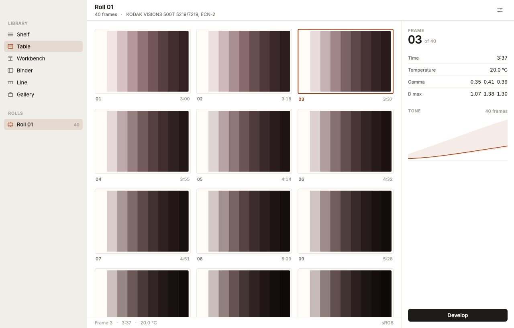
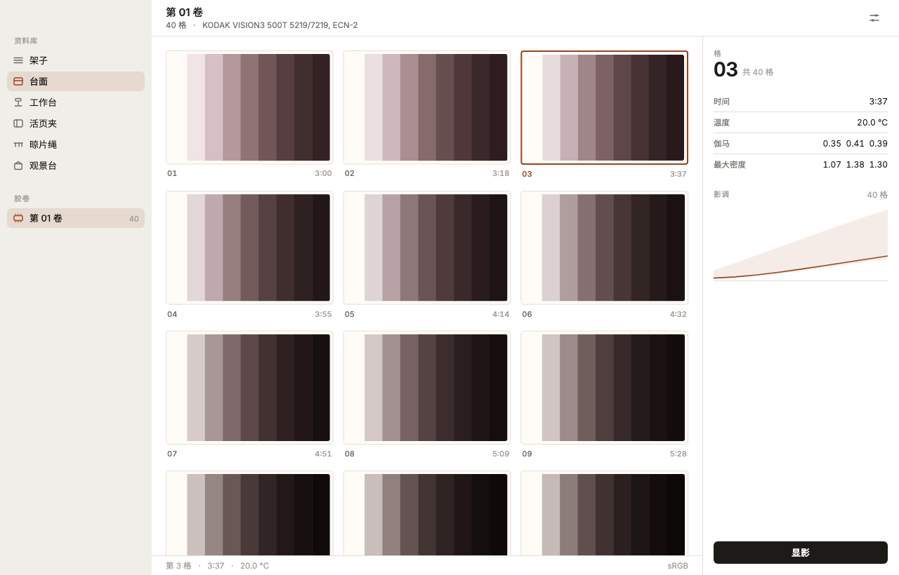
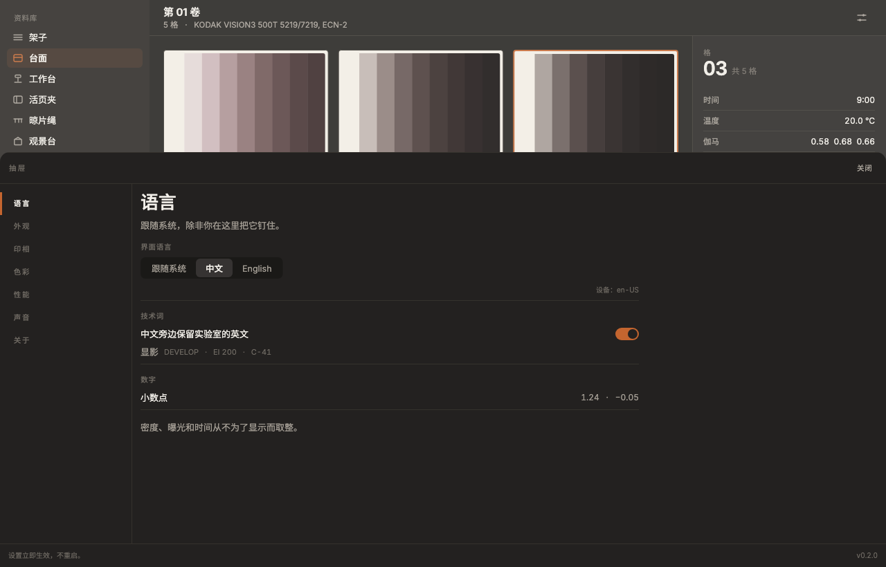
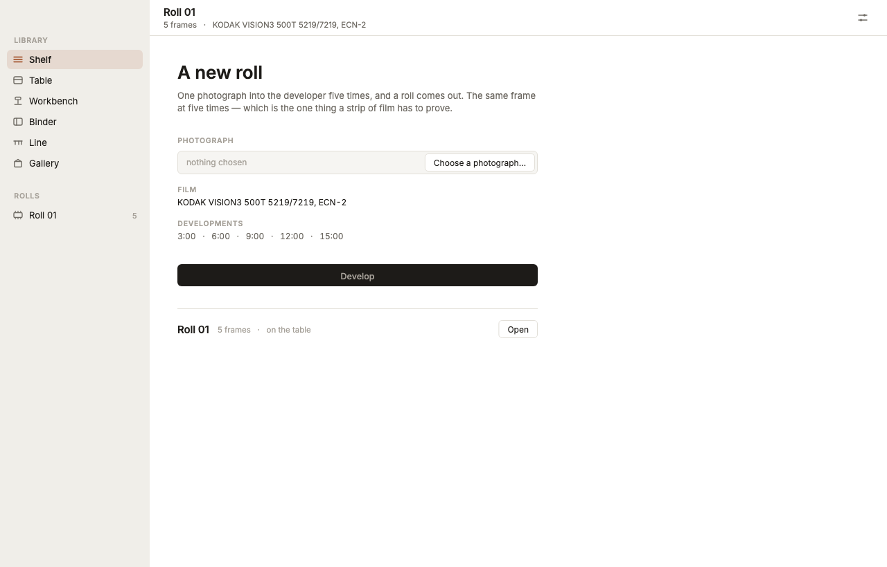
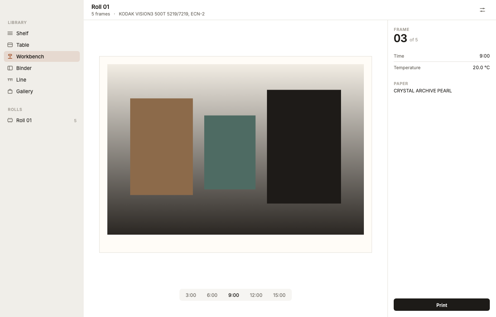
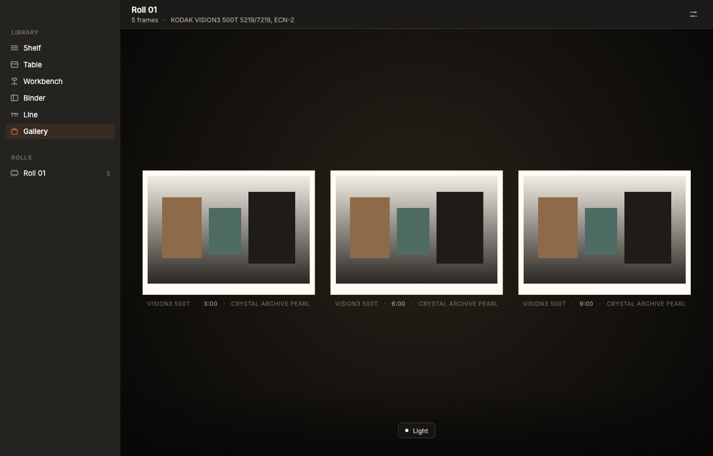
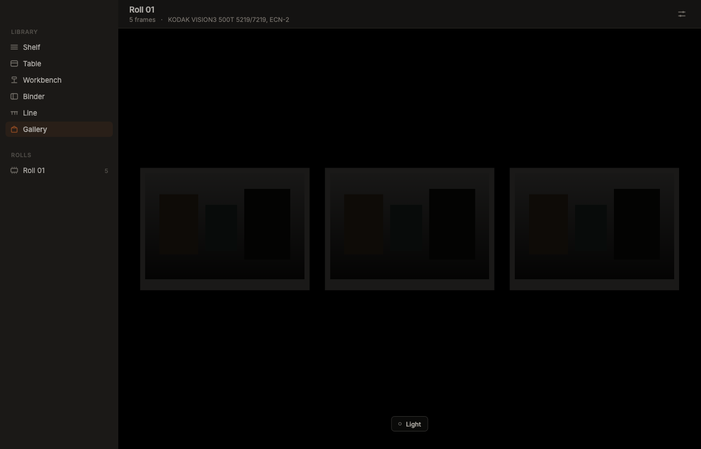
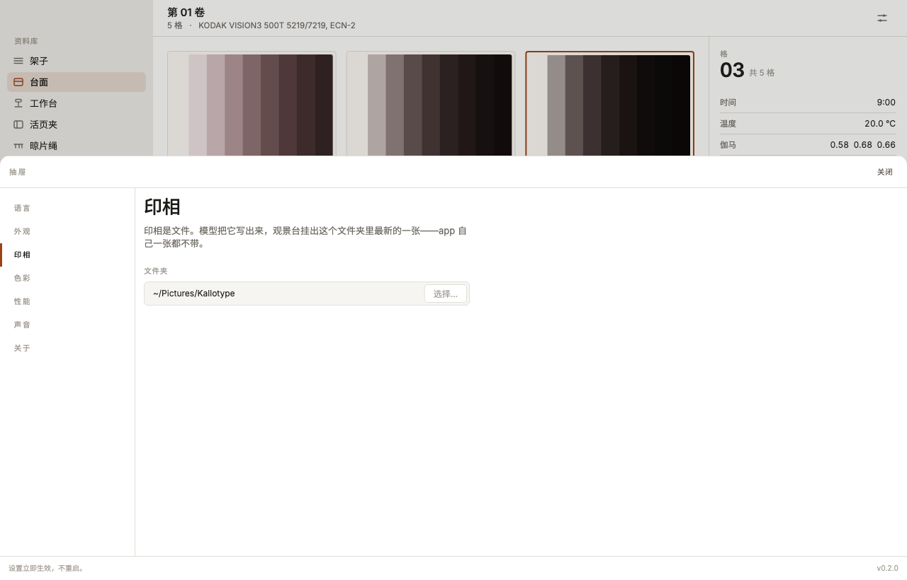

# app
The interface of Kallotype.

This is not a widget library and not a design system for other people to use.
It is **this app's vocabulary**, written down once so that every screen after it
is the same product.

It is also small on purpose. If it grows past a few thousand lines it has become
a framework, and a framework is a thing you maintain instead of a thing you
ship.

---

## Run it

Flutter is pinned to **3.47.9** with FVM, and `app/.fvmrc` is the record of it;
CI reads the same number. 3.47 is the first release that renders the desktop
with Impeller and leaves wide gamut on by default on the Mac, so it is a floor
and not a preference.

```bash
brew install fvm    # once
fvm install         # reads .fvmrc
fvm flutter run -d macos
```

Use `fvm flutter`, not `flutter`. A machine can have another SDK on its `PATH`,
and the two render differently — which is exactly the failure this pin exists to
prevent.

All six platforms are checked in: `macos`, `windows`, `linux`, `ios`, `android`.
They share one identity, `dev.kallotype.app`, and three floors — macOS 13,
iOS 15, and Android API 29, which is where Impeller takes the Vulkan path
instead of falling back to its OpenGL ES backend.

The Mac build is **not sandboxed**, and that is a decision rather than an
omission. A sandboxed app's home directory *is* its container, so the export
folder would be somewhere no person can find it, and remembering a folder the
user chose across launches needs security-scoped bookmarks. Until this app is
going to the App Store — the one place the sandbox is not optional — the folder
behaves the way a person expects, and the bookmarks are the price of the day it
does.

There is no `MaterialApp` anywhere, and that is the point.

---

## What is verified

`fvm flutter analyze` is clean, and eight goldens pin the language — one for
each place, and the states a place can be in:

| | | |
|---|---|---|
|  |  |  |
| **the table**, forty frames, light | **the same**, in Chinese | **the drawer**, in Chinese, dark |
|  |  |  |
| **the shelf**, where a photograph enters | **the workbench**, one frame enlarged | **the gallery**, lit |
|  |  | |
| **the same**, with the lamp off | **the drawer**, where the folder is set | |

The gallery's goldens hang a test card the test draws, because the app ships no
pictures: a print is a file the model exports, and the golden has to have
something on the wall to be about.

```bash
fvm flutter test                    # compares against the images
fvm flutter test --update-goldens   # rewrites them, deliberately
```

The test loads the bundled faces from disk before it draws, so the picture is in
the product's own type rather than the runner's. That is the reason the fonts are
bundled — and both are under the SIL Open Font License, so a public repository
may carry them: `fonts/OFL-Inter.txt`, `fonts/OFL-NotoSansSC.txt`.

---

## What you are looking at

One window. A column of places on the left, a toolbar that is also the window's
handle, a field, and — where the place has one — a record on the right.

| | |
|---|---|
| **The shelf is the way in** | One photograph, into the developer five times, and a roll comes out: the same frame at 3, 6, 9, 12 and 15 minutes. That ladder is the product's whole argument, so the first roll is a comparison rather than a collection. |
| **The workbench is one frame** | The enlarger's easel, lit, with the roll's ladder laid under it as a control: five times, five real prints, and the picture changes as you move along them. Nothing interpolates — every step is a render the model made at that time. |
| **The model is a process, for now** | `kalo` is asked for each frame and writes a PNG into the app's own folder; the app decodes them at the bench's width. An FFI will replace the middle of `lib/lab/model.dart` and nothing else: the shape a binding has is the shape a subprocess already has. |
| **Five places, one of each built** | Shelf, Table, Binder, Line, Gallery. The workbench belongs between the table and the binder and is not built yet. A place that has nothing in it says what it is for instead of showing another place's screen. |
| **The table is the roll, unrolled** | A contact sheet is a print, so every frame on it is a positive printed for its own highlights. Longer development is visibly more contrast, and it is not a filter — the nine densities on each frame are the model's. |
| **The gallery is a room with one light** | A print is not a picture; it is a sheet of paper reflecting whatever light falls on it. So the wall, the paper, the wall label and the chrome all multiply by one number, and the switch is that number. Turn it off and the wall goes to black, the chrome goes to the dark set, and the print stays at a tenth — the eye adapting, not the bulb. |
| **A print is a file, not an asset** | The app ships no pictures. `just print <photograph>` renders one through the model into the export folder, and the gallery hangs whatever is in there — nothing, most of the time, which is why an empty wall is a state and not a bug. The folder is a setting, and on a phone it is the one place the system lets an app write. |
| **The chrome is light, the print is paper** | The window is a tool, so its planes are one neutral ramp in both appearances. The only warm and saturated surfaces in the product are the paper a print sits on and the gallery wall behind it. |
| **Time is a dimension** | The frames on the table are the same frame developed for longer, and the inspector draws the whole roll as an envelope with the selected frame inside it. The point is the difference between them. |
| **Nothing is a default** | No ripple, no elevation, no Roboto, no colour roles, no 4 dp grid. |

---

## The rules

These are the ones worth enforcing in review.

1. **No `MaterialApp`. No `Material`, `Card`, `Elevation`, `InkWell`.**
   `WidgetsApp` gives text direction, focus, overlay, semantics and routing.
   It gives nothing else. `uses-material-design: false` in `pubspec.yaml` is
   where that is written down.

2. **No shadows for depth.** A plane is raised by being lighter than what is
   behind it, and by a hairline. `KalloShadow.sheet` is the one shadow in the
   code, and it says the drawer is above the window; it does not say anything is
   deep.

3. **One accent.** The safelight, turned down: a selection and the tone curve.
   Everything else is a neutral on one luminance ramp, because the contrast in
   this product is density — which is brightness — and not hue. The gallery's
   wall and paper are the exception that proves it: they are not state, they are
   objects.

4. **The ramps are closed sets.** Seven spacing steps, four radii, eight type
   roles. When you need a new one, the layout is usually wrong. The gaps in
   `KalloSpace` are the whole reason it reads as deliberate.

5. **A hairline is one device pixel, not one logical pixel.** *Not met yet*: the
   hairlines are `BorderSide`s of width 1, which is two device pixels on a
   Retina screen. The rule stands; the code has to catch up.

6. **Nothing animates alone.** `KalloMotion.stagger` is 40 ms. If three things
   move, they move 40 ms apart. The room's light is one number and one tween, so
   that when it changes, everything changes together.

7. **Nothing on screen is invented here.** No curve, no density and no grain is
   derived in Dart; `assets/film_strip.json` is written by `just view` from the
   model and is a rendering of it at a commit. The one thing the app decides is
   *light* — a multiplication — and that is stated where it happens
   (`KalloColors.under`).

---

## Tokens

`lib/design/tokens.dart` is the whole visual contract.

- **Colours** — two complete sets, `light` and `dark`, resolved once from the
  system unless the user pinned one. Four planes (`ground`, `sidebar`, `content`,
  `surface`), one `hairline`, three inks, one accent in two weights, and `print`:
  the paper. Plus three operations — `under(colour, light)`, `toward(set, t)`
  and `night` — because a room can go dark, and going dark is not the same event
  as the system changing its theme.
- **Space** — 2, 4, 8, 12, 16, 24, 32.
- **Radius** — 3 for film, 6 for a control, 10 for a card, 14 for a sheet.
- **Motion** — 90 / 160 / 240 / 460 ms, three curves, one stagger. A lamp comes
  up faster than a room goes dark: the one direction is the filament, the other
  is the eye.
- **Type** — Inter, with Noto Sans SC behind it for Chinese. Eight roles:
  `plate`, `display`, `title`, `body`, `small`, `caption` (spaced caps),
  `data` and `folio` (tabular, so that a number changing does not move the
  things around it).

The English build is the Chinese build with fewer words in it, so switching
language moves no layout. `lib/design/strings.dart` holds every label; the
film's own vocabulary — `EI`, `C-41`, a stock name, a temperature — never
translates.

---

## What is deliberately not here

- **The model.** The nine densities on every frame are read from
  `assets/film_strip.json`, written by `just view` from `kallotype-view`. The
  roll is VISION3 500T developed five times, not a shape invented to look like
  one. Regenerate it; never edit it.
- **A developed roll has no chart.** `kalo render` writes pixels and not the
  densities behind them, so the tone curve and the gamma rows only appear for
  the roll the model drew — the committed strip — and not for a roll the app
  developed. The chart comes back when the model is behind an FFI and can be
  asked for the numbers directly.
- **The line.** Printing a frame copies its PNG into the export folder and
  writes the record beside it, because a print is a file and the frame on the
  roll is already the render. The queue of prints is therefore always empty,
  and the place that would show it is still a statement.
- **A folder chooser on a phone.** iOS gives an app one folder and shows it in
  Files; Android has a per-app directory the system owns. A picker there is a
  desktop idiom, and neither platform is wired yet: iOS reads its Documents
  folder, Android has no folder at all until its own API is called. The drawer
  says which of the two it is instead of showing a button that would do
  nothing.
- **Colour management.** The model writes sRGB and the system manages the
  display. Wide gamut is the screen's business; nothing here is tagged or
  converted.
- **Text input.** `EditableText`, selection, IME and accessibility are the
  framework's job. Do not rebuild them; rebuild everything you can see.
- **The other three places.** Shelf, Binder and Line exist on the map and say
  what they are for. They are the next two or three milestones, not bugs.

---

## How to judge it

Screenshot a place, remove the text, and look at it.

If it still reads as *this* product, the language is working. If it reads as a
Flutter app, the problem is in one of the seven rules above — not in a library.
