# app
The interface of Kallotype.

This is not a widget library and not a design system for other people to use.
It is **this app's vocabulary**, written down once so that every screen after it
is the same product.

It is also small on purpose. If it grows past a few thousand lines it has become
a framework, and a framework is a thing you maintain instead of a thing you
ship.

---

## Run it

Flutter is pinned to **3.47.9** with FVM, and `app/.fvmrc` is the record of it;
CI reads the same number. 3.47 is the first release that renders the desktop
with Impeller and leaves wide gamut on by default on the Mac, so it is a floor
and not a preference.

```bash
brew install fvm    # once
fvm install         # reads .fvmrc
fvm flutter run -d macos
```

Use `fvm flutter`, not `flutter`. A machine can have another SDK on its `PATH`,
and the two render differently — which is exactly the failure this pin exists to
prevent.

All five platforms are checked in: `macos`, `windows`, `linux`, `ios`, `android`.
They share one identity, `dev.kallotype.app`, and three floors — macOS 13,
iOS 15, and Android API 29, which is where Impeller takes the Vulkan path
instead of falling back to its OpenGL ES backend.

The Mac build is **not sandboxed**, and that is a decision rather than an
omission. A sandboxed app's home directory *is* its container, so the export
folder would be somewhere no person can find it, and remembering a folder the
user chose across launches needs security-scoped bookmarks. Until this app is
going to the App Store — the one place the sandbox is not optional — the folder
behaves the way a person expects, and the bookmarks are the price of the day it
does.

There is no `MaterialApp` anywhere, and that is the point.

---

## What is verified

`fvm flutter analyze` is clean, and twenty-one goldens pin the language — one for
each place, the states a place can be in, and the two shelves:

| | | |
|---|---|---|
|  |  | 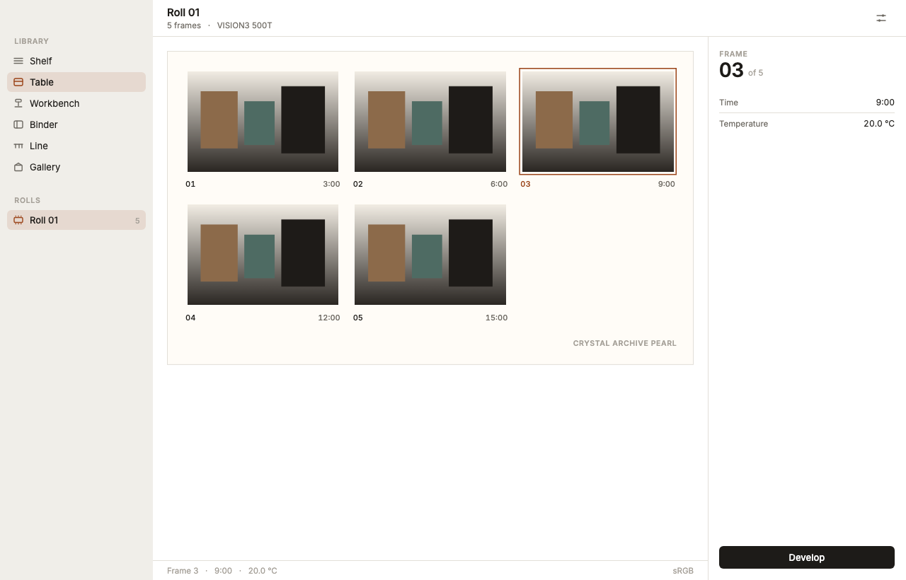 |
| **the table**, forty frames, light | **the same**, in Chinese | **the table**, the model's proof |
|  |  | 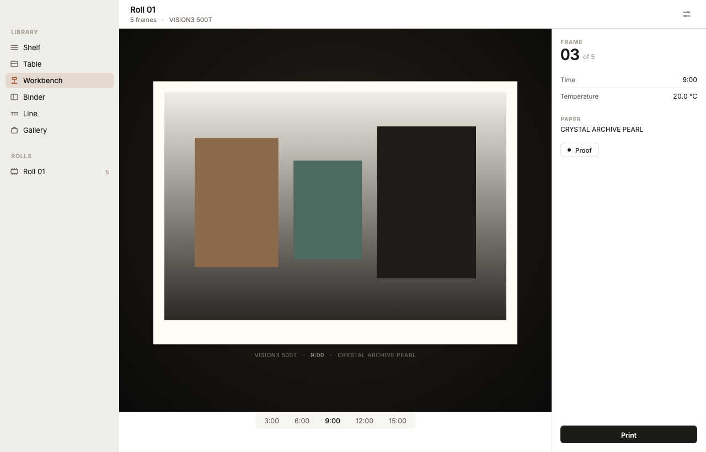 |
| **the shelf**, where a photograph enters | **the workbench**, one frame enlarged | **the workbench**, the frame proved |
|  | 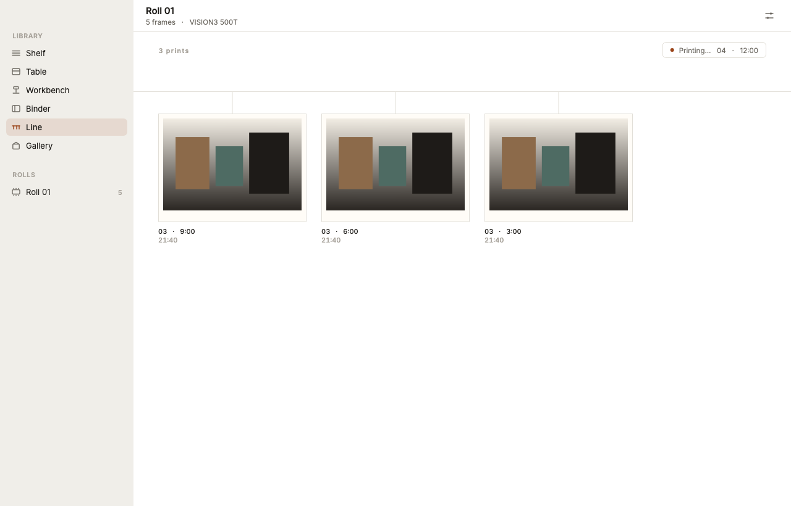 | 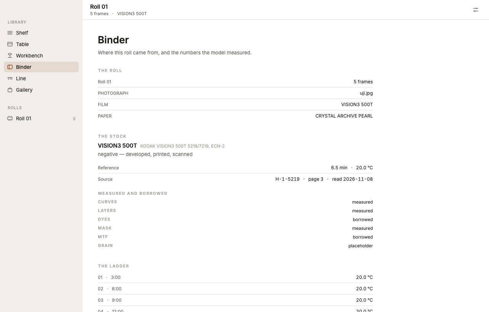 |
| **the gallery**, lit | **the line**, what has been printed | **the binder**, where the roll came from |
|  |  | 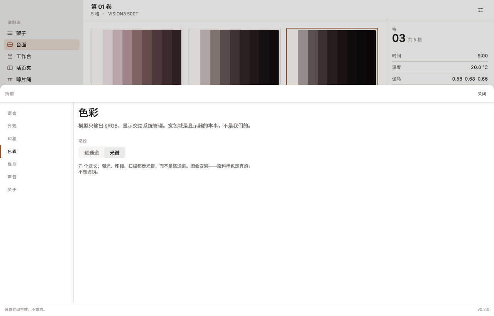 |
| **the drawer**, in Chinese, dark | **the drawer**, where the folder is set | **the drawer**, where the path is chosen |
|  | 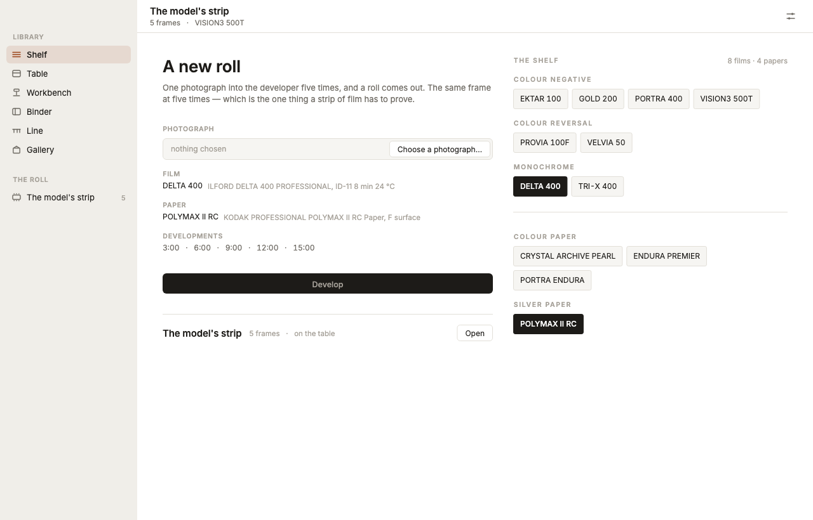 | 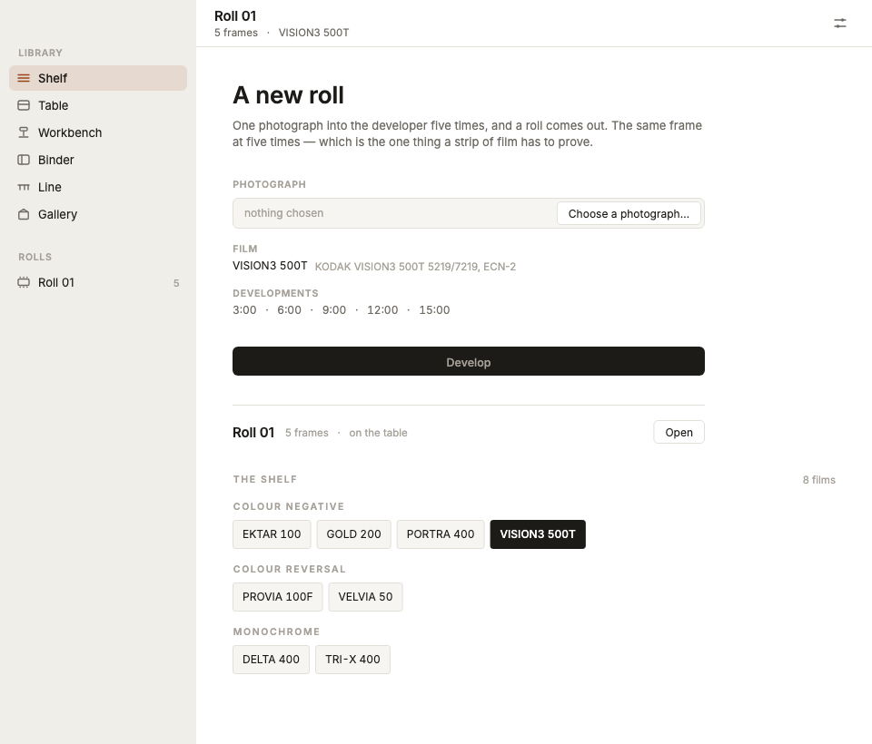 |
| **the gallery**, with the lamp off | **the shelf**, with a silver film taken | **the shelf**, in the narrowest window |
| 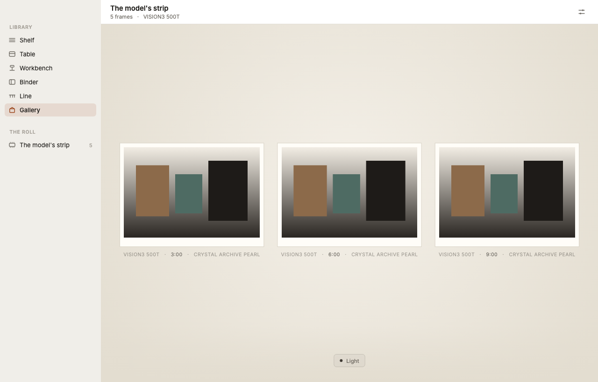 | 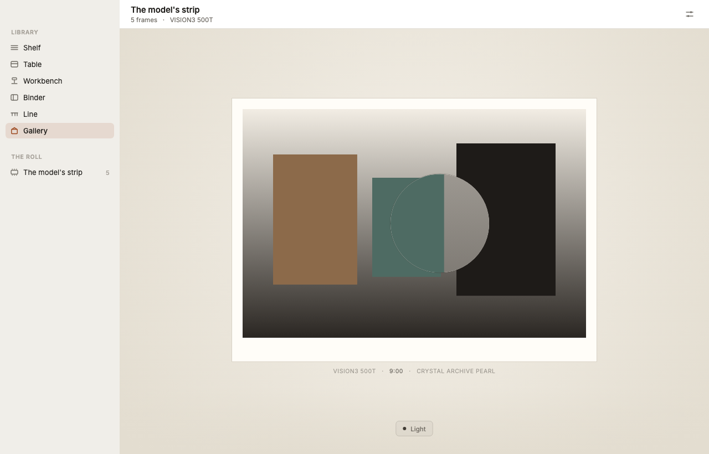 | 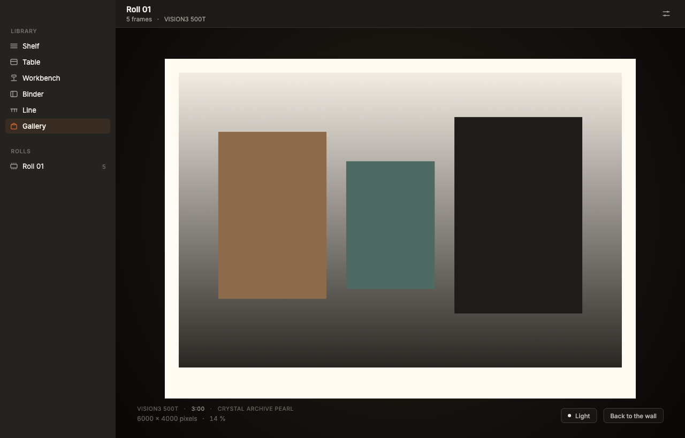 |
| **the gallery**, in a light appearance | **the lens**, held over a print | **a print**, walked up to |
| 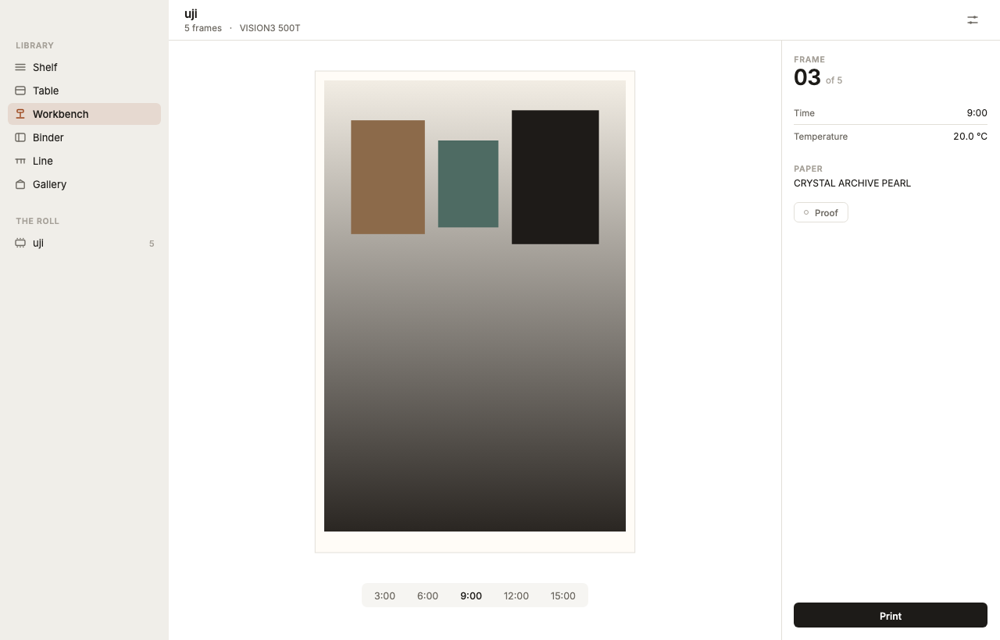 | 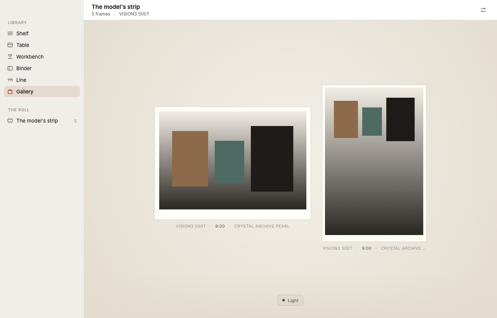 | |
| **the workbench**, a vertical frame | **the gallery**, two papers, one size | |

A proof is read through a loupe, so the table has one too — the same glass as
the wall's, and the same object: a turned bezel, a reflection of the room, and a
glass that darkens at its edge. It is on a switch, because a glass that comes up
under every pass of the pointer is in the way of choosing a strip, and the
pointer is hidden while it is up: the glass is where the pointer is. What it
magnifies is the sheet, not the enlarger's print — a strip that a five-stop
development difference prints nearly black is a picture again at three times the
sheet, and it is the same picture.

| |
|---|
| 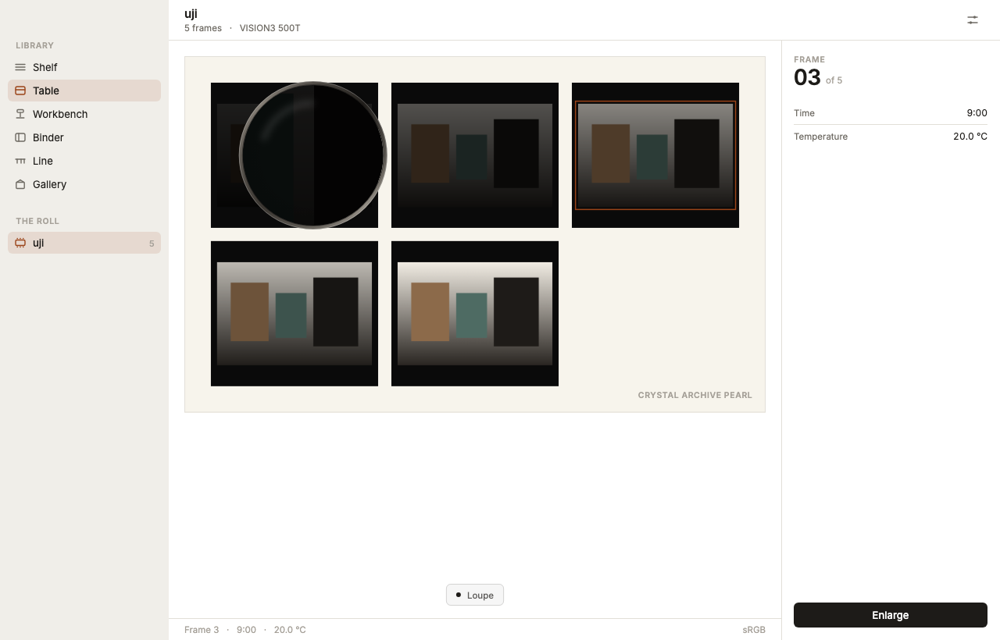 |
| **the table**, the proof under the glass |

The gallery's goldens hang a test card the test draws, because the app ships no
pictures: a print is a file the model exports, and the golden has to have
something on the wall to be about.

```bash
fvm flutter test                    # compares against the images
fvm flutter test --update-goldens   # rewrites them, deliberately
```

The test loads the bundled faces from disk before it draws, so the picture is in
the product's own type rather than the runner's. That is the reason the fonts are
bundled — and both are under the SIL Open Font License, so a public repository
may carry them: `fonts/OFL-Inter.txt`, `fonts/OFL-NotoSansSC.txt`.

---

## What you are looking at

One window. A column of places on the left, a toolbar that is also the window's
handle, a field, and — where the place has one — a record on the right.

| | |
|---|---|
| **The shelf is the way in, and it is the model's** | One photograph, into the developer five times, and a roll comes out: the same frame at 3, 6, 9, 12 and 15 minutes. That ladder is the product's whole argument, so the first roll is a comparison rather than a collection. The materials are not constants in the app: `kalo stocks --json` hands over every film the model carries, grouped by chemistry, and every paper under a rule of its own, so a roll is developed as the two boxes you took off the shelf — and the shelf cannot show a film or a paper the model does not have. |
| **The binder is where the roll came from** | The photograph, the film, the paper, the five times, and — under each material — the sheet it was read from and one line per field saying whether that field was measured, borrowed from another stock, or left as a compiled placeholder. A stock that borrowed its dyes is a different claim from one that measured them, and this is the page that says which is which. |
| **The workbench is one frame** | The enlarger's easel, lit, with the roll's ladder laid under it as a control: five times, five real prints, and the picture changes as you move along them. Nothing interpolates — every step is a render the model made at that time. The bench also has one lamp: *proof* takes the frame out of the room and hangs it the way the gallery will — the same wall, the same sheet, the same label, at the size a hanging is — so the time is chosen against the wall and not against a screen. The ladder stays under it: the label's loud word is the time in hand. The paper is the picture's shape — a vertical frame is a tall sheet with the whole photograph on it, not a landscape sheet with a band through its middle — and the wall, the line and the lens all read the shape from the print they are given. |
| **The line is what happened** | A string across the room with the work hanging from it, newest first, and a corner that says what is still being made. The gallery is the same files looked at properly, on a wall, in the dark. |
| **The path is a choice** | Exposure, print and scan go through the spectrum — 71 wavelengths, reconstructed from the input and integrated against each layer's sensitivity — or through one number per channel. It is a setting because the model keeps it opt-in: the structure is physical end to end, and the data under it is mixed — the curves and layer sensitivities of twenty-one films are measured, the papers are, the illuminant is CIE D50, and fifteen films still borrow their dye shapes because their sheets print a neutral instead of three dyes. The binder says per film which is which. The two paths are different photographs, not different labels, and the roll remembers which made it: the binder says so under the film, and a print of that roll is made the same way. |
| **The model is the app's own library** | `kallo_ui` links `kallotype-api` through `flutter_rust_bridge`; a roll is one call that reads the photograph once, prints the five frames and the proof from that one read. The `kalo` binary is still underneath as the fallback when the library cannot load — tests run that way — and both answer the same `Model`, because the binding was written to the shape the subprocess already had. |
| **Six places, all six built** | Shelf, Table, Workbench, Binder, Line, Gallery. The order is the work's: what you have, what you compare, what you judge one frame on, what you keep, what you print, and where it hangs. |
| **The table is the model's proof** | A contact proof is the film laid on paper and exposed once, so the table shows the model's print of it and not a drawing: five strips on one sheet, the clear rebate printed black, and the stock, frame number and development printed on the film's edge. One exposure means the strips are a comparison — a development longer than the sheet's own prints denser, the shorter ones thinner — which is the one thing a print of each frame, corrected frame by frame, cannot say. The model's record beside the sheet says where the frames are; the app adds only the pencil: a box around the development being considered, in the safelight's colour, and the paper's name in its margin. A roll the model drew has no negative, so the table falls back to the chart it can draw. |
| **A print can be looked through, then walked up to** | Hovering a print brings a loupe to the pointer: three times the wall, from the print's own file decoded wide enough to be sharp, with the sheet's paper still in the glass. The lens goes away when the pointer does. Clicking opens the print at the file's own size: the sheet keeps its size and shape — this is a loupe on paper, not a picture viewer — and the image is magnified *inside* it, clipped by its own margin, up to 1:1, one image pixel per device pixel, which is as far as the file goes. The label under it says the file's pixels and the scale; escape puts it back on the wall, and the lamp comes with you. |
| **The gallery is a wall with one lamp** | A print is not a picture; it is a sheet of paper reflecting whatever light falls on it. So the wall, the paper and the wall label multiply by one number, and the switch is that number. Turn it off and the wall goes black, the labels go with it, the print stays at a tenth — and the window around them does not move: the lamp is the gallery's, not the app's. In a light appearance the wall is a wall in daylight; the lamp still goes out. The wall hangs one paper: a sheet is the picture's shape, so a vertical print is the same sheet turned — it is given the same area, not the same width — and the line hangs it the same way. |
| **A print is a file, not an asset** | The app ships no pictures. `just print <photograph>` renders one through the model into the export folder, and the gallery hangs whatever is in there — nothing, most of the time, which is why an empty wall is a state and not a bug. The folder is a setting, and on a phone it is the one place the system lets an app write. |
| **The chrome is light, the print is paper** | The window is a tool, so its planes are one neutral ramp in both appearances. The only warm and saturated surfaces in the product are the paper a print sits on and the gallery wall behind it. |
| **Time is a dimension** | The frames on the table are the same frame developed for longer, and the inspector draws the whole roll as an envelope with the selected frame inside it. The point is the difference between them. |
| **Nothing is a default** | No ripple, no elevation, no Roboto, no colour roles, no 4 dp grid. |

---

## The rules

These are the ones worth enforcing in review.

1. **No `MaterialApp`. No `Material`, `Card`, `Elevation`, `InkWell`.**
   `WidgetsApp` gives text direction, focus, overlay, semantics and routing.
   It gives nothing else. `uses-material-design: false` in `pubspec.yaml` is
   where that is written down.

2. **No shadows for depth.** A plane is raised by being lighter than what is
   behind it, and by a hairline. `KalloShadow.sheet` is the one shadow in the
   code, and it says the drawer is above the window; it does not say anything is
   deep.

3. **One accent.** The safelight, turned down: a selection and the tone curve.
   Everything else is a neutral on one luminance ramp, because the contrast in
   this product is density — which is brightness — and not hue. The gallery's
   wall and paper are the exception that proves it: they are not state, they are
   objects.

4. **The ramps are closed sets.** Seven spacing steps, four radii, eight type
   roles. When you need a new one, the layout is usually wrong. The gaps in
   `KalloSpace` are the whole reason it reads as deliberate.

5. **A hairline is one device pixel, not one logical pixel.** *Not met yet*: the
   hairlines are `BorderSide`s of width 1, which is two device pixels on a
   Retina screen. The rule stands; the code has to catch up.

6. **Nothing animates alone.** `KalloMotion.stagger` is 40 ms. If three things
   move, they move 40 ms apart. The room's light is one number and one tween, so
   that when it changes, everything changes together.

7. **Nothing on screen is invented here.** No curve, no density and no grain is
   derived in Dart; `assets/film_strip.json` is written by `just view` from the
   model and is a rendering of it at a commit. The one thing the app decides is
   *light* — a multiplication — and that is stated where it happens
   (`KalloColors.under`).

---

## Tokens

`lib/design/tokens.dart` is the whole visual contract.

- **Colours** — two complete sets, `light` and `dark`, resolved once from the
  system unless the user pinned one. Four planes (`ground`, `sidebar`, `content`,
  `surface`), one `hairline`, three inks, one accent in two weights, and `print`:
  the paper. Plus one operation — `under(colour, light)` — because a wall under
  a lamp is the same wall lit less, and a print is a reflectance, not an image
  with an opacity.
- **The wall** — `KalloWall`: the ground, the paper, the label and the control
  colours of the one room in the product that is lit by a lamp, in both
  appearances, plus the largest a print gets on it and how much light an eye
  keeps in the dark. A wall is lit by the room it stands in, so it follows the
  window's appearance; the lamp is the gallery's and takes the wall with it.
- **Ink on paper** — `KalloInk`: what a contact proof writes on its sheet, at
  the light set's values in both appearances, because the paper does not turn
  dark when the window does. The accent is the safelight's, for the mark around
  the frame that was chosen.
- **Space** — 2, 4, 8, 12, 16, 24, 32.
- **Radius** — 3 for film, 6 for a control, 10 for a card, 14 for a sheet.
- **Motion** — 90 / 160 / 240 / 460 ms, three curves, one stagger. A lamp comes
  up faster than a room goes dark: the one direction is the filament, the other
  is the eye.
- **Type** — Inter, with Noto Sans SC behind it for Chinese. Eight roles:
  `plate`, `display`, `title`, `body`, `small`, `caption` (spaced caps),
  `data` and `folio` (tabular, so that a number changing does not move the
  things around it).

The English build is the Chinese build with fewer words in it, so switching
language moves no layout. `lib/design/strings.dart` holds every label; the
film's own vocabulary — `EI`, `C-41`, a stock name, a temperature — never
translates.

---

## What is deliberately not here

- **The model.** The nine densities on every frame are read from
  `assets/film_strip.json`, written by `just view` from `kallotype-view`. The
  roll is VISION3 500T developed five times, not a shape invented to look like
  one. Regenerate it; never edit it.
- **A developed roll's chart is the film's, not the picture's.** The library
  returns the stock's nine-step wedge at each development, so a roll the app
  developed carries the same tone curve and gamma rows as the committed strip.
  The subprocess fallback writes pixels and no densities, and a roll developed
  that way stays chartless — which is what `flutter test` sees.
- **A settings card with nothing to set.** The drawer is five cards: language,
  appearance, the print folder, the path, and what the app is. A card about a
  renderer the app cannot switch, or a sound it does not make, was the
  scaffold's idea of a settings page; it is not this one. The same goes for the
  version: it is the bundle's, and an app that wrote it out twice got it wrong
  in both places.
- **A soft proof of the paper's surface.** A print is rendered again from the
  photograph, at the size the photograph has and capped at 6000 points, and the
  file beside it is the record rather than a second copy of the picture. What
  the app can show before that is the presentation: the bench hangs the frame
  the way the wall will, and the table is the model's own contact proof. What
  it cannot show is the paper itself — the model exports pixels, not a
  reflectance, so the surface, the sheen, and the difference between Crystal
  Archive and Endura are not simulated, and the sheet is one paper colour in
  both rooms.
- **A print from a reversal.** A reversal is developed to a positive and
  scanned: there is no print stage between the film and the picture. The bench
  says so where the button would be rather than making a print that is a second
  scan of the same slide.
- **A silver paper for a colour film.** The shelf does not offer one. The model's
  print is three channels and a silver paper has one record, so a colour film on
  a silver paper would render colour — `polymax_ii_rc` says in its own note that
  the format cannot express a paper that is one record. The shelf offers what the
  model can actually do, and a paper that rendered colour would be a lie about
  the paper.
- **A paper for a film with no print stage.** A reversal has no paper to choose:
  there is no print. The shelf says so where the papers would be.
- **A folder chooser on a phone.** iOS gives an app one folder and shows it in
  Files; Android has a per-app directory the system owns. A picker there is a
  desktop idiom, and neither platform is wired yet: iOS reads its Documents
  folder, Android has no folder at all until its own API is called. The drawer
  says which of the two it is instead of showing a button that would do
  nothing.
- **Colour management.** The model writes sRGB and the system manages the
  display. Wide gamut is the screen's business; nothing here is tagged or
  converted.
- **Text input.** `EditableText`, selection, IME and accessibility are the
  framework's job. Do not rebuild them; rebuild everything you can see.

---

## How to judge it

Screenshot a place, remove the text, and look at it.

If it still reads as *this* product, the language is working. If it reads as a
Flutter app, the problem is in one of the seven rules above — not in a library.
