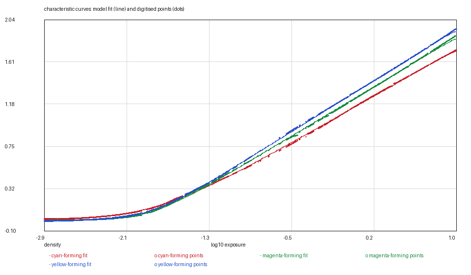
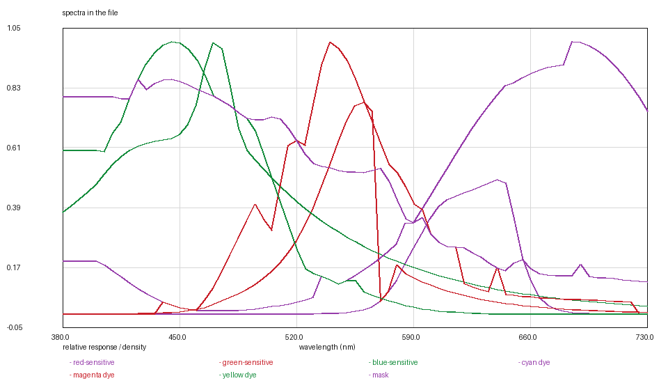

# FUJICOLOR C200: the chart that is artwork

*Kallotype film-data series, report 19 of 24. Version 1, 2026-11-09.
Data: `fuji-c200.kalofilm` (5,920 bytes). Code: `films/tools/`.*

## Abstract

FUJICOLOR C200 is the cheapest film in the series and the one whose sheet is
drawn, not rendered: every chart on page 6 is a 1-bit mask, so the curve reader
is reading artwork — pixels that were drawn as line art and stored without
grey levels. Two of those charts cost a method:

- **the sensitivity chart is five separate images** — two raster strips with the
  seam through the middle of the plot, and the decade line the curves stand on —
  reassembled from their page coordinates before anything is read;
- **the characteristic curves label their layers with white lozenges painted
  over the curves**, so the columns cannot be followed by continuity and are
  paired by order instead: a characteristic plot's three layers differ in speed,
  not shape.

The curves are the densest digitisation in the series — **1,137 points** each —
and they fit at **0.0068 / 0.0081 / 0.0054** over the two-rate rising model.
One MTF curve is published for the film (σ = 3.38 µm, shared by the three
layers); the dye shapes and the mask are borrowed from the VISION3 500T.

## 1. Materials

**The data sheet.** FUJIFILM FUJICOLOR C200, publication AF3-0249E, page 6,
retrieved 2026-11-08. Curves, sensitivity and MTF on page 6; the dye panel
prints a mid-scale neutral rather than three dyes.

**The artwork.** Every chart is a 1-bit mask in the PDF, rasterised from line
art. The curves are therefore read column by column at one or two pixels of
width, which is why this sheet yields 1,137 points per layer where the Kodak
sheets yield 128.

## 2. Methods

### 2.1 Reading a label that sits on top of the curve

Three curves cross a white lozenge naming the layer. A reader that follows
continuity loses the curve under the label and rejoins the wrong stroke; the
column-pairing used here instead assumes what the panel prints — the three
layers have the same shape and differ in speed — and assigns columns by order.

### 2.2 The fit

| layer | base | d_max | γ /decade | log_e0 | rates | rms |
|---|---|---|---|---|---|---|
| red | 0.1212 | 1.7492 | 0.6116 | −0.3867 | 3 / 20 | 0.0068 |
| green | 0.4233 | 1.8852 | 0.6456 | −0.3967 | 5 / 20 | 0.0081 |
| blue | 0.7328 | 1.9528 | 0.6688 | −0.4167 | 5 / 20 | 0.0054 |

1,137 points per layer, about 0.004 decades apart. The two-rate fit's shoulders
sit at the top of the grid — the sheet cuts the curves while they are still
climbing, and the `--asymptote-window 0.02` rule keeps the asymptote within
hundredths of the highest drawn density.

### 2.3 The anchor

The sheet prints camera stops and no reference exposure, so the film is anchored
on the printing aim — green at 0.70 of a density above base at 18 per cent grey,
shift **+0.7763** (2.6 stops) from the compiled table's corner-midpoint anchor.

### 2.4 What is borrowed

The dye shapes and the mask are the VISION3 500T digitisation: page 6's dye
panel prints a mid-scale neutral and a minimum density, not three dyes. Grain is
5.42 grains/µm² from the NPH 400 scans; the MTF is this sheet's own, one curve
for the film.

## 3. Results

### Table 1 — the other measurables

| quantity | value | source |
|---|---|---|
| layer sensitivities | three curves, reassembled from five images | page 6 |
| MTF | σ 3.38 µm, one curve for the film | page 6 |
| dyes | borrowed | the VISION3 500T digitisation |
| mask | borrowed | the 500T's minimum density |
| grain | 5.42 grains/µm² | NPH 400 scans |

### Figures






## 4. What is measured and what is decided

Measured: the three curves, the layer sensitivities, the MTF.

Decided:

1. **The column pairing**, because the labels are painted over the curves.
2. **The 0.02 asymptote window.**
3. **The printing-aim anchor.**
4. **The borrowed dyes, mask and grain.**

## 5. Uncertainty and limits

The curve digitisation is the densest in the series and the residuals are the
smallest of the consumer sheets: the artwork is clean, and a 1-bit mask has no
grey levels to blur a 0.004-decade sample. What it does cost is the lozenges'
columns, where the pairing can jump by one column — visible in the residual
figure and worth a pixel of density, not a model change.

## 6. Availability and reproduction

`fuji-c200.kalofilm` carries the header, the tables and a SHA-256;
`kalo render --film-file` loads it.

```bash
python3 ../tools/kalofilm.py --check fuji-c200.kalofilm
```

No image of the data sheet is reproduced in this directory.

## References

1. FUJIFILM, *FUJIFILM FUJICOLOR C200*, publication AF3-0249E, page 6.
2. Kallotype, `films/fuji-200/REPORT.md` — the other consumer sheet read from
   the same kind of artwork.
