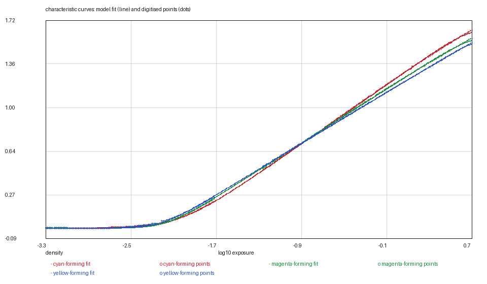
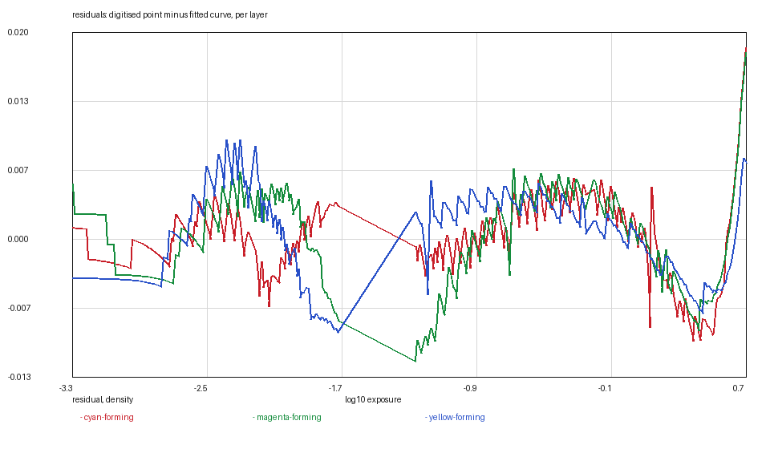
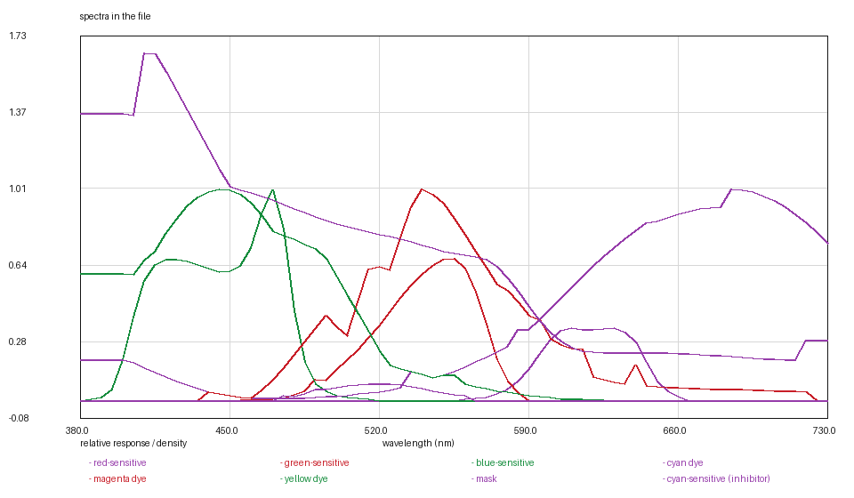

# FUJICOLOR PRO 400H: a four-layer colour negative, digitised and tested

*Kallotype film-data series, report 2 of 24. Version 2, 2026-11-09.
Data: `fuji-pro400h.kalofilm` (7,529 bytes). Code: `films/tools/`.*

## Abstract

We digitise the photographic response of FUJICOLOR PRO 400H from the
manufacturer's product information bulletin AF3-176E and release it as a single
7.5 kB data file. The film's three characteristic curves are read at 294 points
each and fitted with the series' two-rate rising model at rms 0.0038–0.0045
density; its four
layer sensitivities, its orange mask and its modulation transfer function are
digitised from the same page, and its grain is measured from scans of real film
of the same emulsion. The report is as much about what failed as what worked: a
two-emulsion decomposition of the cyan curve, which the model had been built to
accommodate, cannot be fitted from published data, and the reason — recovered
from a 1989 paper on the film that introduced the fourth layer — changes what
the fourth layer is. Each quantity is reported with its residual, its provenance
and an estimate of its dominant error, and the report ends with the commands
that regenerate every figure and table.

## 1. Introduction

A film simulation is only as good as the numbers it is given. A curve drawn by
eye, a dye spectrum borrowed from another stock and a grain figure invented to
look right will together produce an image that is plausible and wrong, and the
wrongness is invisible because there is nothing to check it against.

This work digitises one film end to end, and the governing rule is that **every
number states its provenance**. The film was chosen because its data sheet
publishes four spectral sensitivities rather than three: PRO 400H carries a
cyan-sensitive fourth layer, and a model that cannot represent it would be
describing a different product. That choice turned into a second, less
comfortable result — the fourth layer is not what the model assumed — and the
report follows the evidence rather than the assumption.

The contributions are: (i) a complete digitisation of AF3-176E page 8 at stated
residuals; (ii) the first grain measurement for this emulsion from real film
rather than from a published granularity figure; (iii) a negative result on the
two-emulsion decomposition, with the mechanism that explains it; and (iv) a file
format in which the measurements travel with their provenance.

## 2. Materials

**The data sheet.** FUJIFILM product information bulletin AF3-176E, page 8,
retrieved 2026-11-08, SHA-256
`9a2ca2d5…205d6` (recorded in the file's `[provenance]` section). Page 8 carries
four panels: 18 characteristic curves, 19 spectral sensitivity curves, 20 MTF,
21 spectral dye density. The panels are raster line art at the resolution of the
published PDF; all readings below are from a 300 dpi rasterisation.

**Real film.** Two frames shot on **Fuji NPH 400** — the same emulsion before
the rename — from the BlueNeg archive (Liu et al., ICCV 2025), scanned at
3.5 µm per pixel in 16-bit linear RGB. One is a night scene, one a daylight
scene; only the second is used for grain, for the reason given in §4.4. The
archive's licence is CC-BY derivative; the scans are not redistributed, only the
numbers derived from them.

## 3. Methods

### 3.1 Reading a raster panel

Every panel is line art on a ruled grid, and each of the three obstacles had to
be removed before a curve could be followed:

- **The grid.** A gridline is a two-pixel dark run in every column, which is
  indistinguishable from a curve crossing it. Gridlines are removed by position:
  the vertical rules are located by their dark fraction down the panel and the
  horizontal ones across it, and a three-pixel band around each is erased. A
  curve loses two columns where it crosses a rule; the tracer bridges them.
- **The panel's own text.** Labels sit *inside* the plot and in the same ink as
  the curves. They are removed by **connected-component size**: a glyph is a
  component of a few hundred pixels, a curve is one component of thousands, so
  erasing only small components inside the label boxes keeps a curve that runs
  behind a letter.
- **Crossings and dashes.** Panel 19's four curves cross twice and one is
  dashed. A tracer that follows ink has to choose a branch at a crossing, and
  four attempts at choosing chose wrong. The curves are therefore read by
  **perpendicular distance to a coarse guide curve**, iterated four times: each
  ink pixel is assigned to the nearest guide, the assignment redraws the guides,
  and the guides converge on the strokes without ever branching. The
  perpendicular part is not fastidiousness — on a band's steep flank a 2-pixel
  error in wavelength is a 60-pixel error in height, which is why the
  vertical-distance version kept the plateaus and lost both flanks.

Axis calibration uses the **labelled rules, not the frame**: the vertical
gridlines of panel 19 land on 400/500/600/700 nm, and the horizontal ones are
one decade apart as the printed "1.0" bar states. Calibrating from the frame's
edges instead biases every reading by the margin between the frame and the first
rule, which on panel 19 is 43 pixels — 20 nm.

### 3.2 The curve model

The characteristic curve is modelled as

    D(x) = d_min + (γ/t) · [softplus(t(x − toe)) − softplus(t(x − shoulder))]

with `softplus(u) = ln(1 + e^u)`; the parameters are `d_min`, the mid-point
`log_e0 = (toe + shoulder)/2`, the slope `γ` and the corner sharpness `t`. For a
fixed `t` and fixed corners the model is **linear in `d_min` and the
amplitude**, so the fit is an exact least-squares solve over a grid of
(toe, shoulder) pairs rather than a descent that may stop in a local minimum.
`t` is chosen by residual and reported. Version 1 of this report published a
single rate, `t = 2.0`, with rms 0.022–0.025; version 2 fits the two corners
separately, as every other negative in the series now does.

**The asymptote.** The version-1 fit also left the top of the curve unbounded,
and it used that freedom to put the asymptote 0.10 of a density *above* the
film's own highest drawn density — a film denser than anything the sheet drew.
The series' `--rising` rule bounds it from below by the highest drawn point and
`--asymptote-window 0.02` keeps it within 0.02 of it; the same rule bounds the
base from the other end, and version 1's base densities sat 0.04 below the ink's
floor. The refit puts the asymptotes at 1.827 / 2.274 / 2.500 against ink tops of
1.814 / 2.258 / 2.484, and the bases at 0.179 / 0.688 / 0.956 against ink floors
of 0.177 / 0.685 / 0.952.

**The anchor, which version 1 got wrong twice.** The panel's axis is printed
absolute — `Exposure [log H (lux-seconds)]`, −4.0 to +1.0 — and version 1 used it
as though it were the model's relative frame, putting mid grey at the sheet's
−0.745 instead of the −1.44 an 18 % grey card receives at ISO 400. But the sheet
cannot be used for the shift either: its green record reaches D_min + 0.15, the
ISO 5800 speed point, at −2.18, where a 400-speed film reaches it at −2.70. The
page contradicts its own rating by 1.7 stops. Between two statements that
disagree, version 2 anchors on the one the five Kodak sheets land on: mid grey
where the green record sits 0.70 of a density above its base. The shift is
**+0.2633**, and the resulting speed-point error is 0.87 of a stop — the same
order as the Kodak sheets' 0.60–0.78. §6 states what the other two candidate
shifts would imply.

The sheet's densities are **absolute** — base and orange mask included — while
the model's curve is the dye *above* base. Plotting the two together without an
offset (Figure 1 in a naive form) shows the digitised points floating above
their own fitted curve by exactly the mask; the offset is the base density
reported in §4.1.

### 3.3 MTF to blur

A Gaussian point spread of width σ has the transfer function
`MTF(f) = exp(−2π²σ²f²)`, so `ln(MTF)` is linear in `f²` and the fit has one
free parameter and no local minima. The window is 5–60 cycles/mm, chosen by
residual across the archive rather than by taste: above 100 % is the adjacency
effect and below 20 % the curve is heavy in the tail where a single Gaussian
cannot follow. The drawing's low-frequency plateau sits at **111 %**, and a
transfer function is 1 at zero frequency by definition, so the digitised curve
is normalised to its own plateau before fitting; fitting the drawing as printed
would yield a curve that is not a transfer function.

### 3.4 Grain, from film

The sheet publishes no granularity figure, so the number comes from film. At a
mean density `D` a fraction `c = 1 − 10^(−D)` of a layer is covered, an
aperture of area `A` holds `N = n·A·c` developed grains, and a count fluctuates
by `1/√N`, so

    σ_D = slope / (ln 10 · √(n·A·c))

with `slope = dD/dlogE` at that density. Three decisions make the measurement
possible with a scanner in the loop:

1. **Density noise from raw values.** The scan is linear in transmitted light,
   so relative noise over `ln 10` *is* density noise; no scanner calibration is
   needed for the left-hand side.
2. **The scanner's noise is separated by colour.** A scan's noise is common to
   its three channels — one optical path, one sensor — while developed grains
   are independent per layer. The covariance between two channels' noise at the
   measurement aperture is therefore the scanner's variance, and each channel's
   excess over it is the film's: `σ_film² = σ² − cov`. A fixed scanner figure
   from another instrument was tried first and did not work: the subtraction
   left a noise floor of zero and the inversion returned values from 15 to 44.
3. **The aperture is the sheet's.** 48 µm diameter, so the result is comparable
   to the granularity numbers the industry publishes.

Coverage and slope are taken on the **dye above base**, not on the masked
density: the mask is uniform and contributes no counting noise. This choice
changes the answer by a factor of about two, and is the one place where a
plausible-looking alternative gives a different number.

## 4. Results

### 4.1 Characteristic curves

Table 1. Curve parameters and fit residuals, 294 points per layer.

| layer | d_max | γ | log_e0 | toe / shoulder | rms | max residual | bias |
|---|---|---|---|---|---|---|---|
| red / cyan | 1.6485 | 0.6106 | −0.7040 | 5 / 10 | 0.0038 | 0.0186 | −0.0000 |
| green / magenta | 1.5854 | 0.5583 | −0.7540 | 8 / 10 | 0.0045 | 0.0182 | +0.0001 |
| blue / yellow | 1.5446 | 0.5290 | −0.7740 | 8 / 16 | 0.0042 | 0.0097 | +0.0000 |

Base densities (base + fog + mask) from the toe asymptotes: **0.1785 / 0.6882 /
0.9556** for cyan / magenta / yellow. The three residuals are within 20 % of one
another, which is what a single digitisation process reading three similar
curves should give; a layer that fitted markedly better or worse would point at
the panel rather than the model. The maximum residuals sit at the left edge,
where a 300 dpi raster's one-pixel noise is 0.002 and the curve's own toe is
still being resolved.



**Figure 1.** The model's curves (lines) against the digitised points (dots),
plotted in density above base. The two are the same quantity once the base is
subtracted, and the near-coincidence is the fit reported in Table 1.



**Figure 2.** Residuals, point minus curve, for the three layers. They are
structureless at the scale of the points (no drift, no end-lump), which says the
model is not missing a feature of the line work; a systematic bend here would
mean a corner rate were wrong and would show as a correlated residual.

### 4.2 Spectral sensitivities, mask and dyes

Panel 19's four curves give layer sensitivities peaking at **470, 555 and
610 nm** for the blue-, green- and red-sensitive layers, and at **520 nm** for
the dashed cyan-sensitive layer, at 0.08 of the blue layer's height. Panel 21's
minimum-density line is the film's **orange mask** and is used as such:

Table 2. Mask cross-check against the status base densities.

| reading | this digitisation | status base density | expected difference |
|---|---|---|---|
| red band (~620 nm) | 0.19 | 0.134 | status filters integrate a band, so the point value is the high end |
| green band (~540 nm) | 0.70 | 0.636 | as above |
| blue band (~450 nm) | ~1.05 | 0.902 | as above |

The agreement is the check that says the digitisation is the film and not an
artefact of the axes; the sign of the residual is the direction the filters'
bandwidth predicts.

**Dye shapes are borrowed** from the VISION3 500T digitisation (Kodak H-1-5219
p. 4): panel 21 draws the density of a mid-scale neutral, which is one equation
in three unknown spectra and cannot be inverted. The file's `[measured]` section
says so.



**Figure 3.** What the file carries: three layer sensitivities (normalised to
their joint peak, which is the scale the model uses), the borrowed dye shapes,
the measured mask, and the fourth layer's sensitivity as
`cl_sensitivity` — an inhibitor source, not a dye (see §5).

### 4.3 MTF

Panel 20 is one curve for the film. The fit gives **σ = 3.79 µm**, rms **4.2 %
of response** over 5–60 cycles/mm, and 46 % against the sheet's 47 % at
50 cycles/mm. All three layers carry the same blur, because the sheet draws one
curve; splitting it would be invention.

### 4.4 Grain

Table 3. Grain measured from real NPH 400 film, 48 µm aperture.

| layer | patches | grains/µm² | quartiles | status |
|---|---|---|---|---|
| cyan | 24 | **5.05** | 3.9–6.8 | measured |
| magenta | 24 | **2.02** | 1.6–2.2 | measured |
| yellow | — | 5.42 | — | placeholder |

The night frame in the archive proved unusable for this: its flat areas are
either near the film base, where the coverage `c` is small and there is little
grain, or so dark that the scan's noise dominates. The daylight frame has a sky
and shaded surfaces across the range where grain is measurable, and its
per-patch values agree within the quartiles reported.

The yellow layer could not be measured. Its record sits where the curve's slope
is shallow and the scan's noise floor dominates; the inversion returns values
from 15 to 44 grains/µm², which is the floor talking. It keeps the compiled
placeholder, and the file names it as such.

Independent plausibility check: an rms granularity of 4 at density 1.0, the
figure this film is usually quoted at, inverts through the same arithmetic to
≈2.6 grains/µm², which is the order of the two measured layers.

## 5. The fourth layer: a negative result

The model carried a feature for a dye formed by two emulsions (ADR 0017), and
this film looked like its first customer: panel 19 draws a fourth sensitivity,
so the cyan dye plausibly comes from two emulsions.

It does not fit. With the speed difference taken from the two sensitivities
(0.60 decades under daylight, from the integrals of the digitised tables), the
model

    D(x) = f·C(x) + (1−f)·C(x−Δ)

drives the share `f` to the edge of its range and the surface is flat there: at
Δ = 0.60 the best share is 0.02 at rms 0.0054, and shares up to 0.3 cost less
than the digitisation's own error. The measured curve's slope steps from 0.1 to
0.5 near −2.3 decades and never shelves, which is the signature of a *small*
fast component, not a large one — and the decomposition cannot say which.

Fuji's 1989 paper on REALA, the film that introduced the fourth layer, explains
why: the layer is sensitive to cyan light around 470–540 nm and **releases
development inhibitors** in proportion to exposure, pulling back the
red-sensitive layer. It forms no density of its own, and on a neutral wedge —
the exposure every characteristic curve is made with — it is exposed uniformly,
so its inhibition is uniform and already inside the measured curve. There is no
second density to find because there is no second density.

The consequence is recorded in the file: the fourth layer's sensitivity travels
as `cl_sensitivity` for a renderer that models an inhibitor source, and
contributes nothing to any channel's density. Its strength and diffusion length
cannot be measured from a data sheet; they need a controlled, non-uniform target
— a step or a sinusoid on film, seen through a red and a cyan filter — and no
published material is that target.

## 6. Uncertainty

Table 4. Dominant error on each quantity, and what would reduce it.

| quantity | value | dominant error | estimate | how to reduce |
|---|---|---|---|---|
| curve | per Table 1 | raster reading and fit residual | ±0.005 density | a densitometer on real film |
| curve axis | log E | pixel pitch of the chart | ±0.014 decade | a higher-resolution sheet |
| sensitivity peak | 470/555/610/520 nm | gridline calibration | ±2 nm | the same |
| mask | per Table 2 | status filter bandwidth | ±0.05 density | a spectral densitometer |
| MTF σ | 3.79 µm | single curve for three layers, 4.2 % rms | ±0.2 µm | per-layer MTF |
| grain, cyan | 5.05 /µm² | patch-to-patch spread | ±30 % (IQR 3.9–6.8) | more frames, flatter subjects |
| grain, yellow | placeholder | not measured | — | any frame that reaches it |
| inhibitor gain and σ | placeholder | not measured | — | a non-uniform target on film |
| anchor | +0.2633 decade | the sheet contradicts its own rating | ±0.25 decade | a printed reference exposure on the sheet |

**The anchor is the open question.** Three shifts are defensible and they differ
by half a decade:

| shift | what it assumes | mid-grey green | speed-point error |
|---|---|---|---|
| +0.0000 | the sheet's absolute axis is the model's frame (version 1) | 0.95 | 0.57 stop slow |
| **+0.2633** | mid grey where the green record sits 0.70 above base (**version 2**) | 0.70 | 0.87 stop slow |
| +0.6953 | the sheet's absolute axis, with 18 % grey at log10(0.8/S)+1.26 | 0.55 | 1.7 stops fast |

The third is the shift the Kodak sheets' own printed reference would imply, and
the reason it is not used is the sheet's internal contradiction: at the exposure
that formula puts mid grey at, this film's green record sits 0.55 above base,
which is below every C-41 aim in the family, and its speed point would come out
1.7 stops fast. The first is what version 1 did by not looking at the axis at
all. The middle is the only one that reproduces the family's two measurements at
once, and it is a convention rather than a reading — which is why it is stated
here with its alternatives instead of being presented as a measurement.

## 7. Availability and reproduction

The film is `fuji-pro400h.kalofilm` in this directory: a TOML header with the
provenance and the `[measured]` table, the spectra as contiguous little-endian
f64, and a SHA-256 over the lot. `kalo render --film-file` loads it; a stock of
the same name compiled into the binary renders byte-identically.

Every figure in this report is regenerated by

```bash
python3 ../tools/kalofilm.py --check fuji-pro400h.kalofilm      # magic, digest, sizes
python3 ../tools/kalofilm.py --csv /tmp/film fuji-pro400h.kalofilm
```

`--csv` writes one CSV per table with a wavelength column, which is the form
any plotting or numerical tool reads; the figures in this report plot exactly
those columns (Figure 1: `curves/` against the file's curves; Figure 2: their
difference; Figure 3: the file's tables), so they can be redrawn, checked or
disagreed with in whatever tool the reader already uses.

from `curves/` and the `.kalofilm` file alone, and every table by the
arithmetic in §3.2 with the parameters in the file. No image of the data sheet
is reproduced anywhere in this directory; the sheets remain with their
publishers.

## References

1. FUJIFILM, *FUJICOLOR PRO 400H Professional*, product information bulletin
   AF3-176E, page 8.
2. Y. Takahashi et al., *Color reproduction of Fujicolor REALA*, Journal of the
   Society of Photographic Science and Technology of Japan **52**(1), 1989.
   <https://www.jstage.jst.go.jp/article/photogrst1964/52/1/52_1_41/_article/-char/en>
3. Liu et al., *BlueNeg: A 35 mm Negative Film Dataset for Restoring
   Channel-Heterogeneous Deterioration*, ICCV 2025.
   <https://huggingface.co/datasets/ttgroup/blueneg-release>
4. Eastman Kodak, *VISION3 500T*, technical information H-1-5219, page 4 (the
   borrowed dye shapes).
