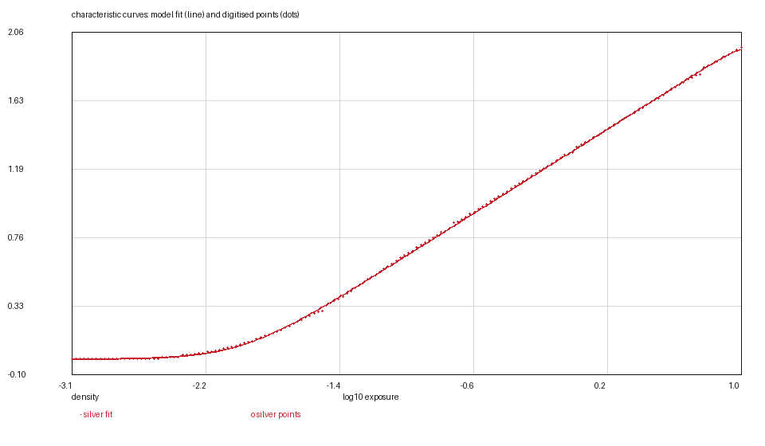
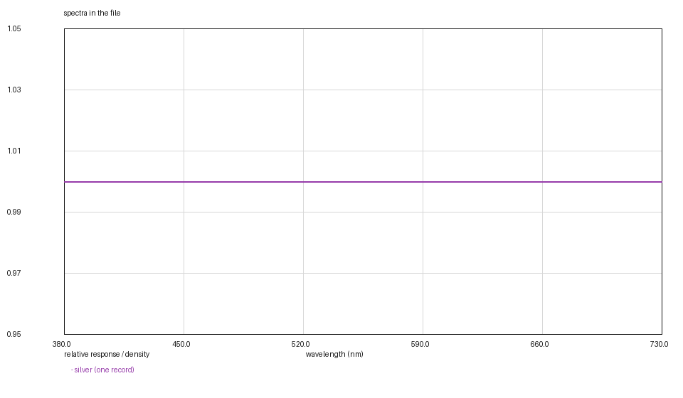

# ILFORD HP5 PLUS: one measurement out of five

*Kallotype film-data series, report 8 of 24. Version 1, 2026-11-08.
Data: `hp5-plus.kalofilm` (5,552 bytes). Code: `films/tools/`.*

## Abstract

We digitise ILFORD HP5 PLUS from HARMAN's technical information of November
2018 — the same document as the Japanese edition of 2023 — and release it as a
5.6 kB data file. It is the first film in this series whose sheet supports one of
the five quantities a `.kalofilm` measures.

**What the sheet has.** One characteristic curve, printed on its fifth page as a
488 × 344 pixel raster: HP5 Plus in ILFOTEC HC (1+31), 6½ minutes at 20 °C,
intermittent agitation. Development tables for every developer ILFORD sells. A
filter-factor table and a reciprocity table.

**What it does not have.** A spectral-sensitivity chart. A modulation-transfer
curve. A granularity figure. Not "we did not find them": the six pages are the
whole document, and the same is true of the Japanese edition, which is a
translation of it page for page.

The curve is read from pixels, so this is the first raster digitisation in the
series since DELTA 400 and the coarsest one yet — one sample per 0.025 decade
from a sheet that draws 0.5 decade per grid cell. Its axis is **relative** log
exposure, with no lux-second scale, which means the anchor cannot be measured the
way TRI-X's was. It is instead the definition of speed: the ISO speed point is
where the curve crosses base + 0.10, and the reference exposure lies 1.26 decades
above it. The curve is placed to satisfy that, and the report says that this is
the one anchor in the series which nothing on the page can contradict.

The fit is γ 0.650 per decade, base 0.177, residual 0.0065 — about a pixel and a
half. The file carries a flat layer response, no blur and the compiled grain
placeholder, and its `[measured]` table says exactly that for each field.

## 1. Introduction

Seven films precede this one, and six of them arrived with a sheet that published
most of what the file wanted: curves, a sensitivity chart, an MTF, a grain
number. TRI-X, the film before this one, had all but one.

HP5 PLUS is the other case. Its technical information is a processing document:
development times, filter factors, fixing and washing. The single chart is the
characteristic curve, and the sheet's own caption is careful about what it is —
"developed in ILFORD ILFOTEC HC (1+31) stock for 6½ minutes at 20 °C with
intermittent agitation" and "this curve is also representative of roll film and
sheet film formats". It says nothing about spectra, sharpness or granularity.

A data format has to answer that honestly. The temptation is to fill the gaps
with the same borrowed numbers the colour negatives use for their dyes, and the
result would be a file that renders plausibly and lies. What this file does
instead is carry the absences as values: a flat sensitivity (which is what
"panchromatic" means at the resolution of claim the sheet supports), no blur at
all, and the compiled grain placeholder declared as a placeholder. Every one of
those is a number in a file; every one is in `[measured]` as what it is.

## 2. Materials

**The data sheet.** ILFORD HP5 PLUS Technical Information, HARMAN technology
Limited, November 2018, six pages, SHA-256 `f06f383d…f037f`. The Japanese edition
(ilford.co.jp, `TDS_HP5PLUS.pdf`, February 2023) is the same document translated:
same page count, same layout, same single chart, and its fifth page still carries
the English "Page 5 of 6 / Nov 2018" footer. The English edition is the one read
here, because its raster is RGB rather than a CMYK conversion.

| printed page | what it holds |
|---|---|
| 1 | the film, its speed, what it is for |
| 2 | filter factors |
| 3 | development times, manual and machine |
| 4 | the same for automated processors, EI 200 to 3200 |
| 5 | **one characteristic curve**, as a raster image |
| 6 | stop, fix, wash, rinse |

**The artwork.** Page 5's chart is a 488 × 344 RGB image placed at 207 × 146 pt.
It is a ten-column, seven-row grid with a single curve drawn through it. There is
no vector path, and no second curve.

## 3. Methods

### 3.1 The curve, from pixels

The grid is the calibration, and it is the sheet's own drawing rather than a
typed-in range. Ten vertical rules sit at x = 8, 53, 98, …, 414 pixels — every
45.1 — and the labels 1, 2, 3 and 4 sit on the 3rd, 5th, 7th and 9th of them, so
one cell is 0.5 of a decade and the frame runs from 0.0 to 4.5. Seven horizontal
rules sit at y = 7, 53, 98, …, 276 — every 44.8 — and the labels 1.0 and 2.0 sit
on the 5th and 3rd counting up from the bottom, so one cell is 0.5 of a density
and the bottom rule is 0.0, the top 3.0.

The rules are one pixel thick and the curve is three, so erasing a one-pixel band
along every rule leaves the curve and nothing else; a column that then holds no
ink is interpolated. The result is 164 samples at 0.025 decade, from relative
0.03 to 4.10 and density 0.178 to 2.135.

This is the coarsest source in the series: DELTA 400's raster had 367 columns,
this one has 407 usable ones but the calibration is a 45-pixel cell and the
stroke is three pixels wide, so the ink's own noise is of the same order as the
fit residual.

### 3.2 The anchor: the definition of speed, and nothing else

Every other film in the series could check its anchor. The Kodak colour sheets
print `Log H Ref`; TRI-X's axis is absolute lux-seconds and its speed point could
be compared with the rating (it is 0.52 of a stop late). This sheet's axis is
**relative log exposure** — the labels are 1, 2, 3, 4 and the caption says
"Relative log exposure" — so there is no absolute scale to compare anything with.

What is left is the definition. ISO 6 places the speed point of a black-and-white
negative at a density of 0.10 above base plus fog, and the reference exposure of
an 18 per cent grey card 1.26 decades above the speed point. On this curve the
0.10 crossing is at relative exposure 1.074, so the curve is shifted by −3.079 to
put that crossing at the model's log10(0.18) − 1.26 = −2.0047.

That is an anchor the page cannot contradict — and it is worth saying plainly
that it is the weakest in the series for exactly that reason. A sheet with an
absolute axis can disagree with its rating and TRI-X's does; this one agrees by
construction.

At 18 per cent grey the curve reads 0.832 of a density above base — higher than
the 0.70 a C-41 negative is balanced for, which is what a black-and-white
negative's longer straight line and steeper γ do to the same standard.

### 3.3 The fit

`--two-rates --rising --asymptote-window 0.02`, the negative's bound, on 164
points. The result is d_min 0.1771, d_max 1.9772 above it, γ 0.6504, rates 5 and
16, residual **0.0065**. On a 488-pixel raster that is about a pixel and a half
of ink, and it is the largest residual in the series for the smallest source.

The curve is monotone over the whole drawn range and the shoulder is outside the
frame, as on every negative; the asymptote is 0.02 above the highest drawn
density, which is the window.

### 3.4 What the file says instead of numbers

- **Layers: flat.** The sheet publishes no spectral-sensitivity chart. A flat
  response across 380–730 nm is what "panchromatic" means at this resolution of
  claim — the film responds to all visible wavelengths — and it is not a
  measurement. DELTA 400, the tree's other ILFORD film, says the same thing for
  the same reason.
- **MTF: none.** No blur is modelled. A film with no point-spread function in
  the model is one that renders infinitely sharp; the alternative was to borrow
  another stock's σ, and a borrowed blur is a number that looks measured.
- **Grain: the placeholder.** The compiled placeholder of 0.62/0.51/0.07 is the
  colour films' default and would tint a silver image, so this file uses its
  average, 0.40, in all three channels — DELTA 400's convention. It is declared
  as a placeholder, not as a measurement.
- **Dyes and mask: none.** A silver image has neither, and the file says so.

## 4. Results

### Table 1 — the characteristic curve

| layer | base (D-min) | d_max | γ /decade | log_e0 | rates | rms |
|---|---|---|---|---|---|---|
| silver | 0.1771 | 1.9772 | 0.6504 | −0.4914 | 5 / 16 | 0.0065 |

The same numbers serve all three channels. `d_max` is above the base: the
absolute asymptote is 0.177 + 1.977 = 2.154, which is 0.02 above the highest
density the raster draws.

### Table 2 — what the sheet does and does not support

| quantity | this file | why |
|---|---|---|
| curve | measured, 164 points, rms 0.0065 | printed page 5 |
| base | measured, 0.1771 | the fit's asymptote under the toe |
| layer sensitivity | flat, declared | the sheet has no sensitivity chart |
| MTF | absent | the sheet has no MTF |
| grain | placeholder 0.40/µm² | the sheet has no granularity figure |
| dyes, mask | none | a silver image has neither |

### Figures






## 5. What is measured and what is decided

Measured: the curve's shape, its base, the corner rates.

Decided:

1. **The anchor.** The ISO definition of the speed point, applied to a relative
   axis. §3.2 says why it is the weakest anchor in the series.
2. **Flat layers.** The only claim the sheet supports.
3. **No blur.** Nothing to fit.
4. **The placeholder grain**, averaged to stay neutral.
5. **The 0.02-density asymptote window**, as on every negative.

## 6. Uncertainty and limits

The raster is the limit. A grid cell is 45 pixels for 0.5 decade, the stroke is
three pixels wide, and the digitised curve therefore carries an uncertainty of
about 0.015 of a decade in x and 0.02 of a density in y — larger than the fit
residual, which is why the residual's 0.0065 should not be read as a measurement
of the fit's quality. It says the fit is as good as the pixels.

The anchor is a definition rather than an observation, so it carries no
uncertainty of its own and no check either. If the drawn curve is not the film
the sheet says it is — if it was drawn for a different ILFOTEC HC dilution, or
for a development that no longer matches the table — nothing in this file would
show it.

Four of the five measured fields are absent, and that is the film's honest
content: a model that refuses a stock because its manufacturer publishes less
than another's would refuse most of the black-and-white catalogue.

## 7. Availability and reproduction

`hp5-plus.kalofilm` carries the header, the tables and a SHA-256;
`kalo render --film-file` loads it. The figures are regenerated from `curves/`
and the file with

```bash
python3 ../tools/kalofilm.py --check hp5-plus.kalofilm      # magic, digest, sizes
python3 ../tools/kalofilm.py --csv /tmp/film hp5-plus.kalofilm
```

`--csv` writes one CSV per table with a wavelength column; the figures in this
report plot exactly those columns, so they can be redrawn, checked or disagreed
with in whatever tool the reader already uses.

The points in `curves/` are in the model's exposure frame — the sheet's relative
log exposure shifted by −3.079 — and carry the sheet's density, base included.
The same 164 points are in all three files.

No image of the data sheet is reproduced in this directory.

## References

1. HARMAN technology Limited, *ILFORD HP5 PLUS Technical Information*, November
   2018, pages 1–6.
2. HARMAN technology Limited, *HP5 PLUS テクニカルインフォメーション*, February
   2023, a translation of the same document.
3. Kallotype, *The `.kalofilm` format, version 1*, `../FORMAT.md`.
4. Kallotype, *KODAK TRI-X 400: one record, and two curves that are not its own*,
   `../trix-400/REPORT.md` — the other silver film, whose sheet publishes four
   of the five fields.
