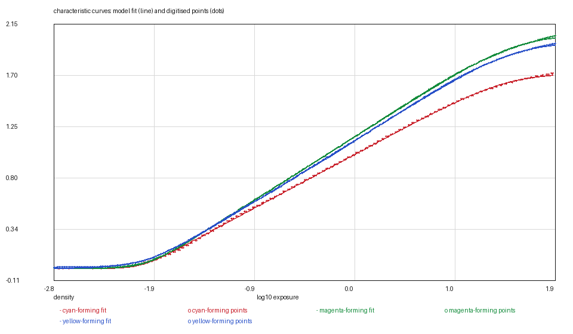
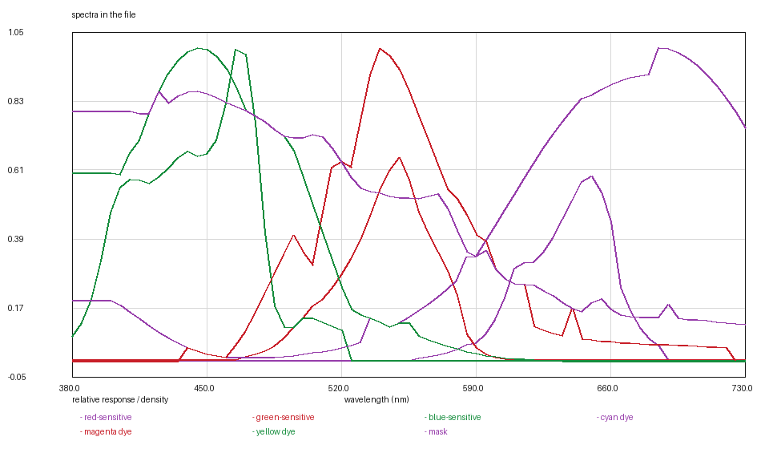

# KODAK VISION3 50D: the dotted curve and the axis that disagrees with its labels

*Kallotype film-data series, report 14 of 24. Version 1, 2026-11-09.
Data: `vision3-50d.kalofilm` (5,737 bytes). Code: `films/tools/`.*

## Abstract

We digitise KODAK VISION3 50D 5203/7203, an ECN-2 daylight cinema negative,
from the five raster charts on pages 3 and 4 of H-1-5203 and release it as a
5.7 kB data file. It is the slowest film in the series and the first cinema stock
in it; its page taught the readers two things no still-film sheet had.

**A dotted curve reads like a line.** The sheet draws the red sensitometric curve
as a dotted stroke and green and blue as solid ones. The tracker reads a dot the
same way it reads a line — a three-pixel run in a column — so red yields **349**
samples where the others yield 538, and its residual, 0.0065, carries that
jitter. The fit is no worse than the drawing.

**A sensitivity axis whose labels do not sit on its ticks.** On page 4 the
printed tick labels (4.0, 3.0, 2.0, 1.0, 0.0) sit about 0.8 unit below the ticks
they name, which puts 0.0 eighty pixels outside the plot box. The ticks and the
gridlines agree with each other and with a 0–4 axis across the frame, so that is
what is used and the numbers are treated as decoration.

The curves are refitted with the series' two-rate rising model (**0.0065 /
0.0042 / 0.0053**), the MTF is **4.53 / 4.41 / 4.26 µm** — the softest of the
three VISION3 sheets — and three of the five modelled quantities are borrowed
from the 500T digitisation: grain, dyes and the mask. The report says what each
borrowing costs and what would end it.

## 1. Introduction

The VISION3 family is the first cinema material in the series, and a cinema
negative is not a still negative with a different name:

- its data sheet is a raster. Every chart, axis number included, is an 8-bit
  image, so each one has to be calibrated from its own frame and rules rather
  than from a text layer;
- its curve has **no shoulder**. The sheet cuts the plot at +8 stops while the
  density is still climbing, so the asymptote is an extrapolation and the report
  has to say so;
- it is *rated* by an exposure index rather than an ISO speed, and its exposure
  axis is in camera stops.

50D is the family's slow daylight stock and the one whose page broke the most
assumptions.

## 2. Materials

**The data sheet.** KODAK VISION3 50D Color Negative Film 5203/7203, publication
H-1-5203, four pages, retrieved 2026-11-08, SHA-256 `17abe14a…20d73`.

| page | chart | used |
|---|---|---|
| 3 | sensitometric curves | curve and base |
| 3 | modulation transfer | σ per layer |
| 3 | rms granularity | not digitised |
| 4 | spectral sensitivity | three layer responses |
| 4 | spectral dye density | read as a check on the shared set |

**The plots.** Five rasters, each with its frame, rules and labels inside the
image. All three films of this family share the layout, and this report names
only 50D's differences; the 250D's report describes the layout itself.

## 3. Methods

### 3.1 The dotted red curve

The tracker follows ink in columns. A solid stroke is a run of about three
pixels; a dotted one is a run of about three pixels every few columns. Nothing
in the algorithm distinguishes them, so the red curve is read as a sequence of
short dashes bridged by interpolation: 349 samples against the others' 538, and
a residual (0.0065) that is the drawing's dot pitch rather than the model's
error. The curve is still complete — the dots lie on the same path — so the fit
is published and the residual is attributed.

### 3.2 The fit, and a shoulder that is not drawn

The model's curve is a trapezoid of two softplus corners. On this sheet the
corner grid cannot find a shoulder inside the data: the ink stops at 1.89 (red) /
2.63 (green) / 2.83 (blue) while the curve is still climbing at the frame's
right edge. The fit therefore puts the asymptote just above the highest drawn
density — the series' `--asymptote-window 0.02` rule — and `d_max` is an
extrapolation of a few hundredths, not a reading.

The two-rate fit gives **0.0065 / 0.0042 / 0.0053** over 349 / 538 / 538 points,
from 0.0119 / 0.0104 / 0.0067 with a single transition. The improvement is
largest in red, which is the dotted curve: the second rate lets the fit follow a
curve whose samples are unevenly spaced.

### 3.3 The anchor: camera stops

The panel's lower axis is **camera stops**, −8 to +8, and the extractor
calibrates from it because it carries seventeen evenly-spaced ticks. The log
exposure axis printed above it disagrees by about 0.15 decade across the frame,
which is what a rounded illustration does; the stops axis is the consistent one.

The model exposes mid grey at log10(0.18) = −0.7447, and the only invariant the
sheets in this series share is the printing aim: a correctly exposed negative
puts its green record about 0.70 of a density above D-min at 18 per cent grey.
The curves are anchored there — shift **+0.5141** — which is the rule PRO 400H
uses and the only one this sheet supports.

The checks follow: at mid grey the three records sit **0.612 / 0.702 / 0.678**
above base (green 0.70 by construction; red and blue inside the still films'
0.55–0.75 band), and the film's speed point lands **0.99 of a stop** slow — the
same direction and order as the Kodak colour sheets' 0.60–0.80. Version 1 of
this report anchored the fitted corner midpoint at mid grey instead, which put
mid grey at 0.88–1.00; that is a convention, and the 0.51-decade difference is
why the family was re-anchored together.

### 3.4 MTF, sensitivity, and the shared dyes

**MTF.** Page 3, one curve per layer on log axes. σ = **4.53 / 4.41 / 4.26 µm**
— the least sharp of the three VISION3 sheets, 4.3–4.5 µm against the 250D's
3.1–4.3. The axis was calibrated from eight of its ten rules (the other two are
missing under the curves) to 0.3 of a pixel, and the difference from its sisters
is the drawing rather than a reading error.

**Sensitivity.** Page 4, three layers, peaks at **650 / 550 / 465 nm**. The
printed tick labels are 0.8 unit below the ticks they name and are ignored; the
ticks and gridlines define a 0–4 axis over the frame and that is what is used.

**Dyes.** Page 4's dye panel was digitised and compared with the compiled 500T
tables: the model carries one dye set for the family and this sheet's agrees with
it to 0.12 of a density and 5 nm. The file borrows the 500T set and says so —
the borrowing is a model decision, not an absent measurement.

**Grain.** Page 3's granularity chart was not digitised: its dashed curves are
too sparse for the dot tracker (83 dots in the whole plot against several hundred
on the 500T sheet), and the one layer that could be tracked came out at
0.16 grains/µm² against the 500T's 0.07 — the right direction for a slower film
and not enough to publish. The grain is the 500T's, declared.

## 4. Results

### Table 1 — characteristic curves

| layer | base | d_max | γ /decade | log_e0 | rates | rms |
|---|---|---|---|---|---|---|
| red | 0.1760 | 1.7192 | 0.4940 | −0.7710 | 10 / 4 | 0.0065 |
| green | 0.5804 | 2.0591 | 0.5817 | −0.7010 | 8 / 4 | 0.0042 |
| blue | 0.8482 | 1.9926 | 0.5661 | −0.7110 | 5 / 4 | 0.0053 |

`d_max` is above the base; the absolute asymptote is `base + d_max`. Residuals
are against the 349 / 538 / 538 points in `curves/`.

### Table 2 — the other measurables

| quantity | value | source |
|---|---|---|
| sensitivity peaks | 650 / 550 / 465 nm | page 4 |
| MTF | σ 4.53 / 4.41 / 4.26 µm | page 3 |
| grain | borrowed: 0.62 / 0.51 / 0.07 | the 500T digitisation |
| dyes | borrowed | the model carries one set; this sheet's agrees to 0.12 |
| mask | borrowed | the 500T's minimum density |

### Figures






## 5. What is measured and what is decided

Measured: the three curve shapes, the layer sensitivities, the MTF, the base.

Decided:

1. **The 0.02 asymptote window**, because the shoulder is outside the frame.
2. **The camera-stops axis** over the log-exposure axis, which disagrees with it.
3. **The ticks over the printed sensitivity labels.**
4. **The printing-aim anchor**, because the sheet prints no reference exposure.
4. **The shared dye set**, after measuring this sheet's own and finding it agrees.
5. **The borrowed grain and mask.**

## 6. Uncertainty and limits

The curves are raster reads: 538 columns for the solid strokes, 349 for the
dotted one, one-pixel quantisation in density. The asymptote is an extrapolation
of hundredths.

The anchor is a decision rather than a reading: the sheet prints camera stops
and no reference exposure, so the curves sit where the printing aim puts them.
§3.3 states the checks that follow — mid grey 0.61–0.70 above base and a speed
point 0.99 of a stop slow — and the three VISION3 films were moved together, so
their relative positions are unchanged.

## 7. Availability and reproduction

`vision3-50d.kalofilm` carries the header, the tables and a SHA-256;
`kalo render --film-file` loads it. The figures are regenerated from `curves/`
and the file with

```bash
python3 ../tools/kalofilm.py --check vision3-50d.kalofilm      # magic, digest, sizes
python3 ../tools/kalofilm.py --csv /tmp/film vision3-50d.kalofilm
```

No image of the data sheet is reproduced in this directory.

## References

1. Eastman Kodak Company, *KODAK VISION3 50D Color Negative Film 5203/7203 —
   Technical Data*, publication H-1-5203, pages 3 and 4.
2. Kallotype, *The `.kalofilm` format, version 1*, `../FORMAT.md`.
3. Kallotype, `films/vision3-250d/REPORT.md` — the family's layout and the
   raster-reading method this report shares.
