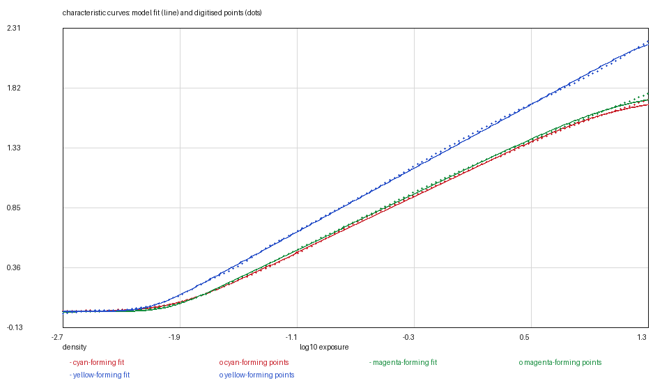

# KODAK PROFESSIONAL EKTAR 100: the sheet that prints its own aim

*Kallotype film-data series, report 9 of 23. Version 1, 2026-11-09.
Data: `ektar-100.kalofilm` (6,319 bytes). Code: `films/tools/`.*

## Abstract

We digitise KODAK PROFESSIONAL EKTAR 100, a C-41 colour negative, from the four
vector panels on page 4 of E-4046 and release it as a 6.3 kB data file. The stock
has been in the tree since the colour-negative survey; this report is the first
that **re-derives** it rather than deriving it, and the difference is three
corrections that the earlier pass could not have known it needed.

**The anchor.** E-4046 prints `Log H Ref: −0.84` above its characteristic panel —
the exposure an 18 per cent grey card receives at EI 100. The stock used to be
anchored by putting the fitted corner midpoint on the model's mid grey, which is
a convention; the printed reference is a measurement, and on this sheet the two
are 0.195 decade apart, 0.65 of a stop. The shift is **+0.0953**.

**The fit.** The old fit put each layer's asymptote below the ink it was fitting
(2.945 against a blue top of 3.073) because the corner grid stopped at the data.
A negative is still climbing at the plot's right edge, so the fit is
`--two-rates --rising --asymptote-window 0.02`: **0.0087 / 0.0103 / 0.0117**, from
0.0216 / 0.0363 / 0.0413.

**The digitisation.** Every curve on this page is built from cubic Bézier
segments — three of them per curve, knots a decade apart — and the reader used to
keep only each cubic's end point, which is a chord through the curve. The green
curve was up to **0.10 of a density** away from its own artwork, and its fitted
base moved by 0.06 when the cubics were sampled. That is the largest digitisation
error the project has found, and it was invisible in the residuals because the
fit was fitting the chord.

**The mask.** The dye panel prints a mid-scale neutral and D-min; the D-min curve
is the model's mask, so the stock carries its own (**0.876** of a density at
440 nm, 0.211 at the red end) instead of borrowing VISION3's. At 18 per cent grey
the green record sits 0.720 of a density above its base, against the 0.70 a C-41
negative is balanced on. Grain is not claimed: the sheet publishes a Print Grain
Index and says the index cannot be compared to rms granularity.

## 1. Introduction

EKTAR 100 was one of the three stocks derived during the colour-negative survey:
curves, sensitivities, MTF, a borrowed mask, an anchor argued from the corner
midpoint. That was the best the tools could do at the time. Three things have
changed since, and this film is the first one small enough to carry all three:

- `fit_stock_curve.py` learned that a negative **rises**, and that the asymptote
  is bounded from below by the highest density the sheet draws (`--rising`);
- the Kodak sheets print their own exposure reference, `Log H Ref`, and the
  survey's five-sheet family rule turns it into an anchor without an assumption;
- the dye panel's D-min curve is a measurement of the mask, not a decoration
  beside the neutral subject.

A fourth change is new here. The three curves on this page are cut into cubic
Bézier segments, and the vector reader had been treating a cubic as a straight
line from its start to its end. On a sheet that draws 3.9 decades with three
cubics, that is not an approximation — it is a different curve.

EKTAR 100 is also the film in the family with the least room for such error: it
is the slowest, the highest-contrast and the finest-grained of the Kodak
negatives, and its curve is the most nearly straight of the five.

## 2. Materials

**The data sheet.** KODAK PROFESSIONAL EKTAR 100 Film, publication E-4046,
revised 2/16 (February 2016), page 4, retrieved 2026-11-08, SHA-256
`e39971d1…5590`. Page 4 carries all four panels; the other three pages carry
exposure tables, a reciprocity table and the Print Grain Index.

**The artwork.** Page 4 is entirely vector: 119 drawing objects, not one embedded
image. The characteristic curves are three paths of 12 to 37 items, some of them
cubics, and the axis numbers are positioned text. No threshold is involved
anywhere below.

| panel | frame (pt) | axes |
|---|---|---|
| characteristic curves | 184 × 184 | log H −3.0…+2.0, density 0.0…4.0 |
| spectral sensitivity | 200 × 151 | 250…750 nm, log sensitivity 0.0…3.0 |
| spectral dye density | 184 × 184 | 400…700 nm, density 0.0…2.5 |
| modulation transfer | 203 × 153 | 1…600 cycles/mm, 1…100 % (both log) |

Calibration comes from the page's own tick labels: 0.02 log units in x and 0.008
of a density in y on the characteristic panel, 0.00 and 0.002 on the MTF panel's
log axes, 0.16 nm and 0.007 on the dye panel. The dye panel's x calibration is
the loosest on the sheet because one wavelength label sits a third of a point
off its tick; 0.16 nm is a fortieth of the model's sample spacing and is not
corrected.

## 3. Methods

### 3.1 Reading a curve that is drawn in cubic segments

`extract_vector_curve.py` walks a path's items in order. Two kinds matter: `l`,
a straight segment, and `c`, a cubic Bézier given by its start, two control
points and its end. The reader used to append the **end point** of a cubic and
move on, on the theory that at a data sheet's scale the bulge between two knots
is smaller than the reading. That theory is false on this page.

The three curves here are built from 3 to 4 cubics and up to 34 straight
segments, so the cubics carry the corners, where curvature is highest and the
chord is farthest from the curve. The reader now evaluates each cubic at twelve
points by De Casteljau and appends all of them; the polyline it hands to the
resampler is then the artwork rather than a polygon through it.

The cost of the old reading, measured against the new one on the same three
paths: the green curve differs by up to **0.106 of a density**, red by 0.019 and
blue by 0.007. It is not noise in the fit — it moved the fitted green base by
0.06, from 0.586 to 0.648, which is the difference between a base below the
ink's floor and a base on it. Five of the nine layers of the three re-derived
films in this batch improved their residual under the new reading and four got
slightly worse: the chord had been flattering some fits and hurting others, and
the new number is the one against the artwork. It is reported either way.

### 3.2 The fit: a negative rises

The model's curve is a trapezoid of two softplus corners. Fitting it means
choosing where the corners are and how sharply each one turns; the two linear
parameters follow exactly for every choice. On reversal sheets the curve **falls**
to a clear-film asymptote that the sheet draws flattening, so that asymptote is
bounded by what a transparent material can be. A negative's curve **climbs**, and
the Kodak sheets all stop drawing while it is still climbing.

The old fit therefore did the only thing it could: it put the asymptote at
1.890 / 2.315 / 2.945, under tops of 1.941 / 2.421 / 3.073, and bought a residual
of 0.02 to 0.04 by refusing to draw the top of the curve. `--rising` reverses the
bound — the asymptote may not sit below the highest drawn density — and
`--asymptote-window 0.02` keeps it within 0.02 of that point, the mirror of the
reversal rule. The residuals become **0.0087 / 0.0103 / 0.0117**.

**How much headroom?** The sheet never draws the shoulder, so the asymptote is
bounded rather than measured. A larger window buys very little:

| window above the drawn top | red | green | blue | rms (r/g/b) |
|---|---|---|---|---|
| 0.02 | 1.957 | 2.440 | 3.093 | 0.0087 / 0.0103 / 0.0117 |
| 0.05 | 1.989 | 2.467 | 3.122 | 0.0079 / 0.0096 / 0.0114 |
| 0.10 | 2.035 | 2.517 | 3.168 | 0.0062 / 0.0080 / 0.0109 |

A tenth of a density of headroom moves the asymptote by 0.08 to 0.09 and the
residual by 0.001 to 0.003, the largest gain of the three films in this batch. It
is still a gain bought by inventing density the sheet does not draw, and the
rule — the model's maximum is the highest density the sheet draws — is worth
more than the residual. The asymptote is the least measured number in the file
and is reported as such, not tuned.

**The corner rates.** The fit chooses 6/4 for red, 10/4 for green and 10/12 for
blue. The shoulder is outside the frame, so its rate and its position trade off
against each other; the report does not claim them as findings.

### 3.3 The anchor: the sheet prints one

Above the characteristic panel is the line

    Exposure: Daylight   Densitometry: Status M   Log H Ref: −0.84

`Log H Ref` is the log exposure an 18 per cent grey card receives at the film's
rated speed. The model exposes mid grey at log10(0.18) = −0.7447, so the sheet's
axis is shifted by **+0.0953** to put its printed reference there. The shift is
one number for all three layers, so relative layer speeds are untouched.

The stock used to be anchored the other way: the fitted corner midpoint was put
at −0.7447, a shift of −0.0997. The midpoint is a property of the fit, not of the
film, and moving it moves the whole curve along the exposure axis. The two
anchors are 0.195 decade apart — 0.65 of a stop — and the printed one is the
measurement.

**The check.** At the anchor the three records sit 0.707, 0.720 and 0.896 of a
density above their fitted bases. A C-41 negative is balanced for a green-record
density of about 0.70 above D-min at 18 per cent grey, and this film reads 0.720.
The anchor is not just defensible; it lands on the printing aim.

**The check that does not close.** At the nominal ISO 100 speed point — 1.26
decades below the reference — the green record reads +0.044 where the standard
asks for +0.10, so the drawn curve reaches the speed point **0.67 of a stop**
later than its rating. It is the sheet's number and not the fit's: PORTRA 400
shows 0.60 and PORTRA 160 0.61. It does not move the anchor, which is the
reference exposure and not the speed point, and the film's rating is not what the
model consumes.

### 3.4 The mask is this sheet's own

The dye panel is headed *Spectral-Dye-Density Curves* and draws two curves,
labelled **Midscale Neutral** and **Minimum Density**. It does not draw three
dyes, and this is the fourth Kodak still-film sheet checked against the family
rule: none of them does. So the dye *shapes* stay borrowed from the VISION3 500T
digitisation, and the file's `[measured]` table says so.

The other half of the panel is a measurement. The model's mask is exactly "the
spectral density of base, fog and the orange mask", which is D-min as a spectrum.
The lower curve is read from 400 to 685 nm — this is the only panel in the family
whose D-min stops short of the frame's right edge — and put on the model's
380–730 nm grid by repeating the end values. `resample_mask.py` applies that rule. It was validated
before it was used here by re-reading PORTRA 400's own D-min from E-4050 and
reproducing that film's shipped mask to 0.0025 of a density; under the cubic
reader of §3.1 the same sheet reads up to 0.015 differently, which is a fact
about the shipped portra-400 file rather than about this one — §6.

The mask runs **0.211 to 0.876**, peaks at 440 nm and is least at 630. Its
extremes agree with the fitted bases (0.217 / 0.648 / 0.873) to 0.01 at the red
and blue ends; the green base sits 0.03 above the mask's value at 545 nm, where
Status M's green weight and the layer's own peak do not fall on the same
wavelength.

### 3.5 Sensitivity, MTF, and the grain that is not there

**Sensitivity.** Three vector curves on a 250–750 nm axis, labelled Yellow-,
Magenta- and Cyan-Forming Layer in place. Stored as `10^log S` on the sheet's own
scale, the peaks are 129.8 at 470 nm (yellow-forming, the blue record), 68.2 at
545 (magenta, green) and 111.7 at 650 (cyan, red). The green record is half the
blue one — the first reading of this panel had normalised each layer to its own
peak, which erased that ratio; the file carries absolute `10^logS` so the ratio
survives.

**MTF.** Three vector curves on log-log axes, fitted as one Gaussian per layer
over 5–60 cycles/mm and 20–100 per cent response: σ = **4.87, 3.67 and 3.49 µm**.
At 50 cycles/mm the model gives 30, 54 and 54 per cent against the sheet's 30, 53
and 54. This is the sharpest film in the series by that measure.

**Grain.** The sheet prints a Print Grain Index table, introduced with the
sentence every Kodak still-film sheet now carries: the index "replaces rms
granularity and has a different scale which cannot be compared to rms
granularity". There is no rms number on the sheet and no way to invert one into
grains per square micrometre. The file says `grain = "placeholder"` and carries
the compiled placeholder, which is the tree's default for a stock that did not
measure it. The alternative — inventing a grain size from the index — is exactly
the kind of number this series exists not to publish. It costs this film more
than the others: "the world's finest-grained colour negative" is the claim on its
own first page, and the model has nothing to say about it.

## 4. Results

### Table 1 — characteristic curves

| layer | base (D-min) | d_max | γ /decade | log_e0 | rates | rms |
|---|---|---|---|---|---|---|
| red | 0.2174 | 1.7396 | 0.5760 | −0.4430 | 6 / 4 | 0.0087 |
| green | 0.6480 | 1.7922 | 0.5744 | −0.4330 | 10 / 4 | 0.0103 |
| blue | 0.8730 | 2.2197 | 0.6529 | −0.4130 | 10 / 12 | 0.0117 |

`d_max` is above the base, as the model's curve is: the absolute asymptote is
`base + d_max`, and 0.873 + 2.220 = 3.093 is the blue curve's ceiling on the
sheet's own axis, against a drawn top of 3.073. Residuals are against the 128
points in `curves/`.

### Table 2 — the other measurables

| quantity | value | source |
|---|---|---|
| sensitivity peaks | 470, 545, 650 nm | page 4, spectral sensitivity |
| MTF | σ 4.87 / 3.67 / 3.49 µm | page 4, MTF, 5–60 cycles/mm |
| mask | 0.876 at 440 nm → 0.211 at 685 | page 4, D-min |
| dyes | borrowed | VISION3 500T digitisation |
| grain | not claimed | page 3, Print Grain Index |

### Figures




## 5. What is measured and what is decided

Measured: the three curve shapes across the drawn range, the layer sensitivities,
the MTF, the mask, and the anchor the sheet prints.

Decided:

1. **The 0.02-density asymptote window.** The model's maximum is the highest
   density the sheet draws, and §3.2 shows what a larger window would cost.
2. **The corner rates.** They are extrapolation beyond the frame, and the report
   does not present them as findings.
3. **The mask's ends.** The panel draws 400–685 nm and the grid runs 380–730; the
   ends repeat rather than extrapolate.
4. **The borrowed dyes.** The sheet prints a neutral and D-min, not three dyes.
5. **The unclaimed grain.** The sheet forbids the conversion.
6. **The blue curve's toe.** Its base is 0.02 above the ink's lowest drawn point,
   because the curve is still falling where the panel stops. `stock check` prints
   that as a note, and it is kept rather than fitted away.

## 6. Uncertainty and limits

The reading is precise — a vector path is the artwork, not a picture of it — but
the artwork is a drawing: the curves are cut into 12 to 37 items, and the
residual wave in `02-residuals.png` follows the knots. The fit cannot do better
than the ink's own segmentation, and the residuals sit at that order.

The asymptote is bounded by a decision, not measured; §3.2 quantifies the
sensitivity. The base densities are that asymptote, so they inherit it: the blue
base is 0.02 above the lowest ink and is the number in the file to look at rather
than an independent reading of D-min.

The Bézier correction moves this film's green base by 0.06 and its green curve by
up to 0.10 of a density. Every stock read before this report was digitised with
the chord reading. The paths of PORTRA 400, TRI-X and the four reversals are
straight-segment polylines and are unaffected; PORTRA 800's and PRO 400H's have
not been re-checked, and re-reading them is outstanding work recorded in the
research log.

The MTF and sensitivity panels were re-read on 2026-11-09 with the reader that
samples cubic Béziers rather than their end points. The MTF moved by at most
**4.1 per cent of response** at its steep ends (1.7 rms) and the sensitivities by
**2.3 per cent of peak** (rms). The MTF figure is the largest any panel moved in
the survey, and it is the size of that fit's own residual (2.0 to 2.9 per cent);
the tables stand unchanged.

## 7. Availability and reproduction

`ektar-100.kalofilm` carries the header, the tables and a SHA-256;
`kalo render --film-file` loads it. The figures are regenerated from `curves/`
and the file with

```bash
python3 ../tools/kalofilm.py --check ektar-100.kalofilm        # magic, digest, sizes
python3 ../tools/kalofilm.py --csv /tmp/film ektar-100.kalofilm
```

`--csv` writes one CSV per table with a wavelength column, and these figures plot
exactly those columns. The points in `curves/` are in the model's exposure frame
— the sheet's log H shifted by +0.0953 — and carry absolute Status M density,
base included; `curves/README.md` states the shift so the fit can be recomputed
from the sheet's own axis if a reader prefers another anchor.

No image of the data sheet is reproduced in this directory.

## References

1. Eastman Kodak Company, *KODAK PROFESSIONAL EKTAR 100 Film*, publication
   E-4046, revised 2-16, page 4.
2. Kallotype, *The `.kalofilm` format, version 1*, `../FORMAT.md`.
3. Kallotype, `films/portra-400/REPORT.md` — the report that first argued the
   printed anchor and the rising fit, and whose §3.4 this report's mask method
   follows.
