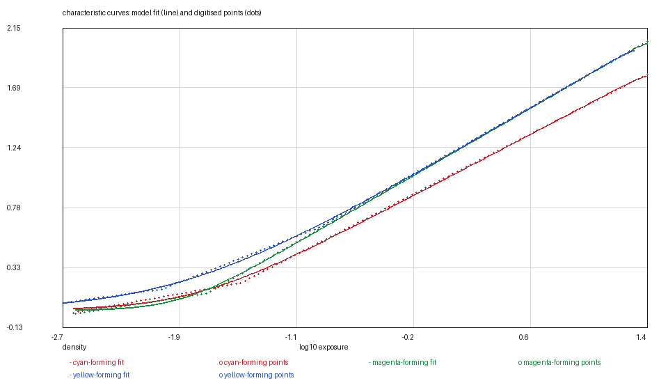
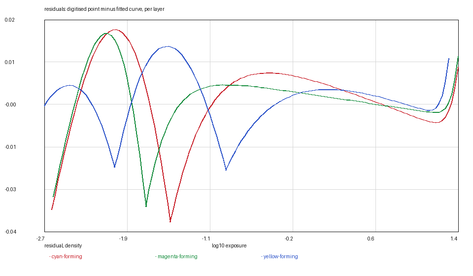
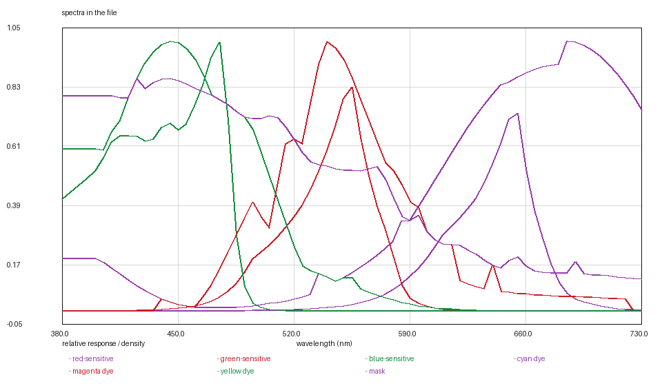

# FUJIFILM 400: the faster sheet, the same two charts

*Kallotype film-data series, report 21 of 22. Version 1, 2026-11-09.
Data: `fuji-400.kalofilm` (5,498 bytes). Code: `films/tools/`.*

## Abstract

FUJIFILM 400 Color Negative Film is the last stock in the catalogue and the
fastest consumer film in the series. Its sheet, AF3-0262E, publishes exactly
what the 200-speed sheet does — characteristic curves and spectral sensitivity
on page 6, a mid-scale neutral instead of three dyes, no MTF and no granularity
figure — so the film is measured in two fields and declares three borrowings.

The curves are fitted at **0.0124 / 0.0096 / 0.0083** over 128 points per layer,
with the two-rate rising model, and anchored on the printing aim at a shift of
**+0.9244** (3.1 stops) from the compiled table's corner-midpoint anchor.

## 1. Materials

**The data sheet.** FUJIFILM 400 Color Negative Film, publication AF3-0262E,
page 6, retrieved 2026-11-08.

**The panel.** Raster curves on a camera-stops axis, read at 128 samples.

## 2. Methods

### 2.1 The fit and the base

| layer | base | d_max | γ /decade | log_e0 | rates | rms |
|---|---|---|---|---|---|---|
| red | 0.1535 | 1.8151 | 0.5780 | −0.1843 | 3 / 16 | 0.0124 |
| green | 0.4028 | 2.0572 | 0.6349 | −0.2393 | 5 / 20 | 0.0096 |
| blue | 0.8052 | 2.0026 | 0.6378 | −0.2794 | 2 / 20 | 0.0083 |

As on FUJIFILM 200, `stock check` notes that the fitted base sits above the
lowest drawn density — 0.1535 against 0.1341 for red — so the model's curve
bottoms at the base and cannot reach that one point. On a 128-sample chart the
base is the least certain number and the note says so.

### 2.2 The anchor

No printed reference, so the printing aim: green at 0.70 above base at mid grey,
shift **+0.9244** (3.1 stops) from the compiled anchor.

### 2.3 What is borrowed

Dyes, mask and blur, for the reasons the 200-speed report gives: a mid-scale
neutral rather than three dyes, no MTF panel, no granularity figure. The grain
is the compiled placeholder.

## 3. Results

### Table 1 — the other measurables

| quantity | value | source |
|---|---|---|
| layer sensitivities | three curves | page 6 |
| dyes | borrowed | the VISION3 500T digitisation |
| mask | borrowed | the 500T's minimum density |
| blur | borrowed | no MTF panel |
| grain | placeholder | no granularity figure |

### Figures







## 4. What is measured and what is decided

Measured: the three curves and the layer sensitivities.

Decided:

1. **The 0.02 asymptote window.**
2. **The printing-aim anchor.**
3. **The three borrowings**, declared in `[measured]`.

## 5. Uncertainty and limits

The residuals (0.008 to 0.012) are at the 128-sample chart's pixel size. The
larger film's curve is steeper and its shoulder shorter than the 200-speed
sheet's, which is visible in the rates: 3/16 for red against 4/20.

Nothing else about this film is unusual; it is the twentieth-first entry in a
series whose last five entries are the consumer stocks — the ones that make the
catalogue a catalogue rather than a collection of flagship films.

## 6. Availability and reproduction

`fuji-400.kalofilm` carries the header, the tables and a SHA-256;
`kalo render --film-file` loads it.

```bash
python3 ../tools/kalofilm.py --check fuji-400.kalofilm
```

No image of the data sheet is reproduced in this directory.

## References

1. FUJIFILM, *FUJIFILM 400 Color Negative Film*, publication AF3-0262E, page 6.
2. Kallotype, `films/fuji-200/REPORT.md` — its slower sibling.
