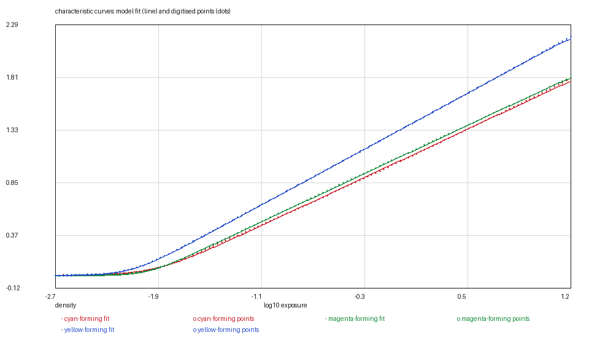

# KODAK PROFESSIONAL PORTRA 400: the negative that rises

*Kallotype film-data series, report 5 of 21. Version 1, 2026-11-08.
Data: `portra-400.kalofilm` (6,268 bytes). Code: `films/tools/`.*

## Abstract

We digitise KODAK PROFESSIONAL PORTRA 400, a C-41 colour negative, from the four
vector panels on page 4 of E-4050 and release it as a 6.3 kB data file. It is the
second negative in this series and the first Kodak one, and it exposed two
defects that no earlier sheet had caught.

**The fit.** `fit_stock_curve.py` was written on reversal sheets, where the curve
falls to a clear-film asymptote that the page draws flattening. A negative's curve
climbs, and all three of E-4050's are still climbing at the right-hand edge of the
plot. The fitter's corner grid stopped at the data, so it had nowhere to put a
shoulder and settled for an asymptote *below* the film's own last measured
density — 1.873 against 2.013 for red — paying 0.042 of a density to refuse to
draw the top of the curve. The defect was already in the tree: the one negative
shipped before this one, PRO 400H, has the same 0.06 of a density missing at the
top of each curve, and it went unnoticed because its residuals looked like its
raster digitisation's. A new `--rising` mode bounds the asymptote from below by
the highest drawn density and lets the shoulder sit outside the frame. The
residual falls to **0.0072, 0.0029 and 0.0037** for red, green and blue.

**The mask.** The sheet's dye panel prints two curves, a mid-scale neutral and
D-min, and Kodak's still-film sheets never publish three dyes — which is why this
film's dye shapes are borrowed. But D-min *is* the model's mask, so the stock now
carries its own orange mask (**0.70** of a density at 380 nm, 0.20 at 650)
instead of the VISION3 spectrum that every other negative in the tree borrows —
PRO 400H is the exception, and it got there first. Reading it exposed a
disagreement between the two generators: the compiler gave a negative without a
measured mask the VISION3 table while the packer wrote none at all, so a file and
the binary would have rendered different films on the spectral path.

The anchor is the sheet's printed `Log H Ref: −1.44`. At the exposure an 18 per
cent grey card receives at ISO 400, the green record sits **0.705** of a density
above D-min — which is where a C-41 negative is balanced. Grain is not claimed:
the sheet publishes a Print Grain Index and says in so many words that the index
cannot be compared to rms granularity.

## 1. Introduction

The series has one negative already — FUJICOLOR PRO 400H — and four charts'
worth of reversal habits in the tools. A negative is not a reversal with the sign
flipped, and the differences are the whole of this report:

- its curve **starts** at base plus fog and climbs, and the sheet stops drawing
  while it is still climbing;
- its image is not the picture but the thing the picture is printed from, so its
  base density — base, fog and the orange mask — is a spectrum the enlarger sees,
  not a constant to subtract;
- its dye panel does not print three dyes. Kodak's still-film sheets print a
  mid-scale neutral subject and D-min, and the second of those is usable.

PRO 400H had already proved the last two points on a Fuji sheet. What PORTRA 400
adds is a cleaner test of the first, and a Kodak sheet's own statements about all
three.

Its sheet is the plainest object in the archive: four panels, all vector, no
raster, no masking, no colour cast to strip. What makes it worth a report is that
its geometry is the opposite of every curve the tools had seen.

## 2. Materials

**The data sheet.** KODAK PROFESSIONAL PORTRA 400 Film, publication E-4050,
revised 2-16 (February 2016), page 4, retrieved 2026-11-08, SHA-256
`e83ac677…97e3a`. Page 4 carries all four panels. The other three pages carry
exposure tables, a reciprocity table and the Print Grain Index.

**The artwork.** This sheet is entirely vector: 121 drawing objects on page 4,
not one embedded image. The curves are ordinary PDF polylines of 37 to 39
segments at a stated stroke width, and the axis numbers are positioned text. The
digitiser therefore reads the chart rather than a picture of it, and no threshold
is involved anywhere below.

| panel | frame (pt) | axes |
|---|---|---|
| characteristic curves | 218 × 216 | log H −4.0…+1.0, density 0.0…4.0 |
| spectral sensitivity | 200 × 151 | 250…750 nm, log sensitivity 0.0…4.0 |
| spectral dye density | 219 × 220 | 400…700 nm, density 0.0…2.5 |
| modulation transfer | 237 × 198 | 1…200 cycles/mm, 1…200 % (both log) |

Calibration comes from the page's own tick labels: 0.02 log units in x and 0.008
of a density in y on the characteristic panel, 0.27 nm and 0.005 on the
sensitivity panel, 0.01 and 0.007 on the dye panel, and 0.0024 and 0.0066
decades on the MTF panel's two log axes. The curve residuals (0.003–0.007) sit
at or below the 0.008 of a density that the y calibration can resolve, so the fit
is as close to the drawn line as the numbers can say; the MTF residual (2.4 to
4.9 per cent) is above its 1.5 per cent calibration and is the fit's, not the
reading's.

## 3. Methods

### 3.1 Reading three polylines that are already separate

This is the easiest characteristic panel in the series. PROVIA's three curves are
separate ink plates, EKTACHROME's are vector paths on one plate, VELVIA's are
drawn on top of one another and have to be told apart by the order of the ink.
E-4050's are three separate polylines inside one frame, labelled **B, G and R**
in place at their low-exposure ends, and the order of the labels is the order of
the curves at every exposure: blue on top (minimum density 0.865), green in the
middle (0.651), red at the bottom (0.217). No tracker is needed and no label has
to be inferred; the three paths are the three curves.

Each path is resampled to 128 points along its own length, which is what makes
the three files comparable column by column. The frame runs from log H −4.0 to
+1.0; the ink runs from −3.39 to +0.55, and the files stop where the ink does.
Nothing is extrapolated in `curves/`.

### 3.2 The fit: a negative rises

The model's curve is a trapezoid made of two softplus corners, and fitting it
means choosing where the corners are. `fit_stock_curve.py` searches a grid of
corner positions and solves the two linear parameters exactly for each. On the
four reversal sheets the curve *fell* to an asymptote, and that asymptote had to
be kept near the clear film's density: an unconstrained fit walked it down to
−0.05 on EKTACHROME E100, a film transmitting more than everything. The one
earlier negative, PRO 400H, was fitted by the same code and came out 0.06 of a
density low at the top of each curve — small enough to hide inside a raster
digitisation's residuals, and never diagnosed.

A negative's geometry is the mirror image, and the fitter did not know it. Two
things were wrong:

1. **The corner grid stopped at the data.** `fit_film` searched corners between
   `x.min()+0.1` and `x.max()−0.4`, which is right for a paper whose shoulder is
   inside the frame and wrong for a film whose shoulder is past the right edge.
   The only way to fit a still-climbing curve with the shoulder inside the data
   is to flatten it early.
2. **The asymptote had no lower bound.** Least squares is free to put the
   plateau under the highest measured point, and it did: the red curve's
   asymptote came out at 1.873 while the sheet draws the same curve to 2.013. A
   negative cannot be denser than its own maximum, and the fit was 0.17 of a
   density low at the last point.

`--rising` fixes both: the corner grid already reaches past the data in
`fit_two_rates`, and the asymptote is now bounded below by the highest drawn
density. `--asymptote-window 0.02` then keeps it within 0.02 of that point — the
mirror of the reversal rule. The model's maximum density is the highest density
the sheet draws, and no more.

The residual falls from **0.0420 / 0.0354 / 0.0457** to **0.0072 / 0.0029 /
0.0037**. That is not a tuning gain: the old fit was fitting the wrong shape,
and the systematic +0.17 it left at the top of each curve was the film being
denied its own density.

**How much headroom?** The sheet never draws the shoulder, so the asymptote is
not measured — it is bounded. Allowing it more room above the drawn top buys
almost nothing:

| window above the drawn top | red | green | blue | rms (r/g/b) |
|---|---|---|---|---|
| 0.02 | 2.032 | 2.478 | 3.057 | 0.0072 / 0.0029 / 0.0037 |
| 0.05 | 2.054 | 2.500 | 3.095 | 0.0070 / 0.0028 / 0.0030 |
| 0.10 | 2.110 | 2.556 | 3.146 | 0.0069 / 0.0028 / 0.0028 |
| 0.20 | 2.211 | 2.647 | 3.237 | 0.0069 / 0.0027 / 0.0027 |

A fifth of a density of headroom moves the rms by 0.001 and the asymptote by 0.2.
The asymptote is the least measured number in the file, and it is reported as
such rather than tuned.

**The corner rates are the second-least measured numbers.** The fit chooses
6/20 for red, 10/20 for green and 8/20 for blue — all three shoulders at the top
of the rate grid. That is not a discovery about the film: the shoulder is outside
the frame, so its rate and its position trade off against each other and the data
barely distinguishes them. Raising the ceiling to 40 buys 0.0004 of rms for red
and less for the others; the drawn part of the curve is insensitive to it. The
rates are kept at the grid's top and the report says why.

### 3.3 The anchor: the sheet prints one

Every previous stock in the series had its anchor argued from first principles.
This sheet prints it. Above the characteristic panel is the line

    Exposure: Daylight   Densitometry: Status M   Log H Ref: −1.44

`Log H Ref` is Kodak's name for the log exposure an 18 per cent grey card
receives at the film's rated speed, and the five Kodak sheets in the archive obey
one relation: `Log H Ref = log10(0.8 / S) + 1.26`. For S = 400 it gives
−1.4398 against the printed −1.44; the same relation predicts −0.84 for
EKTAR 100, −1.14 for GOLD 200 and −1.74 for PORTRA 800, which is what those
sheets print.

The model exposes mid grey at log10(0.18) = −0.7447, so the sheet's axis is
shifted by **+0.6953** to put its printed reference exposure there. The shift is
one number for all three layers, so relative layer speeds are untouched.

**The check.** At that exposure the three records sit 0.657, 0.705 and 0.882 of a
density above their minima (red, green, blue). A C-41 negative is balanced for a
green-record density of about 0.70 above D-min at 18 per cent grey — the number a
printer's aim is built on — and the sheet's own curve gives 0.705. The anchor is
not merely defensible; it lands on the photographic aim.

**The check that does not close.** At the nominal ISO 400 speed point (log H =
−2.70, 1.26 decades below the reference exposure) the green record reads +0.045
where the standard asks for +0.10. The drawn curve therefore reaches the speed
point 0.18 decade — 0.60 of a stop — later than its rating. This is
the sheet's and not the fit's — it is the same +0.044 the first pass through this
page found. It does not move the anchor, because the anchor is the reference
exposure and not the speed point; nor does it justify a speed correction, because
the film's rating is not what this model consumes.

**Where the other negatives stand.** The four negatives already in the tree were
anchored by putting the fitted corner midpoint at log10(0.18) rather than on a
printed reference. On this sheet, with the corrected fit, that convention would
put mid grey 0.38 decade further up the curve: the green record would read 0.91
of a density above D-min where the printing aim is 0.70, because a fit whose
shoulder sits inside the frame has a lower corner midpoint — §3.2 seen from the
anchor's side. The four are left as they are in this report; re-anchoring them is
outstanding work, and it wants the corrected fit first.

### 3.4 The dye panel: two curves, and one of them is the mask

The panel is headed *Spectral-Dye-Density Curves* and draws two curves, labelled
**Midscale Neutral** and **Minimum Density**. It does not draw three dyes, and
this is the third Kodak still-film sheet to be checked against the family rule
(E-4050, E-4046, E-7022): none of them does. So the dye *shapes* stay borrowed
from the VISION3 500T digitisation, and the file's `[measured]` table says so.

The other half of the panel is a measurement. The model's mask is exactly "the
spectral density of base, fog and the orange mask" — D-min, as a spectrum — and
that is the lower curve. It is read from 400 to 700 nm at 5 nm and put on the
model's 380–730 nm grid by repeating the end values (the panel has no ink for the
twenty nanometres at either end; the file says so).

The curve was re-read on 2026-11-09, when the vector reader learned to sample
cubic Béziers instead of their end points: the mask moved by at most 0.015 of a
density (at 405 nm, where the drawn span begins) and by 0.003 rms, and the
numbers below are the re-read ones.

The result is a mask that differs from the borrowed VISION3 one by 0.059 of a
density on average and by 0.121 at the largest:

| nm | 400 | 450 | 500 | 550 | 600 | 650 | 700 |
|---|---|---|---|---|---|---|---|
| PORTRA 400 | 0.697 | 0.826 | 0.770 | 0.613 | 0.248 | 0.204 | 0.230 |
| VISION3 500T | 0.800 | 0.857 | 0.717 | 0.524 | 0.295 | 0.187 | 0.134 |

The film's own base is flatter through the green (0.826 against 0.857 at 450 nm,
0.770 against 0.717 at 500) and higher at the red end (0.230 against 0.134 at
700). Which of the two is the better mask is not a question this report can
answer: a mask is only right in combination with the dyes it was drawn for, and
the model's dye set is VISION3's. What the measurement does say is that the two
spectra are not interchangeable, and that the file now ships the film's own. The
scalar path never sees the mask — it uses the three Status M base densities — so
this changes the spectral print only.

**The disagreement it exposed.** A stock without a measured mask used to get
different treatment from the two generators. `compile_stocks.py` gave any
negative without a `mask` entry the compiled VISION3 table; `pack_film.py` wrote
no mask table at all and stamped the file `mask = "none"`. A `.kalofilm` for
EKTAR 100, GOLD 200 or PORTRA 160 would therefore have rendered a different film
from the binary of the same name on the spectral path. No test could have caught
it: the only negative ever packed was PRO 400H, whose mask is measured, so the
fallback was never exercised. The packer now makes both fallbacks the compiler
makes — the mask and the grain placeholder — and the test that holds files to
their compiled stocks now lists all five films. It had listed three, and
VELVIA 50 was not among them. PORTRA 400 itself needs neither fallback: it has a
measured mask, and its grain is the placeholder by the route §3.5 describes.

### 3.5 Sensitivity, MTF, and the grain that is not there

**Sensitivity.** Three vector curves on a 250–750 nm axis, labelled
Yellow-, Magenta- and Cyan-Forming Layer in place. The sheet draws each one only
across its own band — 378–518, 388–598 and 488–678 nm — and each falls by nearly
two decades at its long-wavelength edge, which is the sharp cut-off a colour
negative's layer has. Stored as `10^log S` on the sheet's own scale, the peaks
are 410.7 at 410 nm (yellow-forming, the blue record), 349.7 at 550 (magenta,
green) and 407.5 at 650 (cyan, red).

**MTF.** Three vector curves on log-log axes, labelled R, G and B at their ends,
calibrated from the page's own ticks. Fit to one Gaussian per layer over 5–60
cycles/mm and 20–100 per cent response: σ = **4.45, 3.42 and 3.11 µm**, rms 4.9,
2.4 and 2.9 per cent. At 50 cycles/mm the model gives 37, 60 and 63 per cent
against the sheet's 39, 60 and 63. Between 5 and 20 cycles/mm the drawn curves
rise above 100 per cent — the adjacency effect — and a single Gaussian cannot
express a rise, so the fit uses the falling part and the report says so.

**Grain.** The sheet prints a Print Grain Index table — 37, 59 and 89 for 4×6,
8×10 and 16×20 prints from 135, at 4.4×, 8.8× and 17.8× — and introduces it with
a sentence no other sheet in the archive has:

> The Print Grain Index number refers to a method of defining graininess in a
> print made with diffuse-printing illumination. It replaces rms granularity and
> has a different scale which cannot be compared to rms granularity.

There is therefore no rms granularity number on this sheet, and no way to invert
one into grains per square micrometre. The file says `grain = "placeholder"` and
carries the compiled placeholder, which is the tree's default for a stock that
did not measure it. The alternative — inventing a grain size from the Print Grain
Index — is exactly the kind of number this series exists not to publish.

## 4. Results

### Table 1 — characteristic curves

| layer | base (D-min) | d_max | γ /decade | log_e0 | rates | rms |
|---|---|---|---|---|---|---|
| red | 0.2170 | 1.8150 | 0.5602 | −0.3102 | 6 / 20 | 0.0072 |
| green | 0.6506 | 1.8269 | 0.5604 | −0.3602 | 10 / 20 | 0.0029 |
| blue | 0.8650 | 2.1916 | 0.6484 | −0.4202 | 8 / 20 | 0.0037 |

`d_max` is above the base, as the model's curve is: the absolute asymptote is
`base + d_max`, and 0.217 + 1.815 = 2.032 is the red curve's ceiling on the
sheet's own axis. Residuals are against the 128 points in `curves/`.

### Table 2 — the other measurables

| quantity | value | source |
|---|---|---|
| sensitivity peaks | 410, 550, 650 nm | page 4, spectral sensitivity |
| MTF | σ 4.45 / 3.42 / 3.11 µm | page 4, MTF, 5–60 cycles/mm |
| mask | 0.697 at 400 nm → 0.204 at 650 → 0.230 at 700 | page 4, D-min |
| dyes | borrowed | VISION3 500T digitisation |
| grain | not claimed | page 3, Print Grain Index |

### Figures




## 5. What is measured and what is decided

Measured: the three plateaus, the three speeds, the curve shapes across the
drawn range, the layer sensitivities, the MTF and the mask. The anchor is the
sheet's own printed number, and the shift that follows from it is arithmetic.

Decided:

1. **The 0.02-density asymptote window.** The sheet does not draw the shoulder;
   the model's maximum is the highest density the sheet draws, and §3.2 shows
   what a larger window would cost.
2. **The shoulder rates at the grid's top.** They are extrapolation, not
   measurement, and the report says so instead of presenting 20/20/20 as a
   finding.
3. **The mask's ends.** The panel draws 400–700 nm and the model's grid runs
   380–730; the ends repeat rather than extrapolate.
4. **The borrowed dyes.** The sheet prints a neutral and D-min, not three dyes.
5. **The unclaimed grain.** The sheet forbids the conversion.
6. **The residual at the top of each curve.** Reported, not fitted away with a
   larger asymptote window.

## 6. Uncertainty and limits

The reading is precise: a vector path is the artwork, not a picture of it, and
the number the file carries is the path's own coordinates. The 0.02 log units and
0.008 of a density that the calibration reports come from where the tick labels
sit, not from the curves. The curves are stroked at 0.96 pt, which on this panel
is 0.018 of a density, but the path is the stroke's centreline — the width is the
ink's, not the reading's.

The fit residuals, 0.0072 / 0.0029 / 0.0037, are of the calibration's order. What
is *not* of that order is the asymptote: it is bounded by a decision, and the
table in §3.2 shows that moving it by 0.2 of a density changes the fit by 0.001.
The model clips at that asymptote; nothing in the sheet says where clipping
really begins.

The speed check (§3.3) is a third of a stop out and is left out. The four
negatives already in the tree use a different anchoring convention, and on this
sheet it would sit mid grey 0.38 decade higher; that is a known inconsistency in
the tree and not a property of this film. Both are recorded here rather than
smoothed over.

On the spectral path the film now carries its own base. The scalar path still
uses the three Status M densities, and those are the fit's asymptotes under each
toe — 0.217 / 0.651 / 0.865 — not independent measurements.

The MTF and sensitivity panels were re-read on 2026-11-09 with the reader that
samples cubic Béziers rather than their end points. The MTF moved by at most
**1.8 per cent of response** (1.1 rms) and the sensitivities by **1.4 per cent of
peak** (rms), both below those panels' own fit residuals (2.4 to 4.9 per cent)
and at the calibration's order; the tables stand unchanged.

## 7. Availability and reproduction

`portra-400.kalofilm` carries the header, the tables and a SHA-256;
`kalo render --film-file` loads it. The figures are regenerated from `curves/`
and the file with

```bash
python3 ../tools/kalofilm.py --check portra-400.kalofilm      # magic, digest, sizes
python3 ../tools/kalofilm.py --csv /tmp/film portra-400.kalofilm
```

`--csv` writes one CSV per table with a wavelength column, which is the form any
plotting or numerical tool reads; the figures in this report plot exactly those
columns (Figure 1: `curves/` against the file's curves; Figure 2: their
difference; Figure 3: the file's tables), so they can be redrawn, checked or
disagreed with in whatever tool the reader already uses.

The points in `curves/` are in the model's exposure frame — the sheet's log H
shifted by +0.6953 — and carry absolute Status M density, base included. The
shift is stated in `curves/README.md` so the fit can be recomputed from the
sheet's own axis if a reader prefers another anchor.

No image of the data sheet is reproduced in this directory.

## References

1. Eastman Kodak Company, *KODAK PROFESSIONAL PORTRA 400 Film*, publication
   E-4050, revised 2-16, page 4.
2. Kallotype, *The `.kalofilm` format, version 1*, `../FORMAT.md`.
3. Eastman Kodak Company, *KODAK PROFESSIONAL EKTAR 100 Film*, publication
   E-4046 (the second sheet confirming that the dye panel is neutral + D-min).
