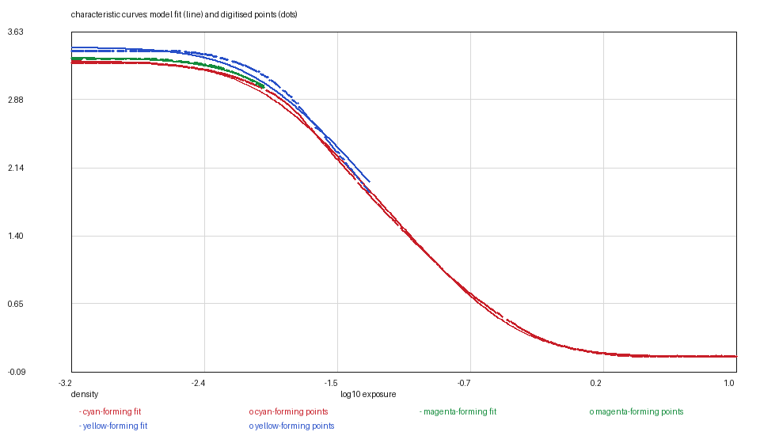
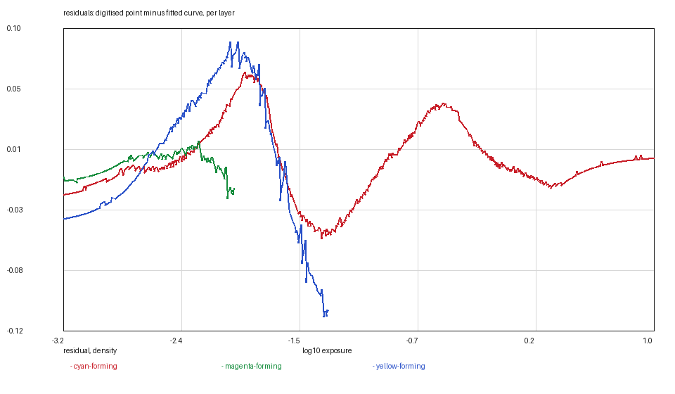
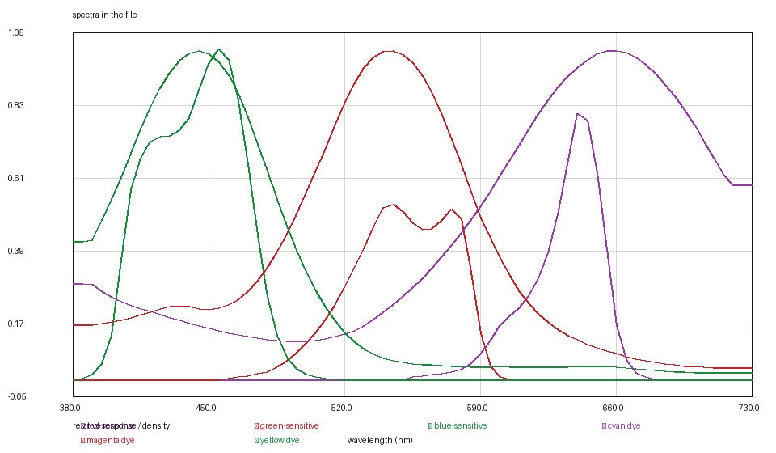

# FUJICHROME PROVIA 100F: a colour reversal, digitised from vector artwork

*Kallotype film-data series, report 1 of 4. Version 1, 2026-11-08.
Data: `provia-100f.kalofilm` (5,444 bytes). Code: `films/tools/`.*

## Abstract

We digitise FUJICHROME PROVIA 100F, an E-6 colour reversal film, from the
manufacturer's bulletin AF3-036E and release it as a single 5.4 kB data file.
Unlike every other sheet in this project's archive, its panels are vector
artwork, so the three layer sensitivities are read from their stroked Bézier
paths rather than tracked through a raster: peaks at 455, 543 and 642 nm. The
characteristic curves are three separate ink plates that overlap for most of
their length, which is why one layer's fit residual is five times another's; we
report the decomposition that causes it rather than smoothing it away. The three
dye spectra are the sheet's own — the only film here whose are — the MTF fits a
Gaussian at σ 4.68 µm, and the grain is inverted from the sheet's published rms
granularity of 8 through counting statistics. Every figure and table can be
regenerated from the shipped points and the data file.

## 1. Introduction

A reversal film is the simplest photographic system to model and the hardest to
excuse: there is no negative, no paper and no printer between the exposure and
the eye. The slide's density is absolute — about 3.3 in an unexposed frame, 0.08
in clear film — and every number in the model is therefore observable to a
densitometer without a chain of inferences.

This film was digitised first for a second reason: its dyes are printed on the
sheet as three separate plates. Most negative sheets publish the density of a
mid-scale neutral subject instead, which is one equation in three unknown
spectra and forces a model to borrow another stock's dye shapes. Here the
primary colours are measured, so what the model prints with is what the film was
made of.

The report describes how each panel was read, what the fit cost, and where the
numbers are weaker than they look.

## 2. Materials

**The data sheet.** FUJIFILM product information bulletin AF3-036E, page 6,
retrieved 2026-11-08, SHA-256 `e28d54e7…de8`. The page carries the
characteristic curves, the spectral sensitivity curves, the dye density curves
and the modulation transfer curve.

**A note on the artwork.** The panels on this page are vector paths rendered
into the PDF, not a scanned raster. That matters: a stroked Bézier path is read
by following the path, not by guessing where a 2-pixel dark run is, and the
resulting sensitivity tables carry no tracking error.

## 3. Methods

### 3.1 Curves from three ink plates

The characteristic curves are drawn as three overprinted inks. The red plate is
complete; the green and blue plates coincide with it over most of the curve's
length, and where two inks overprint, the darker one wins and the lighter one's
centre is lost. The reading is therefore **not** three independent tracings:

- the red curve is digitised in full (768 points);
- the green and blue curves are read where their plates separate from red, and
  elsewhere carry the red layer's *shape* with their own measured offsets
  (183 and 320 points).

The residuals in Table 1 are the cost of that choice, and they are not uniform:
0.009 for green, whose plate separates early, against 0.051 for blue, whose
plate is overprinted through the shoulder. A report that quoted one residual for
"the curves" would be hiding the only interesting number on the page.

### 3.2 The curve model

    D(x) = d_min + (γ/t) · [softplus(t(x − toe)) − softplus(t(x − shoulder))]

For fixed `t` and corners the model is linear in `d_min` and the amplitude, so
the fit is an exact least-squares solve on a grid of corner pairs, not a descent.
`t = 4.0` for this film, and the grid with `t` free was checked against it: the
reported rms is what the wider grid gives.

A reversal's `d_min` is the density of the unexposed slide (about 3.3) and its
`d_max` is clear film, which is the reverse of a negative's convention. The file
states both, and `FORMAT.md` says why.

### 3.3 Sensitivities from vector paths

The layer sensitivities are read at 5 nm from the stroked paths: the
blue-sensitive layer peaks at 455 nm and 1.09 decade, the green at 543 and 0.82,
the red at 642 and 1.00. Two conventions matter.

- **Outside a drawn path the response is a floor**, one decade below that
  layer's minimum, not zero and not an extrapolation. A path stops where the
  layer stops responding; a slope continued for fifty nanometres would invent a
  response the sheet does not show.
- **The three tables share a scale.** The model divides them by their joint
  peak, which is the scale on which their *relative speeds* live; normalising
  each to its own peak would assert that the three layers are equally fast.

### 3.4 MTF to blur

`ln(MTF)` is linear in `f²` for a Gaussian point spread, so the fit is exact with
one free parameter. Window 5–60 cycles/mm, chosen by residual; above 100 % is
the adjacency effect and below 20 % the tail a single Gaussian cannot follow.

### 3.5 Grain from a published rms

The sheet prints a diffuse rms granularity of 8 at a 48 µm aperture. With
`c = 1 − 10^(−D)`, `N = n·A·c` and `σ_D = slope/(ln 10 √N)`, the number
inverts to `n = 3.95` grains/µm².

**`slope` is the local one, at the density the sheet measured**, and the first
release of this file got that wrong: it used `gamma`, 2.08 per decade, and
reported 6.17. On a negative density 1.0 sits in the straight line, so the
shortcut is right there. On a reversal it is 71 % of the way from the unexposed
top to the clear bottom — on the shoulder — where this film's slope is 1.71,
1.69 and 1.60 per decade per layer, mean 1.67. Gamma overstated the density
change per decade at that point by a quarter, and since `n` goes as the square,
the count came out half again too low. EKTACHROME E100 found this; the same
correction is here.

What remains weak is the assumption: Poisson grains, and a published figure that
is a density noise rather than a visual grade. It is reported as an inversion,
not a measurement.

## 4. Results

Table 1. Curve parameters and fit residuals.

| layer | d_min | d_max | γ | log_e0 | t | points | rms | max residual |
|---|---|---|---|---|---|---|---|---|
| red / cyan | 3.3124 | 0.0787 | 2.0838 | −1.2296 | 4.0 | 768 | 0.0254 | 0.0659 |
| green / magenta | 3.3474 | 0.1137 | 2.0838 | −1.1796 | 4.0 | 183 | **0.0090** | 0.0270 |
| blue / yellow | 3.4624 | 0.2287 | 2.0838 | −1.2596 | 4.0 | 320 | **0.0507** | 0.1132 |

The three curves share one slope, which is what a manufacturer draws for a
neutral dye set; the offsets in `d_min` and `log_e0` are the three layers'
different speeds and the toe densities of an unexposed slide.



**Figure 1.** Fitted curves (lines) and digitised points (dots). The blue layer's
departure from its points near the shoulder is the overprinted-plate cost of
Table 1, not a fitting artefact: it is visible here because the figure is drawn
at the resolution of the residual, not of the page.



**Figure 2.** Residuals per layer. Green is flat to ±0.01 over the whole range;
blue drifts in the shoulder, exactly where its plate is buried under red's. The
figure is the evidence for the decomposition claim in §3.1 — a single residual
number would hide it.



**Figure 3.** The file's tables: three layer sensitivities (joint-peak
normalised), three dye absorptions and — absent here by design — no mask, since
a reversal has none.

Table 2. Dye absorptions and sensitivity peaks.

| quantity | cyan / blue | magenta / green | yellow / red |
|---|---|---|---|
| dye peak | 658 nm | 543 nm | 443 nm |
| sensitivity peak | 642 nm | 543 nm | 455 nm |
| sensitivity height | 1.00 decade | 0.82 | 1.09 |

The dye peaks and the sensitivity peaks are offset in opposite directions —
yellow dye absorbs at 443 while the blue-sensitive layer peaks at 455. That is
the film's colour correction at work and is what the model needs both tables for.

## 5. MTF

One curve for the film: **σ = 4.68 µm**, rms **2.8 % of response** over 5–60
cycles/mm. All three layers carry it; the sheet draws one curve, and splitting
it would be invention.

## 6. Uncertainty

Table 3. Dominant error per quantity.

| quantity | value | dominant error | estimate | how to reduce |
|---|---|---|---|---|
| curve | Table 1 | plate overlap, raster reading | ±0.025 density (blue ±0.051) | separate plates, or a densitometer on film |
| curve axis | log E | pixel pitch | ±0.01 decade | a higher-resolution sheet |
| sensitivity peak | 455/543/642 nm | gridline calibration and path endpoints | ±2 nm | — |
| sensitivity height | 1.09/0.82/1.00 decade | path endpoint extrapolation | ±0.03 decade | a sheet that draws the floor |
| dye peak | 443/543/658 nm | vector path, no raster involved | ±1 nm | — |
| MTF σ | 4.68 µm | one curve for three layers | ±0.2 µm | per-layer MTF |
| grain | 3.95 /µm² | Poisson assumption and published rounding of 8 | ±25 % | measure a scan of film |

## 7. Limitations

- **Grain is an inversion, not a measurement.** It is the only quantity here
  that does not come from a line on a page.
- **The blue layer's curve is the weakest fit in this series** (rms 0.051). It
  is reported rather than adjusted.
- **No halation data.** Halation is a property of film, camera and light
  together; no data sheet measures it, and nothing in this file pretends to.
- **One MTF for three layers.**

## 8. Availability and reproduction

`provia-100f.kalofilm` carries the header, the tables and a SHA-256;
`kalo render --film-file` loads it. The figures are regenerated from `curves/`
and the file with

```bash
python3 ../tools/kalofilm.py --check provia-100f.kalofilm      # magic, digest, sizes
python3 ../tools/kalofilm.py --csv /tmp/film provia-100f.kalofilm
```

`--csv` writes one CSV per table with a wavelength column, which is the form
any plotting or numerical tool reads; the figures in this report plot exactly
those columns (Figure 1: `curves/` against the file's curves; Figure 2: their
difference; Figure 3: the file's tables), so they can be redrawn, checked or
disagreed with in whatever tool the reader already uses.

No image of the data sheet is reproduced in this directory.

## References

1. FUJIFILM, *FUJICHROME PROVIA 100F Professional (RDP III)*, product
   information bulletin AF3-036E, page 6.
2. Kallotype, *The `.kalofilm` format, version 1*, `../FORMAT.md`.
