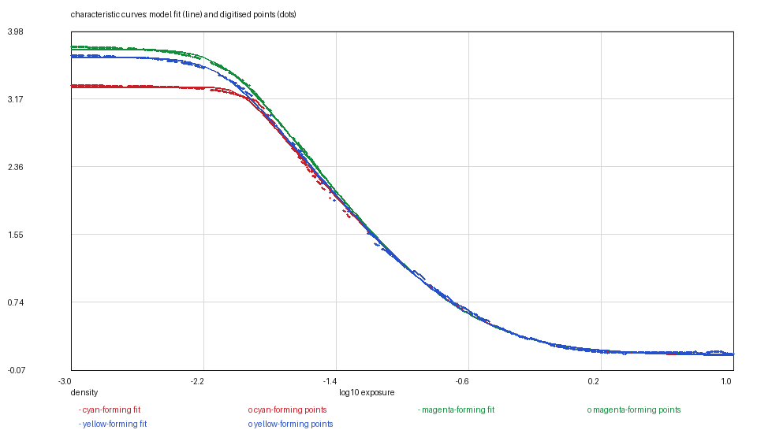
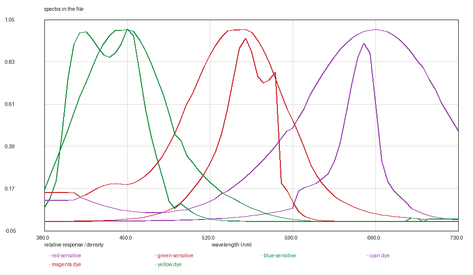

# FUJICHROME VELVIA 50: three curves drawn on top of one another

*Kallotype film-data series, report 4 of 22. Version 1, 2026-11-08.
Data: `velvia-50.kalofilm` (6,006 bytes). Code: `films/tools/`.*

## Abstract

We digitise FUJICHROME VELVIA 50 (RVP), an E-6 colour reversal film, from the
manufacturer's bulletin AF3-960E and release it as a single 6.0 kB data file.
The sheet's page 7 carries four panels as 1-bit stencils: characteristic
curves, spectral sensitivities, an MTF curve and the three dye-density curves.
The characteristic panel is the interesting one. Unlike the other two reversals
in this series, whose curves were printed as separate ink plates, Velvia's three
curves are drawn **in full, on top of one another**, in three line styles, and
they never cross. That makes the panel readable without a tracker — in a column
showing three runs, the order of the ink is the order of the layers — and it
makes the lower half unreadable in a way that is the sheet's, not the reader's:
below a density of about 2.4 the three curves merge into one bundle, and the
three layers share one centreline from there down. We report that as a decision
and price it at 0.023–0.027 of a density. The fit needs two corner rates per
layer (16/3 for red, 8/3 for green and blue), and the red curve is the one that
pushed the fitter's rate grid past 10. The sensitivities peak at 451, 549 and
651 nm, the dyes at 445, 540 and 660 nm, the MTF is one Gaussian at σ 4.28 µm,
and the grain is 2.26 grains/µm² inverted from the sheet's published rms
granularity of 9. Every figure and table can be regenerated from the shipped
points and the data file.

## 1. Introduction

VELVIA 50 is the film this project's colour thesis is about. It is an ISO 50
E-6 reversal with unusually saturated primaries, and it is the third reversal in
the series after PROVIA 100F and EKTACHROME E100. Its data sheet is the first in
the archive where the three characteristic curves are neither separate plates
nor vector paths: they are drawn one over another in a single stencil, which is
also how a photographer sees them — three curves that cross the same grid, not
three pages.

Digitising it therefore tested a different rule than the first two: not "which
ink plate is this" and not "which Bézier path is this", but **which of these
three runs is which curve**, at every column, when the ink itself says so only
by order and by a dash pattern.

## 2. Materials

**The data sheet.** FUJIFILM DATA SHEET — FUJICHROME Velvia RVP for
Professionals, publication AF3-960E, page 7, retrieved 2026-11-08, SHA-256
`4281e316…8541`. The page carries all four panels: 18 characteristic curves,
19 spectral sensitivity, 20 MTF and 21 spectral dye density.

**The artwork.** Each panel is a 1-bit stencil at about 1000 × 850 pixels, white
ink on black, with 6 per cent of the pixels inked. The page is a scan, not a
render: its rules are rotated by about 0.3 degrees (four pixels across the
page), so every rule is fitted as a straight line in the other coordinate
before it is erased. Calibrating from a row index would put a 0.02-density
tilt into the curves.

| panel | size | rules |
|---|---|---|
| 18 characteristic curves | 943 × 856 | columns 103…939 every 93 px, rows 105…757 every 93 px |
| 19 spectral sensitivity | 975 × 858 | columns 158/408/659/906 at 400/500/600/700 nm |
| 20 MTF | 865 × 719 | columns at 5, 10, 20, 50, 100, 200 cycles/mm, log-spaced |
| 21 dye density | 955 × 719 | columns 167/411.5/658/904 at 400/500/600/700 nm |

The characteristic panel's columns run from log H −3.0 to +1.5 in half-decade
steps, labelled at −3.0, −2.0, −1.0, 0.0 and 1.0 (185.8 px per decade); its rows
run from density 0.0 at 757 to 4.0 at 12.5 (186.3 px per density unit). The two
scales agree to 0.3 per cent, which is the check that a square plot has to pass.

## 3. Methods

### 3.1 Reading three overprinted curves

The rules are ink as well as the curves, and every curve crosses every rule. They
are removed by the one test a rule passes and a curve does not: ink near both
edges of the same row (or both ends of the same column). Each rule is then
fitted as a line and erased along it.

What remains is three curves that **never cross**. That is not an assumption:
the vertical gaps between them shrink from 19 and 66 pixels at the plateau to 15
and 15 by a density of 2.4, and never reach zero. So in a column that shows
three runs, the top one is green, the middle blue and the bottom red, and no
tracker is needed. A column that shows two runs is missing one curve — most
often blue, whose dash gaps are the widest — and which one it is missing is
decided by predicting each layer's position from the last column that had all
three and choosing the pair nearest those predictions. A first version chose by
the last position alone and, in the shoulder, where the curve moves three pixels
a column, a five-column dash gap put the prediction fifteen pixels behind the
curve — exactly the distance between two curves. That version handed red blue's
run for ten columns, and the fit paid for it with a step in the residual.

Specks are removed before any of this: a 30-pixel minimum component keeps the
curves and throws away the dust, and one speck is enough to hand red the bottom
of the page for a column.

**The merge, and the gap it leaves.** Below a density of about 2.4 the three
runs become one tall bundle of 20–25 pixels. From there down the sheet does not
separate the curves, and neither does the reader: the bundle's centre is read
once and used for all three layers. Between the last column that showed three
separated runs and the start of the bundle there is a 0.2-decade stretch in
which the runs are one tall bundle and the branch reader has no three runs to
order — that stretch is not sampled, and the fit interpolates it. Two attempts
to close it were made and reverted: starting the merged reader at the knee put
0.14-density steps into the fits, and reading green off the bundle's top edge
and red off its bottom did the same, because the edge of the ink is whichever
dash reaches furthest, not a curve.

### 3.2 The curve model and its fits

    D(x) = d_min + (γ/t) · [softplus(t(x − toe)) − softplus(t(x − shoulder))]

As in the rest of the series, a reversal's `d_min` is the density of the
unexposed slide and its `d_max` is the clear film. The sheet draws the curves
flattening at the clear end and stops there, so the clear density is nearly
measured; the fit is bounded to within 0.02 of the lowest drawn density rather
than allowed to walk the asymptote down.

One corner rate could not turn the two corners at the rates the drawing shows:
the top corner is sharp and the clear end is soft. With a rate per corner the
three layers fit at 16/3 (red) and 8/3 (green, blue). Red is the first stock in
the tree whose corner wanted a rate above the fitter's old ceiling of 10: at
10 its knee left a 0.09-density residual, and extending the grid to 20 took the
rms from 0.0296 to 0.0266. The rates are not shared between layers, unlike
EKTACHROME E100's, because here the difference is visible in the ink rather than
in where an unmeasured asymptote went.

### 3.3 The anchor

A slide transmits 18 per cent of the projector's white at middle grey, so the
red layer's density at log10(0.18) must be `d_max + log10(1/0.18)`. Solving that
on the fitted red curve gives a shift of **−0.1364 decade**, applied to all
three layers. The shift moves with `d_max`, which is the one number the sheet
does not draw all the way to.

### 3.4 The other three panels

**Sensitivity (panel 19).** Three curves in separate wavelength bands, read at
5 nm: blue peaks at 451 nm and 0.58 decade, green at 549 and 0.56, red at 651
and 0.55. The three bands are cut at the valleys between the curves — blue ends
at 496 nm, green at 592, red starts at 592 — with no margin outside them. With a
ten-nanometre margin, green's tail read red's head and came back flat at 0.82
from 610 to 730 nm, and blue's bent up at 500. Green's double hump, and its fall
from +0.47 to −0.9 decade between 575 and 595 nm, are what the sheet draws.

**Dyes (panel 21).** Three curves that cross, at about 490 and 590 nm. Both
ends of the panel are traps. The 1.0 rule is the curves' own peak, and erasing
it (which has to be done, or the rule joins all three curves) cuts the tops off
the peaks; a tracker that starts at a peak and follows the nearest run steps onto
the rule and follows *the axis* for a hundred nanometres — the first version read
cyan flat at 0.998 from 600 to 660 nm and yellow flat at 0.997 from 400 to
445 nm. And at a crossing the nearest run is the other curve. So the reader uses
a guide read every 10 nm where the curves are apart, and takes the run nearest
the guide column by column. The result peaks at 445 (yellow), 540 (magenta) and
660 (cyan) nm, peak-normalised and on the model's 5 nm grid.

**MTF (panel 20).** One curve for the film. It rises to 120 per cent at
8 cycles/mm before it falls — the adjacency effect — and a single Gaussian cannot
express a rise, so the fit uses the falling part, 20–49 cycles/mm: **σ 4.28 µm**,
rms 4.7 per cent of response. At 50 cycles/mm the model gives 42 per cent against
the sheet's 46.

**Grain.** The sheet gives a diffuse rms granularity of 9, read at a density of
1.0 above minimum through a 48 µm aperture. Inverted through counting statistics
at the curve's local slope where that density is reached — 1.26 per decade, not
γ — it gives **2.26 grains/µm²**, one number for the three layers because the
sheet prints one number.

## 4. Results

### Table 1 — characteristic curves

| layer | d_min (slide) | d_max (clear) | γ /decade | log_e0 | rates | rms |
|---|---|---|---|---|---|---|
| red | 3.3177 | 0.1115 | 2.3926 | −1.2699 | 16 / 3 | 0.0266 |
| green | 3.7732 | 0.1192 | 2.6478 | −1.3499 | 8 / 3 | 0.0241 |
| blue | 3.6752 | 0.1149 | 2.4725 | −1.3399 | 8 / 3 | 0.0229 |

Residuals are against the digitised points in `curves/`, 672, 655 and 591 of
them. The three curves are ordered green > blue > red at every exposure, which is
what the drawing shows and what the fits reproduce.

### Table 2 — the other measurables

| quantity | value | source |
|---|---|---|
| sensitivity peaks | 451, 549, 651 nm | panel 19 |
| dye peaks | 445, 540, 660 nm | panel 21 |
| MTF | σ 4.28 µm | panel 20, 20–49 cycles/mm |
| grain | 2.26 grains/µm² | page 6, rms granularity 9 |

### Figures






## 5. What is measured and what is decided

Measured: the three plateaus, the three speeds, the four corner rates, the
sensitivities, the dyes, the MTF and the grain number.

Decided:

1. **The shared lower half.** Below density 2.4 the sheet merges the curves; the
   centreline is one reading for three layers.
2. **The 0.02-density asymptote window.** The sheet draws the clear end
   flattening, so the asymptote is kept near the lowest ink rather than
   extrapolated freely.
3. **The sensitivity bands cut at the valleys (496 and 592 nm).** The
   alternative was a tail that runs into the next curve, which is not a
   measurement of anything.
4. **The MTF window.** The drawn rise above 100 per cent is real and is excluded
   by the model's one-Gaussian form, not by choice.
5. **The residual's shoulder swing.** It is reported, not fitted away.

## 6. Uncertainty and limits

The digitising calibration carries about 0.017 of a density on its own (a line
is 0.24 pt wide). The fit residuals, 0.023–0.027, are of that order. The clear
density is the weakest number: the sheet stops drawing at 0.126 while the curve
is still falling slowly, and the fit puts the asymptote at 0.112, inside the
0.02 window the sheet's own flattening allows but not at a measured floor.

The three layers share their lower half, so their differences are measured only
above density ~2.4. What the renderer does with the film below that density is
the model's, not the sheet's.

## 7. Availability and reproduction

`velvia-50.kalofilm` carries the header, the tables and a SHA-256;
`kalo render --film-file` loads it. The figures are regenerated from `curves/`
and the file with

```bash
python3 ../tools/kalofilm.py --check velvia-50.kalofilm      # magic, digest, sizes
python3 ../tools/kalofilm.py --csv /tmp/film velvia-50.kalofilm
```

`--csv` writes one CSV per table with a wavelength column, which is the form
any plotting or numerical tool reads; the figures in this report plot exactly
those columns (Figure 1: `curves/` against the file's curves; Figure 2: their
difference; Figure 3: the file's tables), so they can be redrawn, checked or
disagreed with in whatever tool the reader already uses.

No image of the data sheet is reproduced in this directory.

## References

1. FUJIFILM, *FUJICHROME Velvia RVP for Professionals*, data sheet AF3-960E,
   page 7.
2. Kallotype, *The `.kalofilm` format, version 1*, `../FORMAT.md`.
