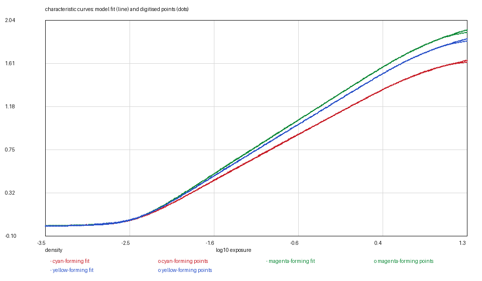
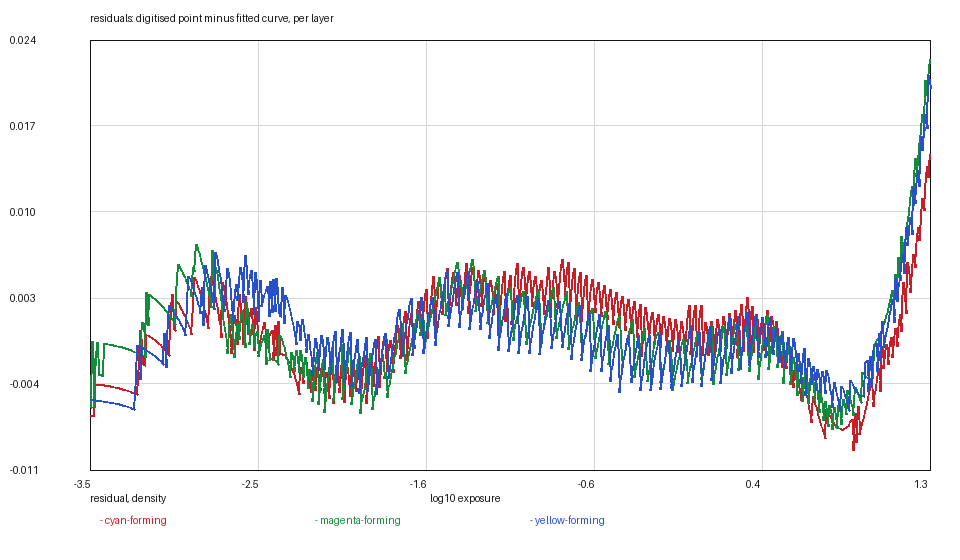

# KODAK VISION3 200T: the note inside the plot

*Kallotype film-data series, report 15 of 22. Version 1, 2026-11-09.
Data: `vision3-200t.kalofilm` (5,651 bytes). Code: `films/tools/`.*

## Abstract

We digitise KODAK VISION3 200T 5213/7213, an ECN-2 tungsten cinema negative,
from the five raster charts on pages 3 and 4 of H-1-5213 and release it as a
5.7 kB data file. It has the best-fitting curves of the three VISION3 films —
**0.0037 / 0.0040 / 0.0037** over 563 points each — and two traps that are worth
a report because they are what a raster sheet does to a reader that trusts its
own geometry.

**The note inside the plot.** The dye panel prints its process note *inside* the
plot box, above the curves. The reader's text filter has to mask a line of type
at the top of the box as well as the five layer labels; without it the yellow
curve's peak came out flat at 0.963 for forty nanometres — the tracker had found
the label's baseline and followed it.

**The cyan curve starts at a dip.** Page 4's cyan sensitivity begins at 0.6 near
490 nm, falls to nothing at 530 and only then climbs to its peak. Continuing that
curve's terminal slope backwards would invent a blue sensitivity the sheet does
not show, so the tails are clamped to the floor instead of extrapolated.

Three of the five modelled quantities are borrowed from the 500T digitisation —
grain, dyes and the mask — and §3.4 says what each costs.

## 1. Introduction

200T is the tungsten stock of the family and the one whose sheets are laid out
most awkwardly. The family's layout and the raster-reading method are described
in the 250D's report; this one covers what 200T alone does.

Its sensitivity panel also carries the family's most striking measured fact: the
blue-sensitive layer peaks at **718** on the sheet's scale against the red
layer's 153, a ratio of 4.7. The printed values are absolute `10^logS` on one
scale, so the ratio is real — a tungsten-balanced film puts most of its speed in
the blue record.

## 2. Materials

**The data sheet.** KODAK VISION3 200T Color Negative Film 5213/7213, publication
H-1-5213, four pages, retrieved 2026-11-08, SHA-256 `9083bf82…afd13`.

| page | chart | used |
|---|---|---|
| 3 | sensitometric curves | curve and base |
| 3 | modulation transfer | σ per layer |
| 3 | rms granularity | not digitised |
| 4 | spectral sensitivity | three layer responses |
| 4 | spectral dye density | read as a check on the shared set |

## 3. Methods

### 3.1 The fit

The model's curve is a trapezoid of two softplus corners; the fit chooses the
corners and their rates and solves the two linear parameters exactly. As on the
other VISION3 sheets the ink is cut while the curve is still climbing, so the
asymptote is bounded by the highest drawn density plus the series' 0.02 window:
`d_max` is an extrapolation of hundredths, not a reading.

The two-rate fit gives **0.0037 / 0.0040 / 0.0037** over 563 points per layer,
from 0.0072 / 0.0085 / 0.0067 with a single transition. These are the cleanest
curves in the series from a raster, and the reason is the plot: three widely
separated strokes with long straight middles.

### 3.2 The note inside the plot

The dye panel's process note — `Process: ECN-2` and its companions — is printed
inside the frame, above the curves. The reader masks text by connected-component
size and by position; a line of type at the *top* of the box is in the same band
as the yellow curve's peak. Without the label mask, the yellow peak came out flat
at 0.963 for forty nanometres: the tracker had locked onto the label's baseline
and followed it across the plot. The mask now covers the top band as well as the
label boxes, and the peak is a peak.

### 3.3 The cyan dip

Page 4's cyan layer begins at 0.6 near 490 nm, falls to the floor at 530, and
rises to its peak at 615. A curve that starts at a *dip* rather than at a tail is
the one case where continuing the terminal slope backwards invents sensitivity:
the extrapolation would put a blue response where the sheet draws none. The
reader's tails are therefore clamped to the floor for this sheet
(`--clamp-tails`), and the file carries zeros below 490 rather than an invented
rise.

### 3.4 The anchor and the borrowings

**The anchor.** The panel's lower axis is camera stops; the sheet prints no
reference exposure. The curves are anchored on the printing aim — green at 0.70
of a density above base at 18 per cent grey, shift **+0.4797** — which is the
rule PRO 400H uses and the only one this sheet supports. The checks follow: at
mid grey the records sit **0.609 / 0.702 / 0.671** above base, and the speed
point lands **0.85 of a stop** slow, the same direction and order as the Kodak
colour sheets' 0.60–0.80.

**Dyes.** This sheet's dye panel was digitised and compared with the compiled
500T set; the model carries one dye set for the family and this sheet's agrees
with it to 0.12 of a density and 5 nm. The file borrows the 500T set and says so.

**Grain.** The granularity chart draws its three density curves so close together
that only two connected components survive, and the dot tracker wants three. Not
digitised; the grain is the 500T's, declared.

**The mask.** The sheet's own minimum-density spectrum was not separated from the
granularity plot; the file borrows the 500T's, as the other two VISION3 films do.

## 4. Results

### Table 1 — characteristic curves

| layer | base | d_max | γ /decade | log_e0 | rates | rms |
|---|---|---|---|---|---|---|
| red | 0.1838 | 1.6492 | 0.4766 | −0.7607 | 6 / 4 | 0.0037 |
| green | 0.5832 | 1.9566 | 0.5590 | −0.7207 | 6 / 4 | 0.0040 |
| blue | 0.8530 | 1.8652 | 0.5360 | −0.7307 | 6 / 4 | 0.0037 |

`d_max` is above the base; the absolute asymptote is `base + d_max`. Residuals
are against the 563 points in `curves/`.

### Table 2 — the other measurables

| quantity | value | source |
|---|---|---|
| sensitivity peaks | 645 / 550 / 440 nm | page 4 |
| sensitivity heights | 153 / 297 / 718 | page 4, one scale |
| MTF | σ 4.25 / 3.49 / 3.14 µm | page 3 |
| grain | borrowed: 0.62 / 0.51 / 0.07 | the 500T digitisation |
| dyes | borrowed | one set for the family, agreeing to 0.12 |
| mask | borrowed | the 500T's minimum density |

### Figures






## 5. What is measured and what is decided

Measured: the three curve shapes, the layer sensitivities, the MTF, the base.

Decided:

1. **The 0.02 asymptote window**, because the shoulder is outside the frame.
2. **The printing-aim anchor**, because the sheet prints no reference exposure.
3. **The clamped cyan tail**, because the curve begins at a dip.
4. **The shared dye set**, after measuring this sheet's own.
5. **The borrowed grain and mask**, both from charts this sheet does not give up.

## 6. Uncertainty and limits

The curves are raster reads, one pixel of density per sample, and the residuals
(0.0037–0.0040) are below the 0.005 that a raster digitisation of a clean plot
usually costs — the strokes here are long and well separated.

The anchor is a decision, not a reading; §3.4 states the mid-grey readings that
follow from it. The borrowed dye set is the only quantity in the file whose
*numbers* are not this sheet's, and the comparison that justifies it is recorded
in the stock file.

## 7. Availability and reproduction

`vision3-200t.kalofilm` carries the header, the tables and a SHA-256;
`kalo render --film-file` loads it. The figures are regenerated from `curves/`
and the file with

```bash
python3 ../tools/kalofilm.py --check vision3-200t.kalofilm      # magic, digest, sizes
python3 ../tools/kalofilm.py --csv /tmp/film vision3-200t.kalofilm
```

No image of the data sheet is reproduced in this directory.

## References

1. Eastman Kodak Company, *KODAK VISION3 200T Color Negative Film 5213/7213 —
   Technical Data*, publication H-1-5213, pages 3 and 4.
2. Kallotype, *The `.kalofilm` format, version 1*, `../FORMAT.md`.
3. Kallotype, `films/vision3-250d/REPORT.md` — the family's layout and method.
