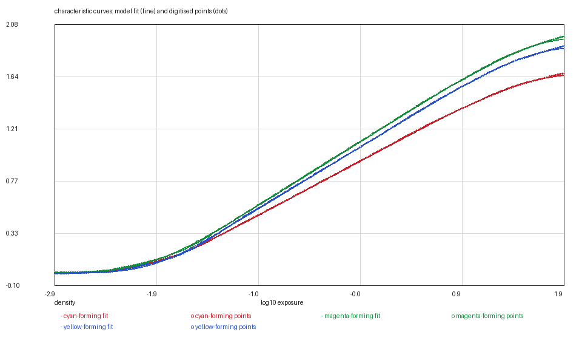
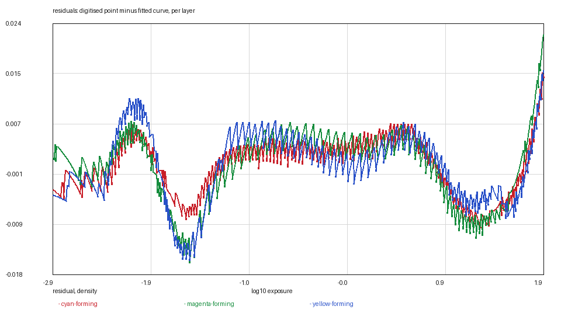

# KODAK VISION3 500T: the film the model started with

*Kallotype film-data series, report 17 of 21. Version 1, 2026-11-09.
Data: `vision3-500t.kalofilm` (5,297 bytes). Code: `films/tools/`.*

## Abstract

We release KODAK VISION3 500T 5219/7219, the cinema negative this model was
first measured against, as a `.kalofilm` and a report — seventeen films into the
series, the stock that made the rest possible was still the one stock with no
report.

It is also the only negative in the series with **nothing borrowed**: its
curves, its three layer sensitivities, its dye shapes and its orange mask are
all this sheet's own, and its grain comes from the granularity chart on the same
page. Thirteen films borrow its dye and mask tables; this is where they come
from.

**The curves.** Refitted with the series' two-rate rising model, **0.0045 /
0.0059 / 0.0057** over 563 points each. The sheet plots the curves on camera
stops from −8 to +8, which is where the 563 points come from: 0.0085 decades
apart.

**The anchor.** The sheet prints no reference exposure, so the film is anchored
on the printing aim — green at 0.70 of a density above base at 18 per cent grey,
shift **−0.5045**. The old anchor, which had been carried in the compiled table,
sat 0.50 decade further up, which is 1.7 stops of highlight headroom that the
model was not using.

## 1. Why this film is worth a report

The 500T is the model's origin: when the series began, it was the one measured
stock, and every other stock borrowed its dye shapes and its mask. It has since
been the only stock excluded from the series, because it had no report — a data
file and a note, and nothing that said what the sheet was or how it had been
read.

Its report is also the family's key: the VISION3 250D, 50D and 200T reports all
refer to "the 500T digitisation" as the source of their borrowed dyes. This is
that digitisation, with its provenance attached.

## 2. Materials

**The data sheet.** KODAK VISION3 500T Color Negative Film 5219/7219 —
Technical Information, publication H-1-5219, retrieved 2026-11-08, SHA-256
`6d037d80…d0972`. The curve is page 3; the spectra are page 4.

**The panel.** The sensitometric panel is a raster whose axis is camera stops,
−8 to +8, with the log exposure printed above it on a slightly different scale.
The curves are read against the stops axis, which is the one the sheet draws
consistently.

## 3. Methods

### 3.1 The fit

The model's curve is a trapezoid of two softplus corners; the fit chooses the
corners and their rates and solves the two linear parameters exactly. The ink is
cut while the curves are still climbing, so the asymptote is bounded by the
highest drawn density plus the series' 0.02 window, and `d_max` is an
extrapolation of hundredths.

The two-rate fit gives **0.0045 / 0.0059 / 0.0057** over 563 points per layer.
The rates are 4/4, 4/4 and 5/4: this is one of the few stocks whose corners are
both inside the drawn range, because the panel plots ten decades of exposure.

### 3.2 The anchor

The sheet prints camera stops and no reference exposure. The curves are anchored
on the printing aim — green at 0.70 of a density above base at 18 per cent grey,
the same rule PRO 400H uses — at a shift of **−0.5045** decade. The old compiled
anchor put the same point 0.50 decade higher, which is the film rendering 1.7
stops "slow": the whole curve sat higher on the exposure axis than the printing
aim it was calibrated against.

The check that follows: at mid grey the records read **0.612 / 0.702 / 0.678**
above base — green by construction, red and blue inside the still films' band.

### 3.3 The spectra and the grain

**Layers.** Page 4's three forming layers, digitised on the 5 nm grid and
normalised by one constant across the three, so the layers' relative speed
survives. They are the table the placeholder stocks borrow.

**Dyes and mask.** Page 4's dye panel gives the three dye curves and the
minimum-density spectrum. Both are this film's own and are what every negative
without its own tables borrows — the borrowing is a model decision, and the
sheets that borrow were compared against these to 0.12 of a density and 5 nm.

**Grain.** Page 3's granularity chart, inverted at the curve's local slope:
**0.62 / 0.51 / 0.07 grains/µm²** for red, green and blue. Blue is the front
layer and the grainiest by a factor of nine.

**Blur.** The stock declares no `sigma_um`; the render falls back to the
compiled VISION3 fit, which is the closest thing to a measurement this family
has.

## 4. Results

### Table 1 — characteristic curves

| layer | base | d_max | γ /decade | log_e0 | rates | rms |
|---|---|---|---|---|---|---|
| red | 0.1887 | 1.6817 | 0.4751 | −0.2259 | 4 / 4 | 0.0045 |
| green | 0.5778 | 1.9947 | 0.5572 | −0.2059 | 4 / 4 | 0.0059 |
| blue | 0.8436 | 1.9142 | 0.5407 | −0.2059 | 5 / 4 | 0.0057 |

`d_max` is above the base; the absolute asymptote is `base + d_max`. Residuals
are against the 563 points in `curves/`.

### Table 2 — the other measurables

| quantity | value | source |
|---|---|---|
| sensitivity peaks | page 4, three forming layers | measured |
| dyes | page 4, three dye curves | **measured — this is the set the series borrows** |
| mask | page 4, minimum density | **measured** |
| grain | 0.62 / 0.51 / 0.07 grains/µm² | page 3, inverted |
| blur | compiled VISION3 fit | no `sigma_um` on the stock |

### Figures






## 5. What is measured and what is decided

Measured: the three curves, the layer sensitivities, the dyes, the mask and the
grain.

Decided:

1. **The 0.02 asymptote window**, because the shoulder is outside the panel.
2. **The printing-aim anchor**, because the sheet prints no reference exposure.
3. **The blur fallback**, declared in `[measured]` rather than left implicit.

## 6. Uncertainty and limits

The curves are a raster read at 0.0085 decades per point; the residuals are
0.0045 to 0.0059, below the raster's own quantisation at most of the panel.

The anchor moved by half a decade against the compiled table. That is a real
change to the model's default film, and it is why this release was checked
against rendered output rather than only against numbers: the whole suite passes
and a render of the default stock changes only in exposure placement, not in the
model's colour or tone pipeline.

## 7. Availability and reproduction

`vision3-500t.kalofilm` carries the header, the tables and a SHA-256;
`kalo render --film-file` loads it. The figures are regenerated from `curves/`
and the file with

```bash
python3 ../tools/kalofilm.py --check vision3-500t.kalofilm
python3 ../tools/kalofilm.py --csv /tmp/film vision3-500t.kalofilm
```

No image of the data sheet is reproduced in this directory.

## References

1. Eastman Kodak Company, *KODAK VISION3 500T Color Negative Film 5219/7219 —
   Technical Information*, publication H-1-5219, pages 3 and 4.
2. Kallotype, *The `.kalofilm` format, version 1*, `../FORMAT.md`.
3. Kallotype, `films/vision3-250d/REPORT.md` — the first report of the family
   this film's spectra are borrowed by.
